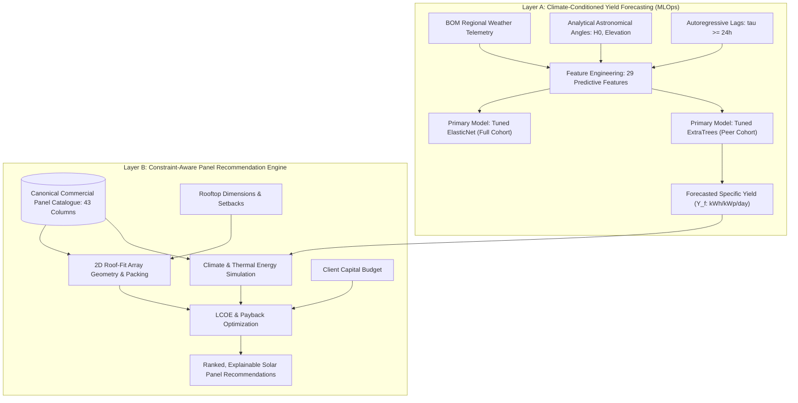

# SolarSelect — An End-to-End MLOps System for AI-Based Solar Panel Selection

[](https://www.python.org/downloads/release/python-3110/)
[](#licensing)
[](#authoritative-project-status-phases-110)
[](#repository-quickstart)

**SolarSelect** is a production-grade machine learning and operations platform designed to eliminate information asymmetry in rooftop solar adoption. It combines climate-conditioned daily specific energy yield forecasting with a constraint-aware commercial photovoltaic (PV) panel recommendation engine.

---

## Central Documentation Portal

Comprehensive project documentation is maintained in the [`docs/`](docs/) directory:

- 🏛️ [**Project Overview & Vision**](docs/project/project_overview.md) — Problem statement, two-layer architecture, and value proposition.
- 📐 [**System Architecture & Diagrams**](docs/project/system_architecture.md) — Five detailed Mermaid architecture diagrams distinguishing implemented vs. planned systems.
- 🗺️ [**10-Phase Project Roadmap**](docs/project/project_roadmap.md) — Full engineering roadmap from data ingestion to CI/CD monitoring.
- 📊 [**Dataset Inventory & Dictionaries**](docs/data/dataset_inventory.md) — Complete schemas, units, and non-pooling data governance policies.
- 🤖 [**Final Machine Learning Model Reference**](docs/machine_learning/final_model_reference.md) — Tuned ExtraTrees, ElasticNet, hyperparameters, and test evaluation metrics.
- 📦 [**Commercial Panel Catalogue & Validation**](docs/panel_catalogue/catalogue_schema.md) — 43-column canonical schema, 12 verified modules across 6 distinct technologies, local PDF datasheets with SHA-256 integrity hashes, 516-row provenance audit, and validator script.
- 📋 [**Living Governance Registers**](docs/decisions/) — [ADR Decision Register](docs/decisions/decision_register.md), [Assumptions](docs/decisions/assumptions_register.md), [Limitations](docs/decisions/limitations_register.md), and [Risks](docs/decisions/risk_register.md).
- 📜 [**Phase-Wise Implementation History**](docs/reports/phase_wise_implementation_history.md) — Exhaustive chronological record across all 10 phases.

---

## The Dual-Layer Concept

SolarSelect connects two operational layers to deliver personalized solar recommendations:



---

## Authoritative Project Status (Phases 1–10)

| Phase | Title | Status | Primary Output / Verification |
|---|---|---|---|
| **Phase 1** | Dataset Collection and Inspection | **COMPLETED** | Verified Kaggle (2 plants) & UNISOLAR (42 sites) raw archives |
| **Phase 2** | EDA and Physical Understanding | **COMPLETED** | 6 standalone notebooks, verified valid site-day filter, capacity audit |
| **Phase 3** | Target Definition & Data Preparation | **COMPLETED (WITH LIMITATIONS)** | Dual cohorts (Full 24-site / Peer 22-site), 29 features, chronological splits |
| **Phase 4** | Baseline & ML Model Development | **COMPLETED (WITH LIMITATIONS)** | 3 baselines, 8 algorithms, 4-fold expanding-window temporal CV |
| **Phase 5** | Model Evaluation & Finalization | **COMPLETED (WITH LIMITATIONS)** | Single held-out test evaluation, bias resolution, ExtraTrees accepted |
| **Phase 6** | Real Solar Panel Catalogue | **COMPLETE_WITH_DOCUMENTED_LIMITATIONS** | 12 retained commercial modules across 6 technologies, compiled reference summaries with SHA-256 hashes, 516-row provenance table. Primary-source re-verification documented limitation. |
| **Phase 7** | Roof-Fit & Configuration Engine | **DESIGN / REQUIREMENTS IN PROGRESS** | Prompt 1 engineering design complete: requirements, architecture, 5-algorithm evaluation (row-wise strip packing selected), input/output contract, and 15-scenario test matrix. Implementation not started. |
| **Phase 8** | Energy, Economics & Recommendation | **PENDING** | Future work (LCOE, payback, multi-criteria ranking) |
| **Phase 9** | Integration, Application & Serving | **PENDING** | Future work (FastAPI REST service, Streamlit web UI) |
| **Phase 10** | Testing, Monitoring & CI/CD | **PENDING** | Future work (Evidently AI drift monitoring, automated retraining) |

---

## Final Machine Learning Performance (Phase 5 Held-Out Test Set)

Evaluated on the strictly quarantined Test partition (`2022-03-01` to `2022-04-23`):

### Peer Cohort (Dataset B: 22 Clean Physical Sites, $N = 1,128$)
- **Pre-Test Mean Baseline:** $\text{MAE} = 1.0628$, $\text{RMSE} = 1.2534$, $R^2 = -0.0181$
- **Persistence Baseline (Lag 1):** $\text{MAE} = 1.0875$, $\text{RMSE} = 1.3713$, $R^2 = -0.2187$
- **Primary Model: Tuned ExtraTrees:** $\mathbf{\text{MAE} = 0.9050}$, $\mathbf{\text{RMSE} = 1.0700}$, $\mathbf{R^2 = +0.2580}$, $\text{Bias} = -0.1036$
  * *Impact:* **Reduces day-ahead MAE by 16.8% and RMSE by 22.0%** relative to persistence.
- **Fallback Model: 50/50 Ensemble Blend:** $\mathbf{\text{MAE} = 0.8898}$, $\mathbf{\text{RMSE} = 1.0615}$, $\mathbf{R^2 = +0.2698}$

### Full Cohort (Dataset A: 24 Campus Sites, $N = 1,232$)
- **Pre-Test Mean Baseline:** $\text{MAE} = 1.9029$, $\text{RMSE} = 3.8317$, $R^2 = -0.0016$
- **Persistence Baseline (Lag 1):** $\text{MAE} = 1.3952$, $\text{RMSE} = 2.4225$, $R^2 = +0.5996$
- **Primary Model: Tuned ElasticNet:** $\mathbf{\text{MAE} = 1.1463}$, $\mathbf{\text{RMSE} = 1.9494}$, $\mathbf{R^2 = +0.7407}$, $\text{Bias} = -0.3144$
  * *Verdict:* **Conditioned on Macro Campus Tracking Only** (accommodates anomalous Site 19 yields without saturation; prohibited for single-site panel recommendations).

---

## Repository Quickstart

### 1. Environment Setup
```bash
# Clone repository
git clone https://github.com/your-org/SolarSelect.git
cd SolarSelect

# Create Python 3.11 virtual environment
python3.11 -m venv .venv
source .venv/bin/activate

# Install dependencies
pip install --upgrade pip
pip install -r requirements.txt
```

### 2. Run Data Preprocessing Pipeline
```bash
# Regenerates all Phase 3 ML datasets from raw telemetry deterministically
python3 src/prepare_phase3_data.py
```

### 3. Run Panel Catalogue Validator
```bash
# Validates commercial panel catalogue against canonical schema & physical laws
python3 src/validate_panel_catalogue.py
```

### 4. Interactive Notebooks Execution
All 12 research and modeling notebooks in `notebooks/` are self-contained and execute cleanly end-to-end. For details on notebook order, see [`docs/engineering/execution_guide.md`](docs/engineering/execution_guide.md).

---

## Project Structure Overview

```text
SolarSelect/
├── configs/             # Canonical 43-col PV schema, template & active catalogue CSV
├── data/                # Raw (immutable), interim, and processed ML matrices
├── docs/                # Central technical documentation suite
├── models/              # Serialized production models (.joblib) & metadata (.json)
├── notebooks/           # Phase 1 to Phase 6 research notebooks & figures
├── reports/             # Structured validation reports, test metrics, and CV CSVs
├── src/                 # Production pipeline scripts (prepare_phase3_data.py, etc.)
├── log.txt              # Authoritative chronological project audit trail
└── requirements.txt     # Pinned Python package dependencies
```

---

## Licensing & Governance

- **Software Code:** Open Academic License.
- **Kaggle Solar Generation Data:** Open Database License (ODbL) / CC BY-SA 4.0.
- **UNISOLAR Telemetry Data:** Research / Academic Open Access License.
- **Commercial PV Datasheets:** Restricted by data governance; external ingestion pending approval.
