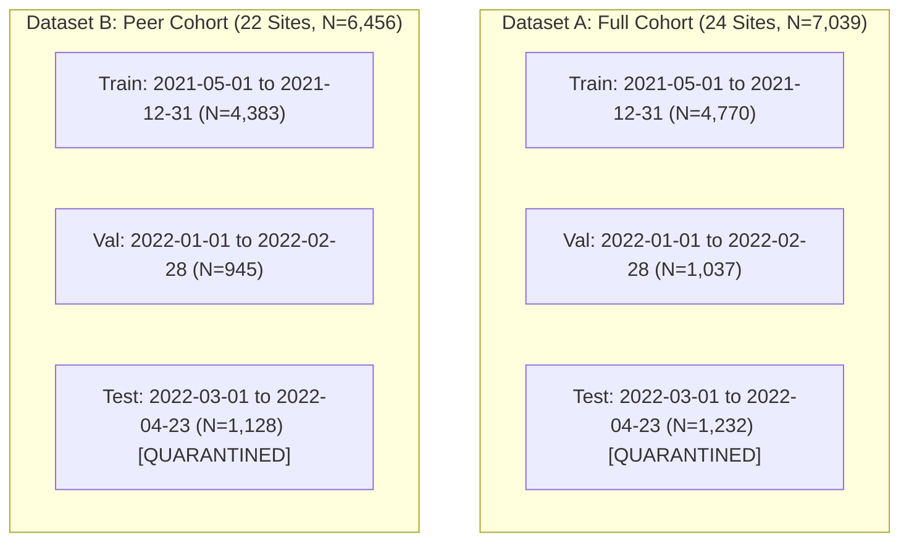

# Preprocessing Methodology — SolarSelect

This document details the exact mathematical transformations, observation filtering criteria, lag construction, and split policies implemented by [`src/prepare_phase3_data.py`](../../src/prepare_phase3_data.py).

---

## 1. Value-Encoding Diagnostic & Missing-Value Treatment

In Phase 2 Task 3, deep inspection of the UNISOLAR raw generation file (`Solar_Energy_Generation.csv`) revealed a critical data recording convention:
- **Concentration of Missingness:** In raw data, $56.23\%$ ($1,536,301$ rows) of 15-minute intervals are `NaN`.
- **Nighttime and Sub-Threshold Encoding:** Missingness is heavily concentrated during nighttime hours. Furthermore, daytime periods with solar generation below approximately $0.100$ to $0.125\text{ kWh}$ are also recorded as `NaN`.
- **Unresolved Data-Quality Limitation:** The available repository evidence **cannot definitively distinguish all sub-threshold production from telemetry dropout or communication missingness**.
- **Rule Against Naive Zero-Filling:** Consequently, `NaN` values **must not automatically be replaced with zero**. Naively zero-filling all `NaN` rows would conceal communication dropouts, while naively dropping all `NaN` rows would eliminate nighttime intervals and distort daily integration.

---

## 2. A-Priori Valid Site-Day Criteria

To distinguish legitimate operational solar days from communication dropouts or incomplete telemetry logs, Phase 2 and Phase 3 established the **A-Priori Valid Site-Day Filter**:

A site-day (Site $s$ on Date $d$) is accepted into the modeling matrix if and only if:
1. **Timestamp Completeness:** Exactly **96 intervals** (15-minute resolution across 24 hours) exist in the telemetry grid for that site and calendar date.
2. **Documented Nameplate Capacity:** Documented DC capacity rating $\text{kW}_p > 0$ exists in `Solar_Site_Details.csv`.
3. **Core Solar Window Completeness:** During the core solar production window (**09:00 to 15:45**, comprising exactly **28 intervals**):
   $$\text{Core Non-Null Intervals} \ge 26 \quad (\ge 92.86\% \text{ completeness})$$
   *Rationale:* This allows for at most two missing 15-minute telemetry intervals during peak daylight hours. Days with inverter tripping or communication failures dropping below 26 intervals are excluded.
4. **Energy Summation:** Daily energy is computed as the sum of all valid 15-minute readings across the 96 intervals:
   $$E_{\text{day}} = \sum_{i=1}^{96} E_{15\text{m}, i} \quad (\text{treating non-core null intervals as } 0.0\text{ kWh once the day passes the core threshold})$$
5. **Target Calculation:** Daily specific yield is computed by dividing daily energy by installed DC capacity:
   $$Y_{f, \text{day}} = \frac{E_{\text{day}}}{\text{kW}_p} \quad \left[\frac{\text{kWh}}{\text{kW}_p/\text{day}}\right]$$

---

## 3. Comprehensive Site-Day Accounting Across Annual Window

For the 24 documented-$\text{kW}_p$ sites over the 365-day annual window (`2021-05-01` to `2022-04-30`):
$$\text{Expected Annual Site-Days} = 24 \times 365 = 8,760 \text{ site-days}$$

The pipeline reconciles all 8,760 site-days into three mutually exclusive categories:

```text
Total Expected Site-Days: 8,760 (100.0%)
├── 1. Total Valid Site-Days Retained: 7,039 (80.35%)
│   ├── Full Cohort (Dataset A): 7,039 site-days (Sites 14–40 excl. 28, 29)
│   └── Peer Cohort (Dataset B): 6,456 site-days (Excludes Site 19 [n=291] & Site 24 [n=292])
├── 2. Observed Invalid Site-Days Excluded: 1,481 (16.91%)
│   └── Excluded due to <26 core intervals, maintenance outages, or zero inverter response
└── 3. Absent Telemetry Calendar Dates: 240 site-days (2.74%)
    ├── 2021 Dates (3 dates x 24 sites = 72 site-days): 2021-07-10, 2021-08-11, 2021-11-27
    └── 2022 Dates (7 dates x 24 sites = 168 site-days): 2022-04-24 to 2022-04-30 (telemetry ended April 23)
```

---

## 4. Calendar-Aware Lag Construction (Zero Forward-Fill Distortion)

Autoregressive lag features are engineered on a continuous, gap-aware calendar timeline:
1. **Continuous Daily Grid:** A continuous sequence of calendar dates from `2021-05-01` to `2022-04-23` is constructed for every site.
2. **Exact Calendar Shifts:** Lag 1 ($t-1$) corresponds to the actual prior calendar date ($d - 1$), NOT the prior row in an irregularly sampled table.
3. **Imputation Heuristic:** If day $d-1$ was absent from telemetry or invalid, `has_valid_lag1` is flagged as `0`, and the missing lag value is imputed using the median fitted strictly on the training partition:
   $$\text{Training Imputation Median for } \text{lag1\_daily\_yield} = 2.2799\text{ kWh}/\text{kW}_p/\text{day}$$
4. **Astronomical & Cyclical Features:** Continuous sinusoidal and cosinusoidal encodings are generated for `day_of_year` and `month`. Extraterrestrial solar insolation ($H_0$), daylight photoperiod, and solar noon elevation angle are calculated analytically from site latitude ($-37.718^\circ\text{ S}$) without sensor dependency.

---

## 5. Dual-Cohort Architecture & Chronological Partitions

To address physical anomalies transparently, the pipeline produces two parallel cohorts:



- **Full Cohort (Dataset A):** Includes all 24 sites with documented $\text{kW}_p$. Preserves anomalous Sites 19 and 24 without clipping for campus-wide aggregate tracking.
- **Peer Cohort (Dataset B):** Strictly excludes Sites 19 and 24. Yields a clean, physically bounded dataset ($Y_{f, \text{max}} = 6.917\text{ kWh}/\text{kW}_p/\text{day}$, $\text{CF}_{24\text{h}} \le 28.82\%$) serving as the primary benchmark for Layer B individual panel recommendations.
