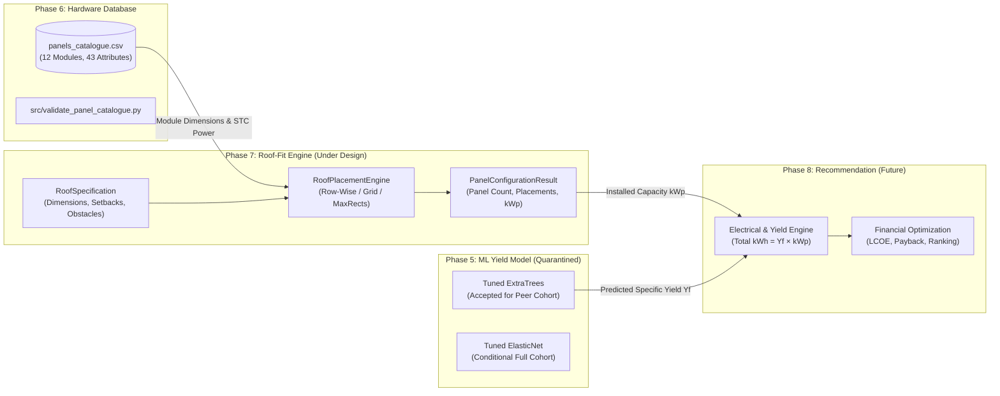
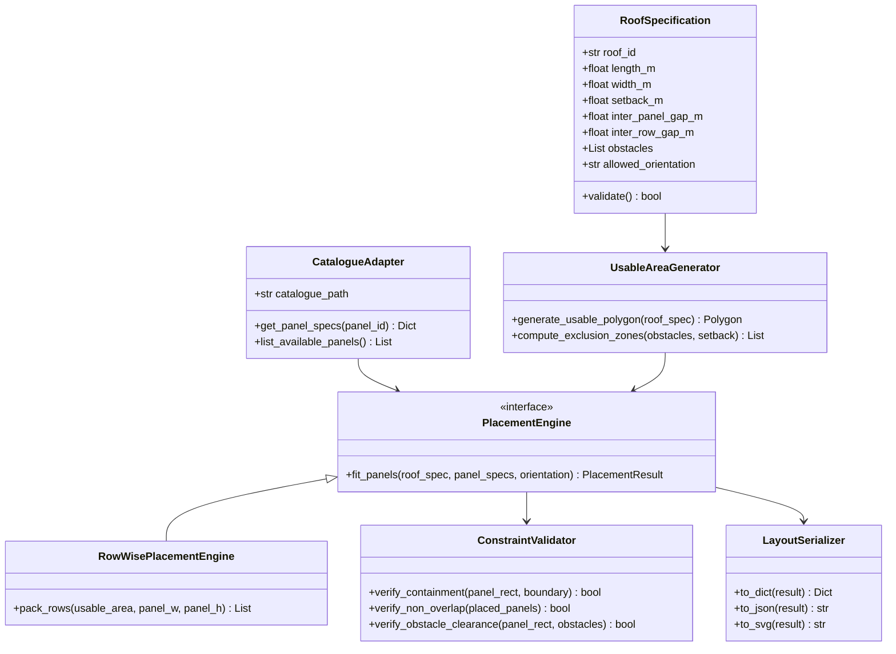
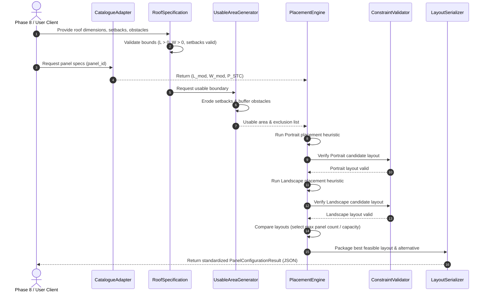

# Phase 7: Roof-Fit and Panel Configuration Engine — Architectural Design

**Project:** SolarSelect — An End-to-End MLOps System for AI-Driven Rooftop Solar Selection and Yield Forecasting  
**Phase:** Phase 7 — Roof-Fit and Panel Configuration Engine (Prompt 1: Requirements & Engineering Design)  
**Document Status:** **`DRAFT_ARCHITECTURE_SPECIFICATION`**  
**Related Documents:**
- [`phase7_requirements.md`](phase7_requirements.md)
- [`phase7_algorithm_comparison.md`](phase7_algorithm_comparison.md)
- [`phase7_input_output_contract.md`](phase7_input_output_contract.md)
- [`phase7_testing_strategy.md`](phase7_testing_strategy.md)
- [`../../docs/project/system_architecture.md`](../../docs/project/system_architecture.md)

---

## 1. System Context & Architectural Placement

SolarSelect operates on a two-layer architecture:
- **Layer A (Predictive Core):** Daily climate-conditioned specific energy yield forecasting ($Y_f$ in $\text{kWh}/\text{kW}_p/\text{day}$), established and frozen in Phases 1–5.
- **Layer B (Constraint-Aware Recommendation Engine):** Physical roof modeling, hardware configuration, electrical sizing, and financial ranking, established in Phases 6–8.

Within Layer B, **Phase 7** provides the physical geometry engine:

---

## 2. Subsystem Decomposition & Component Responsibilities

The Phase 7 engine is decomposed into six modular, single-responsibility components:

### Component Details
1. **`RoofSpecificationValidator`:**
   - Validates that gross dimensions are positive ($L > 0, W > 0$).
   - Validates that setbacks do not exceed half the roof dimensions ($2 \times S_{\text{edge}} < \min(L, W)$).
   - Validates that all defined obstacles fall within the gross roof envelope.
2. **`CatalogueAdapter`:**
   - Reads [`configs/panels_catalogue.csv`](../../configs/panels_catalogue.csv).
   - Retrieves bare physical length ($L_{\text{module}}$), width ($W_{\text{module}}$), and nameplate power ($P_{\text{STC}}$).
   - Enforces fallback policies if dimensions are null or invalid.
3. **`UsableAreaGenerator`:**
   - Subtracts the perimeter setback ring from gross roof geometry to establish the primary usable bounding box.
   - Buffers internal obstacles and generates obstacle exclusion masks.
4. **`PlacementEngine` (`RowWisePlacementEngine`):**
   - Applies the selected packing heuristic across portrait and landscape orientations.
   - Computes candidate coordinate locations $[(x_i, y_i, w_i, h_i)]$.
5. **`ConstraintValidator`:**
   - Acts as an independent assertion layer verifying that every placed panel strictly satisfies hard boundary containment (protrusion margin $\ge 0.0$), pairwise non-overlap ($\text{Area} \le 0.0$), and obstacle exclusion. Numerical tolerance $\epsilon = 10^{-4}\text{ m}$ is strictly prohibited from authorizing boundary violations or module overlaps.
6. **`LayoutSerializer`:**
   - Packages coordinates, panel counts, installed DC capacity ($\text{kW}_p$), and spatial metrics into the standard Phase 7 JSON contract.

---

## 3. Data Flow Diagram

---

## 4. Integration Boundaries and Anti-Corruption Layer

To maintain strict independence between phases:

### 4.1 Boundary with Phase 6 (Hardware Catalogue)
- Phase 7 interacts with Phase 6 strictly via a **read-only interface** to [`configs/panels_catalogue.csv`](../../configs/panels_catalogue.csv).
- Phase 7 does not modify catalogue schemas, append new hardware rows, or re-run acquisition pipelines.
- If a queried `panel_id` is not found or lacks dimension data, the adapter raises an explicit `MissingPanelDimensionError` rather than guessing or fabricating numbers.

### 4.2 Boundary with Phase 5 (Predictive ML Models)
- **Zero Direct Coupling:** Phase 7 does not import, load, or invoke `models/phase5/final/` artifacts.
- The ML models predict specific yield ($Y_f$) in normalized units ($\text{kWh}/\text{kW}_p/\text{day}$). They do not care about physical panel dimensions or roof geometry.
- The integration occurs downstream in Phase 8, which multiplies $Y_f \times P_{\text{DC}}$.

### 4.3 Boundary with Phase 8 (Recommendation Engine)
- Phase 7 exports a clean, self-contained data contract (defined in [`phase7_input_output_contract.md`](phase7_input_output_contract.md)).
- Phase 8 consumes:
  - `panel_count` ($N$)
  - `installed_dc_capacity_kwp` ($P_{\text{DC}} = N \times P_{\text{STC}} / 1000$)
  - `occupied_area_m2` ($A_{\text{occupied}}$)
  - `feasibility_status` (`FEASIBLE`, `INFEASIBLE_ROOF_TOO_SMALL`, etc.)
- Phase 8 handles all inverter matching, cable losses, tilt derating, and economic ranking.

---

## 5. Architectural Design Patterns & Error Handling

1. **Strategy Pattern for Packing Algorithms:**
   - The engine defines an abstract `PlacementStrategy` base class. The initial implementation uses `RowWisePlacementStrategy`. If future requirements demand complex bin packing, a `MaximalRectanglesStrategy` or `PolygonalDecompositionStrategy` can be plugged in without changing client code.
2. **Fail-Fast Geometric Validation:**
   - If gross roof dimensions are smaller than a single panel ($L_{\text{usable}} < \min(L, W)$), the engine terminates early with `INFEASIBLE_ROOF_TOO_SMALL` rather than executing wasteful collision checks.
3. **Defensive Non-Overlapping Invariant:**
   - Even though the placement algorithm is designed to avoid collisions, a standalone `ConstraintValidator` independently checks all $O(N^2)$ panel pairs as an assertion layer before output serialization.
4. **Deterministic Reproducibility:**
   - The engine uses pure analytical sorting and greedy coordinate sweeps. No randomized algorithms (genetic algorithms, simulated annealing) or non-deterministic heuristics are permitted. Repeated runs produce identical byte-for-byte coordinate sets.
5. **Integer-Scaled Conservative Quantization & Minimum Physical Clearance Policy:**
   - **Integer Geometric Representation:** Every panel placement coordinate is represented as an integer number of geometry units ($x_{\text{int}}, y_{\text{int}} \in \mathbb{Z}_{\ge 0}$) in the standard Cartesian coordinate system ($(0,0)$ at bottom-left corner; $+X$ along length/rails, $+Y$ along width/across rows), with scale factor $M = 10{,}000\text{ units/m}$ ($0.1\text{ mm}$ resolution).
   - **Directional Quantization:** Gross dimensions floor inward; setbacks, module dimensions, inter-panel clearances, inter-row clearances, and obstacle buffers round up (ceil) outward. Panel positions are selected, placed, and validated entirely in the integer coordinate domain.
   - **Obstacle Buffer Expansion:** For rectangular obstacles, boundaries are expanded outward in integer units: $[x_{\min} - B, y_{\min} - B] \times [x_{\max} + B, y_{\max} + B]$ using ceiled buffers. Exclusion is checked directly against this expanded rectangle.
   - **Hard Clearances & Zero Tolerance Slack:** Physical clearances are hard minimums: inter-panel gap $x_{j,\text{int}} - (x_{i,\text{int}} + w_{i,\text{int}}) \ge G_{p,\text{int}}$ and inter-row gap $y_{k+1,\text{int}} - (y_{k,\text{int}} + h_{k,\text{int}}) \ge G_{r,\text{int}}$ are strictly enforced. No floating-point tolerance may permit a setback, clearance, buffer, or non-overlap violation.
   - **Qualified Mathematical Guarantee:** The conservative quantization approach mathematically guarantees that layouts validated in the integer domain satisfy all 2D geometric constraints for the defined geometry. This guarantee depends on: correct input dimensions and units, correct application of documented rounding rules, integer-domain placement and validation, and correct rectangular obstacle expansion and intersection checks. The engine generates geometrically feasible panel placements under supplied assumptions; these results do not establish structural safety, regulatory compliance, electrical compatibility, or installation approval.

