# Phase 7: Roof-Fit and Panel Configuration Engine — Requirements Specification

**Project:** SolarSelect — An End-to-End MLOps System for AI-Driven Rooftop Solar Selection and Yield Forecasting  
**Phase:** Phase 7 — Roof-Fit and Panel Configuration Engine (Prompt 1: Requirements & Engineering Design)  
**Document Status:** **`DRAFT_REQUIREMENTS_SPECIFICATION`**  
**Related Documents:**
- [`phase7_architecture.md`](phase7_architecture.md)
- [`phase7_algorithm_comparison.md`](phase7_algorithm_comparison.md)
- [`phase7_input_output_contract.md`](phase7_input_output_contract.md)
- [`phase7_testing_strategy.md`](phase7_testing_strategy.md)
- [`../../configs/panels_catalogue.csv`](../../configs/panels_catalogue.csv)

---

## 1. Executive Summary & Purpose

Phase 6 established the real solar panel catalogue ([`configs/panels_catalogue.csv`](../../configs/panels_catalogue.csv)), providing verified physical dimensions ($L, W, T$) and rated STC power ($P_{\text{mp}}$) across 12 commercial photovoltaic (PV) modules. 

The purpose of **Phase 7 (Roof-Fit and Panel Configuration Engine)** is to bridge hardware specifications and site-specific physical constraints. Given a defined rooftop boundary and a selected panel model, the engine deterministically calculates:
1. How many modules physically fit on the roof surface.
2. What mounting orientations (portrait, landscape, or mixed) are geometrically feasible.
3. Which arrangement yields the highest feasible module count and installed DC capacity ($\text{kW}_p$).
4. The exact 2D placement coordinates and spatial footprint of each module.
5. What portions of the roof remain unoccupied or unviable due to structural setbacks and obstacles.

### Strict Epistemic Separation of Concerns
Phase 7 is restricted purely to **geometric and physical placement feasibility**. It does not perform:
- Inverter string sizing, maximum power point tracker (MPPT) voltage window matching, or DC/AC ratio optimization (governed by Layer B Electrical Architecture in Phase 8).
- Specific energy yield forecasting ($\text{kWh}/\text{kW}_p/\text{day}$), which is governed by the Phase 5 ML forecasting model.
- Financial metric evaluation (LCOE, payback period, net present value), which is governed by the Phase 8 Recommendation Engine.
- Structural load-bearing capacity assessment or local civil code certification (governed by documented limitation LIM-014).

---

## 2. Core Functional Requirements

The future Phase 7 placement engine must satisfy the following functional requirements:

| Requirement ID | Requirement Name | Functional Specification | Acceptance Criteria |
|---|---|---|---|
| **FR-001** | **Catalogue Dimension Ingestion** | Ingest module physical length ($L_{\text{module}}$) and width ($W_{\text{module}}$) from [`configs/panels_catalogue.csv`](../../configs/panels_catalogue.csv) based on `panel_id`. | Successfully resolves dimensions for all 12 catalogue modules; raises validation error if dimensions are missing or null. |
| **FR-002** | **Rectangular Roof Bounding** | Model rectangular roof boundaries defined by gross length ($L_{\text{roof}}$) and width ($W_{\text{roof}}$) in metres. | Handles any positive real dimensions ($L, W > 0$); rejects zero or negative dimensions. |
| **FR-003** | **Perimeter Setback Enforcement** | Enforce edge setbacks ($S_{\text{edge}}$) along all roof boundaries to account for local fire codes, gutter clearances, and wind vortex zones. | No panel rectangle intersects the setback zone ($d_{\text{edge}} \ge S_{\text{edge}}$). |
| **FR-004** | **Obstacle Collision Avoidance** | Model arbitrary internal rectangular obstacles (vents, HVAC units, chimneys, skylights, roof hatches) with defined exclusion buffers. | No panel rectangle overlaps with any defined obstacle or obstacle buffer ($\text{Panel}_i \cap \text{Obstacle}_j = \emptyset$). |
| **FR-005** | **Orientation Feasibility Analysis** | Independently evaluate both **Portrait** ($W_{\text{panel}} \parallel X$, $L_{\text{panel}} \parallel Y$) and **Landscape** ($L_{\text{panel}} \parallel X$, $W_{\text{panel}} \parallel Y$) mounting configurations. | Accurately identifies when a roof accommodates only portrait, only landscape, both, or neither. |
| **FR-006** | **Inter-Panel Clear Spacing Enforcement** | Enforce physical clear spacing between adjacent modules along rails ($G_{\text{panel}}$). Separate physical clear spacing from mounting clamp dimensions; do not assume clamp width automatically determines module-to-module clearance. Keep mounting-system-specific requirements fully configurable. | Spacing between adjacent panels along the mounting axis satisfies $G_{\text{panel}} \ge G_{\text{min\_user}}$ (illustrative simulation default $0.020\text{ m}$ / $20\text{ mm}$). |
| **FR-007** | **Inter-Row Clearance Enforcement** | Enforce physical row-to-row spacing ($G_{\text{row}}$) for thermal expansion, racking tolerance, or tilt clearance. Note: $50\text{ mm}$ is an illustrative inter-row clearance, NOT a maintenance walkway. Actual maintenance walkways must be modeled as separate roof exclusion zones or dedicated corridors. | Spacing between rows satisfies $G_{\text{row}} \ge G_{\text{row\_user}}$ (illustrative simulation default $0.050\text{ m}$ / $50\text{ mm}$). |
| **FR-008** | **Best Feasible Layout Selection** | Compare feasible layouts and select the configuration producing the highest panel count ($N_{\text{max}}$) and DC nameplate capacity ($P_{\text{DC}} = N \times P_{\text{STC}}$). | Designates selected configuration as "best feasible layout found" without asserting unproven mathematical global optimality. |
| **FR-009** | **Spatial Metrics Computation** | Compute gross roof area ($A_{\text{gross}}$), setback area ($A_{\text{setback}}$), obstacle exclusion area ($A_{\text{obstacle}}$), net usable area ($A_{\text{usable}}$), occupied array area ($A_{\text{occupied}}$), and unutilized area ($A_{\text{unutilized}}$). | All calculated areas satisfy $A_{\text{gross}} = A_{\text{usable}} + A_{\text{setback}} + A_{\text{obstacle\_exclusive}}$, and $A_{\text{usable}} = A_{\text{occupied}} + A_{\text{unutilized}}$. |
| **FR-010** | **Deterministic Coordinate Output** | Export individual 2D bounding boxes $[(x_i, y_i, w_i, h_i)]$ for every placed module referenced to the roof origin $(0,0)$. | 100% deterministic: repeated runs on identical inputs yield bit-for-bit identical coordinates. |

---

## 3. Roof Input Parameter Classification

Roof input parameters are systematically classified into four tiers to avoid unprincipled default assumptions:

```mermaid
flowchart TD
    subgraph Inputs["Roof Specification Inputs"]
        M["Mandatory Parameters<br/>(Must be supplied by user)"]
        O["Optional Parameters<br/>(User-specified overrides)"]
        C["Configurable Defaults<br/>(Engineering standard fallbacks)"]
        F["Future Extensions<br/>(Slated for Phase 9/10)"]
    end
    
    M --> M1["roof_id (string)"]
    M --> M2["roof_length_m (float > 0)"]
    M --> M3["roof_width_m (float > 0)"]
    M --> M4["panel_id (valid catalogue key)"]
    
    O --> O1["roof_azimuth_deg (0-360°)"]
    O --> O2["roof_pitch_deg (0-60°)"]
    O --> O3["custom_obstacles (list of rects)"]
    O --> O4["allowed_orientations (portrait/landscape/both)"]
    
    C --> C1["perimeter_setback_m (illustrative default 0.50 m)"]
    C --> C2["inter_panel_spacing_m (illustrative default 0.020 m)"]
    C --> C3["inter_row_spacing_m (illustrative default 0.050 m)"]
    C --> C4["obstacle_buffer_m (illustrative default 0.20 m)"]
    
    F --> F1["polygonal_vertices_m (arbitrary 2D)"]
    F --> F2["tilt_rack_pitch_calc (solar elevation)"]
    F --> F3["3D_LiDAR_mesh (point cloud)"]
```

### Detailed Parameter Matrix

| Parameter Name | Data Type | Classification | Engineering Justification & Clearances | Permitted Range | Default Value (Illustrative Only) |
|---|---|---|---|---|---|
| `roof_id` | `str` | **Mandatory** | Unique identifier for roof segment tracking. | Non-empty alphanumeric string | None (Required) |
| `roof_length_m` | `float` | **Mandatory** | Gross roof dimension along the X-axis (metres). | $L > 0.5\text{ m}$ | None (Required) |
| `roof_width_m` | `float` | **Mandatory** | Gross roof dimension along the Y-axis (metres). | $W > 0.5\text{ m}$ | None (Required) |
| `panel_id` | `str` | **Mandatory** | Target hardware primary key in `configs/panels_catalogue.csv`. | Must match valid catalogue `panel_id` | None (Required) |
| `perimeter_setback_m` | `float` | **Configurable Parameter** | Boundary setback around eaves, rakes, and ridges. Not universally safe or legally compliant; applicable clearances vary widely by jurisdiction and building type. The user or installation specification must supply the applicable value. Retained $0.50\text{ m}$ is an illustrative, unvalidated simulation default. | $0.0 \le S \le 5.0\text{ m}$ | $0.50\text{ m}$ (Illustrative simulation default) |
| `inter_panel_spacing_m` | `float` | **Configurable Parameter** | Clear physical spacing between adjacent modules along mounting rails. Separate from clamp dimensions; clamp width does not automatically dictate clear spacing. Mounting-system-specific requirements must remain configurable. | $0.005 \le G_p \le 0.100\text{ m}$ | $0.020\text{ m}$ (Illustrative simulation default) |
| `inter_row_spacing_m` | `float` | **Configurable Parameter** | Clear physical spacing between module rows for racking or thermal expansion. Illustrative clearance only; NOT a maintenance walkway. Dedicated maintenance walkways must be modeled as separate exclusion corridors. | $0.010 \le G_r \le 2.0\text{ m}$ | $0.050\text{ m}$ (Illustrative simulation default) |
| `obstacle_buffer_m` | `float` | **Configurable Parameter** | Additional clearance around an obstacle, distinct from the physical obstacle dimensions. Not a universal regulatory requirement; must be user/system configurable based on flashing and service access. | $0.0 \le B \le 2.0\text{ m}$ | $0.20\text{ m}$ (Illustrative simulation default) |
| `allowed_orientations` | `str` | **Optional** | User constraint on allowable panel mounting orientation. | `["portrait", "landscape", "both"]` | `"both"` |
| `obstacles` | `List[Dict]` | **Optional** | List of internal exclusion zones with coordinates and dimensions $[x, y, w, h, \text{type}]$. Distinct from additional clearance buffers. Also used to model dedicated maintenance walkways ($\ge 0.6–1.0\text{ m}$). | Coords within gross roof boundaries | `[]` (Empty list) |
| `roof_pitch_deg` | `float` | **Optional** | Roof slope angle from horizontal (degrees). Used for true 3D surface area expansion in Phase 8. | $0.0^\circ \le \beta \le 60.0^\circ$ | $0.0^\circ$ (Flat projection) |
| `roof_azimuth_deg` | `float` | **Optional** | Orientation of roof slope relative to true North ($0^\circ = \text{North}$, $90^\circ = \text{East}$, $180^\circ = \text{South}$, $270^\circ = \text{West}$). | $0.0^\circ \le \phi < 360.0^\circ$ | $0.0^\circ$ (North-facing) |
| `polygon_vertices` | `List[Tuple]` | **Future Extension** | Arbitrary 2D polygonal vertices for non-rectangular roof planes (dormers, hips, valleys). | $\ge 3$ non-collinear 2D points | Planned for Phase 9 |

---

## 4. Geometric Constraints & Invariants

All candidate panel placements must strictly satisfy the following geometric invariants:

### 4.1 Coordinate System Standards
- **Origin $(0,0)$:** Positioned at the bottom-left corner of the roof bounding box (conventionally the South-West corner for Southern Hemisphere analysis).
- **X-Axis:** Extends horizontally from West to East along the roof length ($L_{\text{roof}}$).
- **Y-Axis:** Extends vertically from South to North along the roof width ($W_{\text{roof}}$).
- **Units:** All spatial inputs, internal computations, and output bounding boxes are strictly evaluated in **metres (m)** to four decimal places ($0.1\text{ mm}$ resolution).

### 4.2 Distinct Geometric & Installation Spatial Concepts
To prevent unprincipled conflation of physical boundaries, the engine strictly distinguishes six separate spatial concepts:
1. **Physical Bare Module Dimensions ($L_{\text{module}} \times W_{\text{module}}$):** The physical glass-and-frame outer envelope reported in manufacturer datasheets.
2. **Module-to-Module Clear Spacing ($G_{\text{panel}}$):** The physical air gap between adjacent modules along mounting rails (illustrative simulation default $20\text{ mm}$).
3. **Mounting Clamp Dimensions:** The physical hardware envelope of mid-clamps and end-clamps. Clamp width does not automatically dictate clear spacing; mounting system hardware requirements must remain configurable.
4. **Effective Installation Footprint ($L_{\text{eff}} \times W_{\text{eff}}$):** The total allocated tiling envelope per module including clear spacing ($W_{\text{eff}} = W_{\text{module}} + G_{\text{panel}}$ along the rail axis; $L_{\text{eff}} = L_{\text{module}} + G_{\text{row}}$ across rows). Tiling uses effective footprint, while bare module area is used for electrical capacity and yield.
5. **Maintenance Walkways:** Dedicated access corridors ($\ge 0.60–1.0\text{ m}$) required for maintenance, inverter access, or emergency service. These are NOT modeled by the $50\text{ mm}$ inter-row clearance, but must be supplied as explicit rectangular exclusion corridors. Any walkway dimension (e.g., $0.8\text{ m}$ or $1.0\text{ m}$) referenced in test scenarios or documentation is strictly an illustrative test input, not a universal statutory or engineering requirement. Walkway dimensions are fully configurable user inputs subject to site-specific building codes and maintenance requirements.
6. **Regulatory / Installation-Required Clearances ($S_{\text{edge}}$):** Perimeter setbacks mandated by jurisdictional building, electrical, or fire regulations. Must be supplied by the user/system; illustrative simulation defaults do not imply regulatory compliance.

### 4.3 Boundary Containment Invariant
Every panel $i$ with placement rectangle $R_i = [x_i, y_i, x_i + w_i, y_i + h_i]$ must be entirely contained within the net usable roof zone under hard boundary constraints with zero outward tolerance:
$$x_i - S_{\text{edge}} \ge 0.0$$
$$y_i - S_{\text{edge}} \ge 0.0$$
$$(L_{\text{roof}} - S_{\text{edge}}) - (x_i + w_i) \ge 0.0$$
$$(W_{\text{roof}} - S_{\text{edge}}) - (y_i + h_i) \ge 0.0$$
Any calculated coordinate with a negative margin ($< 0.0$) is strictly invalid.

### 4.4 Non-Overlap (Collision Free) Invariant
No two panels may occupy the same physical space. For any distinct pair of modules $i \neq j$:
$$\text{Area}(R_i \cap R_j) \le 0.0$$
Numerically enforced by:
$$(x_i + w_i \le x_j) \lor (x_j + w_j \le x_i) \lor (y_i + h_i \le y_j) \lor (y_j + h_j \le y_i)$$
Positive overlap area is unconditionally prohibited.

### 4.5 Obstacle Clearance Invariant
For each obstacle $k$ defined by physical rectangle $O_k = [x_k, y_k, w_k, h_k]$ and additional clearance buffer $B_k$, the effective obstacle exclusion zone is:
$$O_k^{\text{buffered}} = [x_k - B_k,\ y_k - B_k,\ w_k + 2B_k,\ h_k + 2B_k]$$
For every panel $i$ and obstacle $k$:
$$\text{Area}(R_i \cap O_k^{\text{buffered}}) \le 0.0$$
Zero intrusion into buffered obstacle zones is permitted.

### 4.6 Conservative Integer-Scaled Geometry & Minimum Physical Clearance Policy
To maintain uncompromising physical safety, eliminate floating-point drift, and ensure that clearances are never compromised, SolarSelect enforces an **Integer-Scaled Conservative Quantization & Hard Clearance Policy**:

1. **Integer Geometric Representation & Coordinate System:**
   - **Scale Factor:** $M = 10{,}000\text{ units/m}$ ($1\text{ unit} = 0.0001\text{ m} = 0.1\text{ mm}$).
   - **Integer Coordinates:** Every panel placement coordinate is represented as an integer number of geometry units ($x_{\text{int}}, y_{\text{int}} \in \mathbb{Z}_{\ge 0}$).
   - **Cartesian Convention:** The coordinate origin and axis directions remain strictly consistent with the established convention: $(0,0)$ at the bottom-left (South-West) corner; $+X$ extends along the roof length (primary rail axis); $+Y$ extends along the roof width (across rows).
   - **Integer Domain Selection & Validation:** Candidate panel positions are selected, aligned, and validated entirely in the integer coordinate domain ($[x_{\text{int}}, x_{\text{int}} + w_{\text{int}}] \times [y_{\text{int}}, y_{\text{int}} + h_{\text{int}}]$).

2. **Directional Conservative Rounding Rules:**
   Quantization is directionally biased so that rounding can **never** make a configuration less restrictive or authorize a physical violation:
   - **Gross Roof Canvas:** Rounded **down (floor)**: $L_{\text{int}} = \lfloor L_{\text{roof}} \times M \rfloor$, $W_{\text{int}} = \lfloor W_{\text{roof}} \times M \rfloor$. Never overstates available roof boundary.
   - **Perimeter Setbacks:** Rounded **up (ceil)**: $S_{\text{int}} = \lceil S_{\text{edge}} \times M \rceil$. Never permits setback penetration. Permissible integer interior is $[S_{\text{int}}, L_{\text{int}} - S_{\text{int}}] \times [S_{\text{int}}, W_{\text{int}} - S_{\text{int}}]$.
   - **Module Physical Dimensions:** Rounded **up (ceil)**: $L_{m,\text{int}} = \lceil L_{\text{module}} \times M \rceil$, $W_{m,\text{int}} = \lceil W_{\text{module}} \times M \rceil$. Never underestimates module footprint.
   - **Inter-Panel Clear Spacing:** Rounded **up (ceil)**: $G_{p,\text{int}} = \lceil G_{\text{panel}} \times M \rceil$. Never permits gap smaller than nominal minimum.
   - **Inter-Row Clearance:** Rounded **up (ceil)**: $G_{r,\text{int}} = \lceil G_{\text{row}} \times M \rceil$. Never permits row spacing smaller than nominal minimum.

3. **Rectangular Obstacle Buffer Expansion & Exclusion:**
   - **Expanded Obstacle Integer Bounds:** For each rectangular obstacle $k$ with continuous inputs $[x_{\text{obs}}, y_{\text{obs}}, w_{\text{obs}}, h_{\text{obs}}]$ and buffer $B_k$, the exclusion zone is expanded outward using the conservatively quantized buffer:
     $$x_{\text{obs,min,int},k} = \lfloor x_{\text{obs},k} \times M \rfloor - \lceil B_k \times M \rceil$$
     $$y_{\text{obs,min,int},k} = \lfloor y_{\text{obs},k} \times M \rfloor - \lceil B_k \times M \rceil$$
     $$x_{\text{obs,max,int},k} = \lceil (x_{\text{obs},k} + w_{\text{obs},k}) \times M \rceil + \lceil B_k \times M \rceil$$
     $$y_{\text{obs,max,int},k} = \lceil (y_{\text{obs},k} + h_{\text{obs},k}) \times M \rceil + \lceil B_k \times M \rceil$$
   - **Integer Exclusion Invariant:** Every placed panel $[x_i, x_i + w_i] \times [y_i, y_i + h_i]$ in integer units must satisfy:
     $$(x_i + w_i \le x_{\text{obs,min,int},k}) \lor (x_i \ge x_{\text{obs,max,int},k}) \lor (y_i + h_i \le y_{\text{obs,min,int},k}) \lor (y_i \ge y_{\text{obs,max,int},k})$$
     Zero overlap with the expanded obstacle rectangle is permitted.

4. **Hard Minimum Physical Clearances (Zero Relaxation):**
   Physical clearances are unyielding hard constraints. No floating-point tolerance may permit a setback, clearance, buffer, or non-overlap violation:
   - **Inter-Panel Spacing:** $\text{actual\_gap\_int} = x_{j,\text{int}} - (x_{i,\text{int}} + w_{i,\text{int}}) \ge G_{p,\text{int}}$ strictly.
   - **Inter-Row Clearance:** $\text{actual\_row\_gap\_int} = y_{k+1,\text{int}} - (y_{k,\text{int}} + h_{k,\text{int}}) \ge G_{r,\text{int}}$ strictly.
   - **Boundary Containment:** $x_{i,\text{int}} \ge S_{\text{int}}$, $y_{i,\text{int}} \ge S_{\text{int}}$, $x_{i,\text{int}} + w_{i,\text{int}} \le L_{\text{int}} - S_{\text{int}}$, $y_{i,\text{int}} + h_{i,\text{int}} \le W_{\text{int}} - S_{\text{int}}$ strictly.
   - **Non-Overlap:** Pairwise integer intersection area must equal $0$ strictly.
   - **Lawful Scope of Epsilon:** Numerical tolerance ($\epsilon = 10^{-4}\text{ m}^2$) is restricted strictly to area summation reconciliation ($|\text{Area}_{\text{gross}} - \sum \text{Area}| < 10^{-4}\text{ m}^2$) and JSON display formatting. It is strictly barred from authorizing or pardoning any physical constraint violation.

5. **Qualified Mathematical Guarantee:**
   The conservative quantization approach mathematically guarantees that any layout validated in the integer domain strictly satisfies the 2D geometric boundary and clearance constraints for the defined geometry.
   However, this guarantee is strictly limited to the geometry actually defined and depends entirely on:
   - Correct input dimensions and units.
   - Correct application of the documented directional rounding rules.
   - Integer-domain placement and validation.
   - Correct rectangular obstacle expansion and intersection checks.
   Geometric feasibility does **not** guarantee structural safety, regulatory compliance, electrical compatibility, or installation approval.

---

## 5. Non-Goals and Clear Engineering Boundaries

To maintain rigorous development discipline, Phase 7 explicitly excludes:

1. **No Structural Civil Engineering Certification or Installation Approval:**
   - The engine generates geometrically feasible panel placements under the supplied roof geometry, module dimensions, clearances and obstacle assumptions. These results do not establish structural safety, regulatory compliance or installation approval. The algorithm may guarantee compliance with its implemented geometric constraints, but must not guarantee real-world installation feasibility.
   - The engine does not compute wind uplifting pressure, dead load weight per square metre ($kg/m^2$), rafter deflection, or snow loading. A 2D geometric fit does not constitute structural installation approval.
2. **No Inverter Matching or String Sizing:**
   - The engine does not calculate open-circuit string voltage ($V_{\text{oc,string}}$) at winter minimum temperatures or verify MPPT voltage bounds. These checks belong to Phase 8.
3. **No Energy Yield Forecasting:**
   - Physical panel counts are not multiplied by speculative kWh numbers in Phase 7. Yield prediction is performed strictly by passing the resulting installed capacity ($P_{\text{DC}} = N \times P_{\text{STC}}$) to the Phase 5 ML model in Phase 8.
4. **No Financial LCOE or Payback Calculations:**
   - Economic optimization, retail pricing, and tariff calculations belong strictly to Phase 8.
5. **No 3D Complex Roof Mesh Ingestion:**
   - Phase 7 Prompt 1 establishes the 2D orthogonal rectangular engine. Complex non-planar 3D roof meshes and LiDAR point clouds belong to future Phase 9/10 extensions.

