# Model Development — SolarSelect

This document details the baselines, algorithms, expanding-window temporal cross-validation, and candidate selection executed in **Phase 4**.

---

## 1. Baselines Established

To provide rigorous benchmarks for machine learning performance, three empirical baselines were established:

1. **Pre-Test Mean Baseline:**
   Predicts the static historical average yield computed strictly from training data:
   $$\hat{y}_{\text{mean}} = \bar{y}_{\text{train}}$$
   *Peer Cohort Train Mean:* $2.7663\text{ kWh}/\text{kW}_p/\text{day}$ ($\text{RMSE} = 2.0716$).
2. **Persistence Baseline (Lag 1):**
   Predicts that tomorrow's yield will equal yesterday's observed yield ($t-1$):
   $$\hat{y}_{\text{persistence}} = y_{t-1} = \text{lag1\_daily\_yield}$$
   *Peer Cohort Validation:* $\text{MAE} = 1.1319$, $\text{RMSE} = 1.4984$, $R^2 = -0.5661$.
3. **Historical Rolling Mean Baseline (7-Day SMA):**
   Predicts the simple moving average of the past 7 days:
   $$\hat{y}_{\text{SMA7}} = \frac{1}{7} \sum_{k=1}^7 y_{t-k} = \text{rolling\_mean\_7d\_yield}$$

---

## 2. Machine Learning Algorithm Families Evaluated

Eight distinct machine learning algorithms were trained and tuned independently on both Dataset A (Full Cohort) and Dataset B (Peer Cohort):

1. **Linear Regression (OLS):** Standard ordinary least squares baseline.
2. **Ridge Regression:** $L_2$-regularized linear model ($\alpha = 1.0$).
3. **Lasso Regression:** $L_1$-regularized sparse linear model ($\alpha = 0.05$).
4. **ElasticNet:** Joint $L_1/L_2$-regularized linear model ($\alpha = 0.05, l_1 = 0.90$).
5. **Random Forest Regressor:** Bagged decision tree ensemble ($n=100, d=12$).
6. **Extra Trees Regressor (Extremely Randomized Trees):** Randomized decision tree ensemble ($n=100, d=12, f=0.8$).
7. **Gradient Boosting Regressor (GBR):** Sequential gradient boosting ($n=100, \text{lr}=0.05, d=4$).
8. **LightGBM Regressor:** Leaf-wise histogram-based gradient boosting ($n=100, \text{lr}=0.05, \text{num\_leaves}=31$).

---

## 3. Four-Fold Expanding-Window Temporal Cross-Validation

To respect temporal order and prevent data snooping, model hyperparameters were tuned using a **4-fold expanding-window cross-validation** scheme within the Training partition (`2021-05-01` to `2021-12-31`, 234 active telemetry dates):

```mermaid
gantt
    title 4-Fold Expanding-Window Temporal Cross-Validation
    dateFormat X
    axisFormat %s

    section Fold 1
    Train (Dates 0-120): active, 0, 120
    Val (Dates 120-148): crit, 120, 148

    section Fold 2
    Train (Dates 0-148): active, 0, 148
    Val (Dates 148-176): crit, 148, 176

    section Fold 3
    Train (Dates 0-176): active, 0, 176
    Val (Dates 176-204): crit, 176, 204

    section Fold 4
    Train (Dates 0-204): active, 0, 204
    Val (Dates 204-233): crit, 204, 233
```

- **Date Grouping:** All campus sites on a given date are evaluated together in the validation window, completely eliminating cross-site contamination on the same day.
- **Leakage Prevention:** Training folds only observe past calendar dates relative to their respective validation folds.

---

## 4. Cross-Validation Results Summary (Phase 4)

### A. Peer Cohort (Dataset B, 22 Sites)
- **Tuned ExtraTrees (P4 Primary):** $\text{CV RMSE} = 1.3190 \pm 0.1774$, $\text{CV MAE} = 1.0880 \pm 0.1412$. Strongest tree ensemble.
- **Tuned ElasticNet (P4 Fallback):** $\text{CV RMSE} = 1.3097 \pm 0.2338$, $\text{CV MAE} = 1.0481 \pm 0.1704$.
- **Persistence Benchmark:** $\text{CV RMSE} = 1.7161 \pm 0.3258$, $\text{CV MAE} = 1.3925 \pm 0.2810$.

### B. Full Cohort (Dataset A, 24 Sites)
- **Tuned ElasticNet (P4 Primary):** $\text{CV RMSE} = 2.1299 \pm 0.4018$, $\text{CV MAE} = 1.3683 \pm 0.2205$. Linearly scales across Site 19.
- **Tuned ExtraTrees (P4 Fallback):** $\text{CV RMSE} = 2.2048 \pm 0.4006$, $\text{CV MAE} = 1.4110 \pm 0.2312$.
- **Persistence Benchmark:** $\text{CV RMSE} = 3.1698 \pm 0.7983$, $\text{CV MAE} = 1.8259 \pm 0.4102$.

---

## 5. Candidate Selection Rationale for Phase 5

1. **Peer Cohort Selection:** Tuned ExtraTrees was designated as the Primary candidate due to its ability to capture non-linear interactions between temperature, humidity, and solar angles, while avoiding collinear instability.
2. **Full Cohort Selection:** Tuned ElasticNet was designated as the Primary candidate because tree ensembles hit leaf-averaging boundaries ($Y_{f, \text{max}} \approx 25–28$), severely underpredicting Site 19's summer yields ($30–41\text{ kWh}/\text{kW}_p/\text{day}$, $\text{MAE} = 9.70$). ElasticNet's linear slope gracefully accommodates Site 19's extreme scaling.

