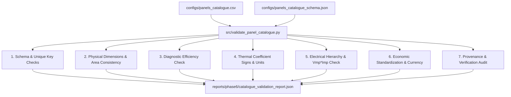

# Validation Rules — SolarSelect

This document details the automated physical, electrical, thermal, economic, and provenance validation rules implemented in [`src/validate_panel_catalogue.py`](../../src/validate_panel_catalogue.py).

---

## 1. Automated Validation Architecture

The validator checks catalogue records against physical laws, IEC standards, and schema rules:

---

## 2. Core Validation Rules and Thresholds

### Rule 1: Diagnostic Efficiency Consistency
When rated power ($P_{\text{rated}}$) and physical dimensions ($L, W$) are present, the validator computes gross diagnostic efficiency:
$$\eta_{\text{calc}} = \frac{P_{\text{rated}}}{\left(\frac{L \cdot W}{10^6}\right) \cdot 1000} \times 100 \quad [\%]$$
- **Discrepancy Threshold:** If reported efficiency $\eta_{\text{reported}}$ exists and $|\eta_{\text{calc}} - \eta_{\text{reported}}| > 0.5\%$, an **Engineering Warning** is raised.
- **Integrity Rule:** The calculated efficiency is used strictly for diagnostic consistency auditing; it never silently overwrites the manufacturer-reported value.

### Rule 2: Thermal Coefficient Signs and Physical Bounds
- **Maximum Power Coefficient ($\gamma_{Pmp}$):** Must be strictly negative ($\gamma < 0$, typically $-0.60$ to $-0.25\%/^\circ\text{C}$). A positive value triggers a **Critical Error**.
- **Open-Circuit Voltage Coefficient ($\beta_{Voc}$):** Must be strictly negative ($\beta < 0$, typically $-0.45$ to $-0.20\%/^\circ\text{C}$).
- **Short-Circuit Current Coefficient ($\alpha_{Isc}$):** Must be strictly positive ($\alpha > 0$, typically $+0.02$ to $+0.08\%/^\circ\text{C}$).
- **Units:** Must explicitly be $\% / ^\circ\text{C}$. Values expressed in $\text{mV}/^\circ\text{C}$ or $\text{W}/^\circ\text{C}$ must be converted or flagged.

### Rule 3: Electrical Parameter Hierarchy
- **Voltage Hierarchy:** Maximum power voltage must be strictly less than open-circuit voltage:
  $$V_{mp} < V_{oc}$$
- **Current Hierarchy:** Maximum power current must be strictly less than short-circuit current:
  $$I_{mp} < I_{sc}$$
- **Power Rating Consistency:**
  $$P_{\text{calc}} = V_{mp} \times I_{mp}$$
  If $|P_{\text{calc}} - P_{\text{rated}}| / P_{\text{rated}} > 5\%$, an **Engineering Warning** is raised.

### Rule 4: Economic Standardization & Currency Pairing
- A price value (`price_per_module`) must NEVER appear without an accompanying `currency` (ISO 4217 code) and `price_basis`.
- Direct comparisons across currencies or disparate price bases (e.g. MSRP vs. MW-scale wholesale EPC) are strictly prohibited.

### Rule 5: Provenance & Verification
- Every active record must specify a non-empty `specification_source`.
- Records with `verification_status != 'VERIFIED_OFFICIAL_DATASHEET'` generate an automated **Provenance Alert**.

