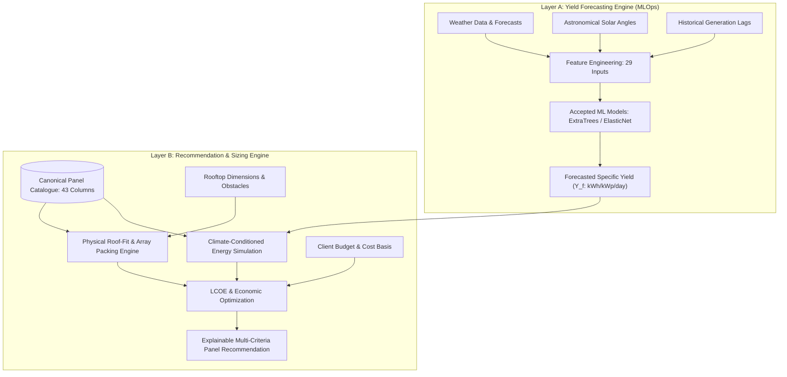

# Project Overview — SolarSelect

## 1. Executive Summary

**SolarSelect** is an end-to-end Machine Learning Operations (MLOps) system designed to solve a fundamental challenge in distributed renewable energy adoption: **recommending the optimal solar photovoltaic (PV) hardware for a specific rooftop under local environmental, physical, and economic constraints.**

Traditional solar selection tools rely on static PV sizing calculators that assume uniform, idealized panel efficiency and generic solar insolation values. In reality, photovoltaic performance depends strongly on dynamic local weather (ambient temperature, humidity, cloud cover, seasonal sun angles) and specific hardware characteristics (temperature coefficients $\gamma_{Pmp}$, degradation rates, cell technology, physical module geometry).

SolarSelect bridges this gap through a dual-layer architectural paradigm:
- **Layer A (Climate-Conditioned Specific Yield Forecasting):** A machine learning engine that forecasts daily normalized specific energy yield ($Y_f = \text{kWh}/\text{kW}_p/\text{day}$) given local weather forecasts, astronomical positions, and historical performance.
- **Layer B (Constraint-Aware Real Solar Panel Recommendation):** An optimization engine that combines Layer A's yield forecasts with a canonical commercial panel catalogue, physical rooftop dimensions, financial budgets, and degradation models to rank and recommend real commercial PV modules.

---

## 2. Core Value Proposition

| Dimension | Conventional Solar Sizing Tools | SolarSelect MLOps Platform |
|---|---|---|
| **Generation Modeling** | Static annual average insolation factors | Climate-conditioned daily ML specific-yield forecasting ($Y_f$) |
| **Thermal Dynamics** | Ignored or assumed fixed 25°C STC rating | Dynamic temperature modeling via panel-specific $\gamma_{Pmp}$ and NOCT/NMOT |
| **Hardware Cataloguing** | Generic placeholder panels (e.g. "300W generic") | Canonical 43-column commercial catalogue with verified electrical and mechanical ratings |
| **Roof Geometry** | Basic square-footage division | Detailed length/width array layout considering module orientation and packing factor |
| **Financial Analysis** | Simple payback based on constant output | Multi-decadal LCOE and lifetime yield incorporating warranted degradation curves |
| **MLOps Governance** | Ad-hoc scripts without versioning or tracking | Strict data quarantine, leakage-safe chronological splits, model registry, and audit trails |

---

## 3. Two-Layer System Architecture Concept

---

## 4. Key Scientific and Engineering Principles

1. **Capacity-Normalized Target ($Y_f$):** Generation is modeled in terms of specific yield ($Y_f = \text{kWh}/\text{kW}_p/\text{day}$). By normalizing energy against installed DC capacity, the machine learning model learns universal environmental response curves rather than memorizing individual plant sizes.
2. **Strict Chronological Data Quarantine:** Solar telemetry exhibits strong temporal autocorrelation and seasonal non-stationarity. Random cross-validation is strictly forbidden; all training, validation, and testing adhere to rigorous chronological boundaries with zero future leakage.
3. **Traceability and Data Provenance:** Hardware specifications cannot be invented or populated through unverified assumptions. All catalogue entries must trace directly to verifiable manufacturer datasheets.
4. **Distinction Between Implemented vs. Planned Systems:** While the overarching architecture includes automated drift monitoring, containerized serving, and multi-objective recommendation ranking, the codebase clearly demarcates what has been experimentally validated from future roadmap items.

