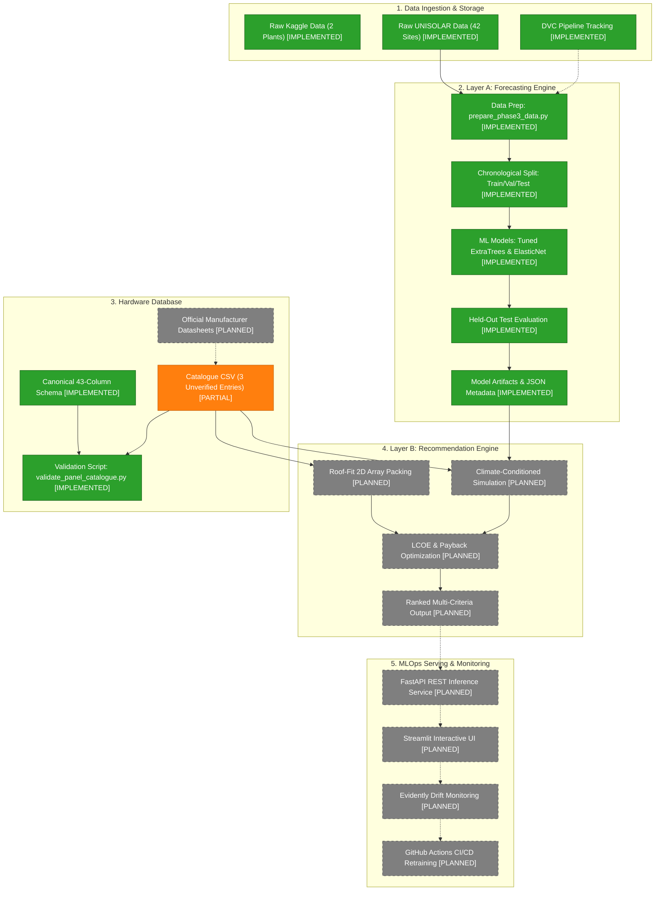
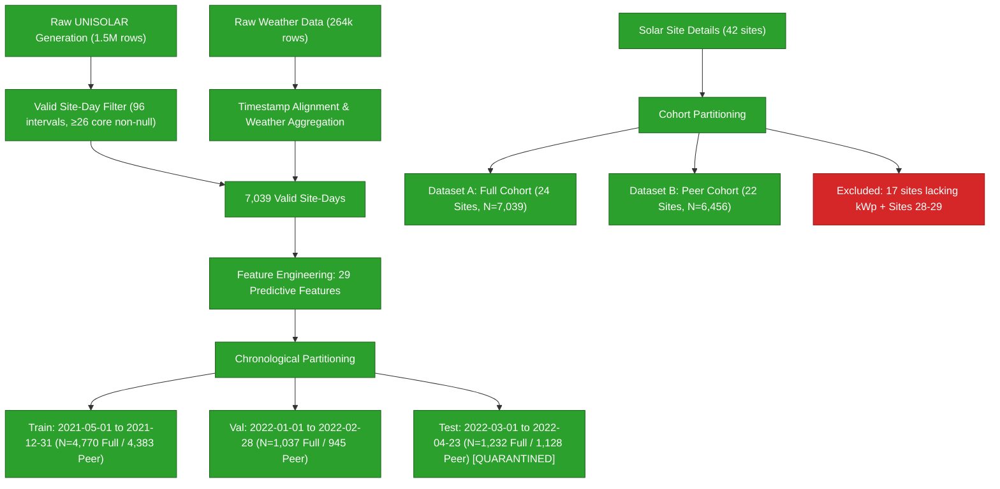
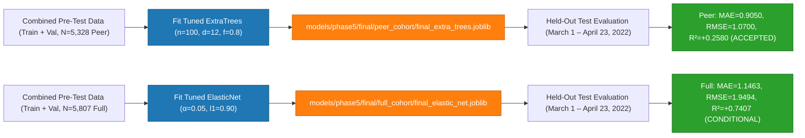
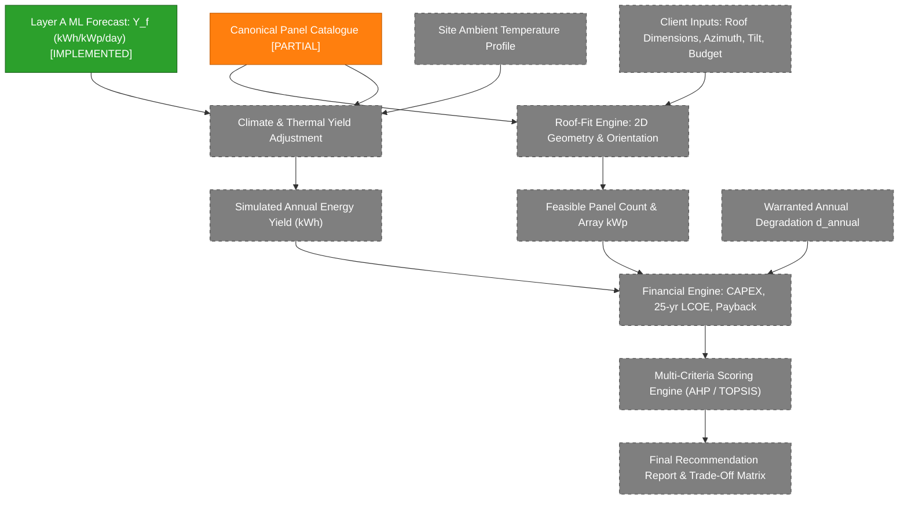

# System Architecture — SolarSelect

This document details the architectural design of **SolarSelect**. In strict compliance with engineering governance standards, every architectural component is categorized into one of three statuses:
- **[IMPLEMENTED]**: Fully coded, tested, and experimentally verified in the repository.
- **[PARTIAL]**: Partially constructed (e.g. schema and validation scripts complete, but data population pending approval).
- **[PLANNED]**: Designed architecture slated for implementation in future phases.

---

## 1. Overall SolarSelect System Architecture

The overarching system integrates telemetry data pipelines, predictive machine learning models, hardware cataloguing, constraint optimization, and operational MLOps serving:

---

## 2. Current Implemented ML Data Pipeline (Phases 1–3)

The data pipeline transforms raw campus telemetry into leakage-free ML training matrices:

---

## 3. Layer A Forecasting Workflow (Phases 4–5)

The production forecasting workflow fits models on pre-test data and produces day-ahead specific yield estimates:

---

## 4. Intended Layer B Recommendation Workflow (Phases 6–8)

The downstream recommendation engine couples Layer A forecasts with hardware parameters to optimize panel choices:

---

## 5. Intended End-to-End MLOps Lifecycle (Phases 9–10)

The operational deployment architecture includes automated serving, experiment tracking, and drift retraining:

```mermaid
flowchart TD
    classDef planned fill:#7f7f7f,stroke:#4f4f4f,color:#fff,stroke-dasharray: 5 5;
    classDef partial fill:#ff7f0e,stroke:#c45f06,color:#fff;
    classDef impl fill:#2ca02c,stroke:#1b611b,color:#fff;

    Dev["Model Development & Codebase"]:::impl --> Git["GitHub Repository & Actions CI"]:::planned
    Dev --> DVCStorage["DVC Remote Data Registry"]:::partial
    Dev --> MLflowRegistry["MLflow Model Registry [PLANNED]"]:::planned

    MLflowRegistry --> Container["Docker Containerized REST API (FastAPI) [PLANNED]"]:::planned
    Container --> WebApp["Streamlit Interactive Web UI [PLANNED]"]:::planned

    Client["User / Solar Installer"] --> WebApp
    WebApp --> Monitoring["Telemetry & Prediction Logging [PLANNED]"]:::planned

    Monitoring --> Evidently["Evidently AI Drift Monitoring [PLANNED]"]:::planned
    Evidently --> DriftAlert{"Drift Detected? (KS-Test p < 0.05)"}:::planned

    DriftAlert -- Yes --> TriggerRetrain["Trigger Automated Retraining Workflow"]:::planned
    DriftAlert -- No --> Stable["Continue Operational Serving"]:::planned
    TriggerRetrain --> Git
```

