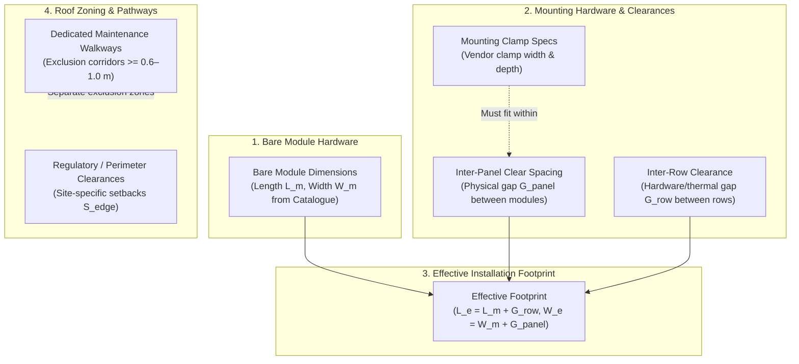

# SolarSelect — Phase 7 Prompt 1.1: Engineering Assumption Review & Design Correction Report

**Project:** SolarSelect — An End-to-End MLOps System for AI-Driven Rooftop Solar Selection and Yield Forecasting  
**Phase:** Phase 7 — Roof-Fit and Panel Configuration Engine  
**Prompt Stage:** Prompt 1.1 (Engineering Assumption Review & Design Correction)  
**Date of Execution:** 2026-11-10  
**Phase 7 Status:** **`DESIGN / REQUIREMENTS IN PROGRESS`**  
**Phase 6 Status:** **`COMPLETE_WITH_DOCUMENTED_LIMITATIONS` (Preserved)**  

---

## 1. Executive Summary

Following the completion of Phase 7 Prompt 1 (Requirements Specification & Architectural Design), a rigorous engineering design review identified five areas where technical terminology, physical clearance assumptions, and algorithmic claims required formal correction and epistemic refinement before proceeding to engine implementation:

1. **Clearance Parameters:** Disambiguated illustrative simulation defaults from statutory/regulatory requirements; separated mounting clamp hardware dimensions from physical module clear spacing; relabeled 50 mm clearance as thermal/racking gap and decoupled it from maintenance walkways ($\ge 0.6\text{–}1.0\text{ m}$); separated obstacle physical dimensions from clearance buffers; and constrained numerical tolerance ($\epsilon = 10^{-4}\text{ m}$) to strictly prevent boundary or non-overlap violations.
2. **Performance Claims:** Removed unsupported claims that the Row-Wise Strip Packing engine executes in $< 2\text{ ms}$. Replaced with a formal commitment to measure empirical execution latency during post-implementation benchmarking.
3. **Algorithmic Guarantees:** Formally documented that Row-Wise Strip Packing is a directional greedy heuristic. The engine generates geometrically feasible panel placements under the supplied roof geometry, module dimensions, clearances and obstacle assumptions. These results do not establish structural safety, regulatory compliance or installation approval. While the algorithm guarantees compliance with its implemented geometric constraints, it does not guarantee real-world installation feasibility or theoretical global maximum panel count, and its packing density is sensitive to row starting positions in obstacle-fragmented spaces. Preserved **`BEST_FEASIBLE_CONFIGURATION_FOUND`** as the contract status.
4. **Geometric & Installation Scope:** Formulated strict definitions for six distinct spatial layers and embedded formal disclaimers stating that the 2D engine does not certify structural safety, wind-load resistance, fire-code compliance, or installation approval.
5. **Testing Strategy Expansion:** Expanded the test suite from 15 to 20 distinct test cases (comprising 125 individual test executions across parameter variation suites and determinism loops) to explicitly verify configurable setbacks, clear spacing variations, obstacle geometry vs. buffers, dedicated maintenance corridors, and row starting position sensitivity, while removing any claims of global optimality.

In accordance with strict project boundaries:
- **Zero engine implementation code was written.**
- **Zero packing algorithm code was executed.**
- **Phase 1–5 ML models, notebooks, and pipelines were preserved 100% unaltered.**
- **Phase 6 catalogue data and reference files were preserved 100% unaltered.**
- **Phase 7 status remains strictly: `DESIGN / REQUIREMENTS IN PROGRESS`.**

---

## 2. Review & Correction of Clearance Parameters

The engineering review addressed five key geometric parameters across all Phase 7 design documents:

| Parameter | Original Prompt 1 Conception | Refined Prompt 1.1 Engineering Distinction | Updated Design Contract |
| :--- | :--- | :--- | :--- |
| **Perimeter Setback** ($S_{\text{edge}}$) | Described as standard fire/wind access perimeter ($0.50\text{ m}$). | **Configurable simulation default.** Not universally safe or legally compliant across jurisdictions. Site-specific building/fire codes (e.g. IFC 1205.2, AS/NZS 5033) must be supplied by the user or installation specification. | Retained $0.50\text{ m}$ strictly as an illustrative, unvalidated simulation default. |
| **Inter-Panel Clearance** ($G_{\text{panel}}$) | Termed "inter-panel clamp gap" ($0.020\text{ m}$ / $20\text{ mm}$). | **Physical clear spacing** between adjacent modules. Must be distinguished from mounting clamp hardware dimensions. Clamps sit within the clear gap, but clamp geometry depends on specific racking vendor specifications. | Retained $0.020\text{ m}$ as configurable clear spacing ($G_{\text{panel}}$); clamp dimensions separated into mounting specs. |
| **Inter-Row Spacing** ($G_{\text{row}}$) | Termed "inter-row walkway gap" ($0.050\text{ m}$ / $50\text{ mm}$). | **Inter-row racking/thermal clearance.** A $50\text{ mm}$ gap is physically incapable of serving as a human maintenance walkway. True walkways require dedicated $\ge 0.6\text{–}1.0\text{ m}$ access corridors. | Renamed parameter to "inter-row clearance" ($0.050\text{ m}$ default). Walkways modeled as explicit exclusion corridors. |
| **Obstacle Clearance Buffer** ($B_{\text{obstacle}}$) | Fixed buffer of $0.20\text{ m}$ ($200\text{ mm}$) around all obstacles. | **Geometric exclusion buffer.** Distinguishes obstacle physical bounding dimensions ($w \times h$) from the additional clearance buffer ($B$). Not a universal regulatory standard. | Retained $B_{\text{obstacle}} = 0.20\text{ m}$ as configurable parameter; total exclusion zone is $[w + 2B] \times [h + 2B]$. |
| **Numerical Tolerance** ($\epsilon$) | $\epsilon = 10^{-4}\text{ m}$ ($0.1\text{ mm}$) for floating-point tolerance. | **Inward Conservative Validation Policy.** Zero outward tolerance: numerical tolerance must strictly never authorize boundary protrusion or panel overlap. | Defined strict inward policy: $x_i - S \ge 0.0, (L - S) - (x_i + w_i) \ge 0.0$, overlap $\le 0.0$. Tolerance $\epsilon = 10^{-4}\text{ m}$ applied strictly on conservative side (test nominal spacing assertions and area sums). |

---

## 3. Rectification of Performance Claims

### Original Claim Identified
In `docs/engineering/phase7_algorithm_comparison.md`, Section 2.2 and Section 3 asserted that Row-Wise Strip Packing:
> *"Executes in $< 2\text{ ms}$ for typical residential roofs ($N < 50$), deterministic, and guarantees physically installable collinear layouts."*

### Engineering Review Finding
This latency claim was an unbenchmarked projection rather than an empirically measured execution time. SolarSelect strictly prohibits citing unverified performance metrics.

### Corrective Action Taken
1. Removed all claims of $< 2\text{ ms}$ latency from:
   - [`docs/engineering/phase7_algorithm_comparison.md`](../../docs/engineering/phase7_algorithm_comparison.md) (Sections 2.2 and 3)
   - [`docs/engineering/phase7_input_output_contract.md`](../../docs/engineering/phase7_input_output_contract.md)
   - [`reports/phase7/phase7_prompt1_requirements_design_report.md`](phase7_prompt1_requirements_design_report.md) (Sections 4 and 6)
2. Updated text to state:
   - Complexity is analytically bounded at $O(R \cdot (C + K \log K))$, where $R$ is rows, $C$ is candidate columns, and $K$ is obstacles.
   - Actual wall-clock execution time will be empirically benchmarked across residential ($< 50$ panels), commercial ($50\text{–}200$ panels), and industrial ($> 200$ panels) roof sizes following implementation in Phase 7 Prompt 2.

---

## 4. Algorithmic Guarantees & Epistemic Honesty

### Heuristic Nature of Row-Wise Strip Packing
The 2D Rooftop Solar Placement Problem (2D-RPP) is a variant of the NP-hard two-dimensional bin packing problem with irregular internal exclusions. Row-Wise Strip Packing is a **directional greedy heuristic**, not an exact mathematical solver (such as Mixed-Integer Linear Programming or Branch-and-Bound).

### Engineering Clarifications Formalized
1. **Valid Configurations Guaranteed:** The algorithm guarantees that any layout it returns satisfies all implemented geometric constraints: boundary containment, pairwise non-overlap, and obstacle avoidance. However, these results do not establish structural safety, regulatory compliance or installation approval.
2. **Global Optimality NOT Guaranteed:** The algorithm does **not** guarantee that the layout contains the theoretical maximum possible panel count ($N^*$). Sub-optimal packing can occur when an obstacle splits a row and leaves residual space slightly smaller than a panel width.
3. **Sensitivity to Row Starting Positions:** The resulting panel count can vary depending on whether the strip sweep begins from the bottom-left, top-left, bottom-right, or top-right, or whether alternating row offsets are applied.
4. **Output Designation:** The result is formally designated in data contracts as:
   $$\mathbf{BEST\_FEASIBLE\_CONFIGURATION\_FOUND}$$
   rather than claiming an "optimal" configuration.
5. **Architectural Modularity:** By encapsulating placement behind the `PlacementEngine` interface (Strategy Pattern), more complex future packing heuristics (e.g., dual-sweep or dynamic programming) can be introduced without altering data contracts.

---

## 5. Geometric & Installation Scope Disambiguation

To eliminate confusion between architectural concepts, six distinct spatial entities were defined:

### Explicit Spatial Definitions
1. **Bare Module Dimensions ($L_m, W_m$):** The bare glass/aluminum frame boundary as published in the manufacturer catalogue (e.g., $1722 \times 1134\text{ mm}$).
2. **Inter-Panel Clear Spacing ($G_{\text{panel}}$):** The physical clear distance between adjacent modules along the same rail (default $0.020\text{ m}$).
3. **Mounting Clamp Dimensions ($w_{\text{clamp}}$):** The physical dimensions of the manufacturer mid-clamps and end-clamps that anchor panels to rails.
4. **Effective Installation Footprint ($L_e, W_e$):** The total allocated spatial footprint of a module including its share of inter-panel and inter-row clearances.
5. **Dedicated Maintenance Walkways ($W_{\text{walkway}}$):** Dedicated human access paths across the roof for maintenance, fire response, and inspection. Modeled as rectangular obstacle exclusion corridors. Any corridor dimension (e.g. $0.8\text{ m}$ or $1.0\text{ m}$) referenced in tests or documentation is strictly an illustrative test input, not a universal statutory or engineering requirement. Walkway dimensions are fully configurable user inputs subject to site-specific building codes and maintenance requirements.
6. **Regulatory Clearances ($S_{\text{edge}}$):** Perimeter setbacks from roof ridges, eaves, and rakes mandated by local jurisdiction codes. Modeled as configurable simulation setbacks ($0.50\text{ m}$ default).

### Formal Safety & Scope Disclaimers
The Phase 7 engine documentation now explicitly declares:
> **Engineering Scope Disclaimer:** The SolarSelect Phase 7 engine performs 2D geometric fit estimation only. It does NOT evaluate roof structural dead-load capacity ($\text{kg}/\text{m}^2$), wind uplift resistance, seismic bracing, snow loading, fire-code classification, or local statutory compliance. All layouts are spatial estimates that require independent review, verification, and sign-off by a licensed civil/structural engineer and a certified electrical contractor prior to physical procurement or installation.

---

## 6. Expanded Testing Strategy: 20 Test Cases (Scenarios & Suites)

The test matrix in [`docs/engineering/phase7_testing_strategy.md`](../../docs/engineering/phase7_testing_strategy.md) defines **20 distinct test cases** (spanning 125 individual test executions across parameter variation suites and determinism loops) to validate all corrected assumptions:

| Test ID | Test Scenario Name | Core Objective & Assertion Verified |
| :--- | :--- | :--- |
| `TC-001` | Roof Too Small | Returns $N=0$ and `INFEASIBLE_ROOF_TOO_SMALL` when $L_{\text{usable}} < \min(L, W)$. |
| `TC-002` | Exact-Fit Roof | Validates boundary containment when usable roof exactly matches one module footprint. |
| `TC-003` | Portrait-Only Feasibility | Validates placement when roof dimensions accommodate portrait but reject landscape. |
| `TC-004` | Landscape-Only Feasibility | Validates placement when roof dimensions accommodate landscape but reject portrait. |
| `TC-005` | Dual Orientation Evaluation | Compares both orientations, selects higher capacity, records alternative. |
| **`TC-005A`** | **Row Starting Position Sensitivity** | **Executes sweep across multiple starting positions; verifies deterministic heuristic behavior without claiming global optimality.** |
| `TC-006` | Multi-Row/Column Grid Packing | Verifies collinear multi-row layout on unobstructed rectangular roof. |
| `TC-007` | Perimeter Edge Setback Enforcement | Asserts that zero panel bounding boxes intersect the perimeter setback ring (protrusion $\le 0.0$). |
| **`TC-007A`** | **Configurable Setback Variation Suite** | **Verifies engine response across varying setbacks ($S \in \{0.0, 0.3, 0.5, 1.0\}\text{ m}$, 4 executions), confirming no hardcoded assumptions.** |
| `TC-008` | Central Obstacle Avoidance | Asserts that central obstacle splits rows cleanly without overlap. |
| **`TC-008A`** | **Obstacle Dimension vs. Buffer Separation** | **Asserts that an obstacle of size $w \times h$ with buffer $B$ produces an exclusion zone of $(w+2B) \times (h+2B)$ (3 executions).** |
| **`TC-008B`** | **Dedicated Maintenance Walkway Corridor** | **Verifies that defining a dedicated corridor obstacle (e.g. $1.0\text{ m}$ or $0.8\text{ m}$, illustrative test inputs) creates a continuous unobstructed access path.** |
| `TC-009` | Edge/Corner Obstacle Avoidance | Asserts that obstacles near roof edges do not cause layout engine collapse. |
| `TC-010` | Inter-Panel Clear Spacing Check | Asserts that lateral gap between adjacent modules satisfies $G_{\text{panel}}$. |
| **`TC-010A`** | **Configurable Clear Spacing Suite** | **Tests varying clear spacings ($G_{\text{panel}} \in \{0.010, 0.020, 0.035\}\text{ m}$, 3 executions), confirming mounting adaptability.** |
| `TC-011` | Inter-Row Clearance Check | Asserts that pitch gap between adjacent rows satisfies $G_{\text{row}} \ge 0.050\text{ m}$. |
| `TC-012` | Pairwise Non-Overlap Invariant | Comprehensive $O(N^2)$ assertion that $\text{Area}(R_i \cap R_j) = 0$ for all placed panels. |
| `TC-013` | Missing Catalogue Dimensions | Asserts `MissingPanelDimensionError` when catalogue record lacks length/width. |
| `TC-014` | Invalid Roof Specification | Asserts `InvalidRoofSpecificationError` for non-positive or self-intersecting bounds. |
| `TC-015` | 100-Run Strict Determinism | Runs 100 iterations on identical inputs; asserts bit-for-bit identical coordinate arrays. |

---

## 7. Governance Updates & Register Consistency

### Decision Register (`docs/decisions/decision_register.md`)
- Preserved `ADR-016` (Geometric Coordinate Standards & Physical Separation of Concerns).
- Preserved `ADR-017` (Selection of Row-Wise Strip Packing Engine), explicitly emphasizing that it direct-models continuous linear racking rails and formalizes output as `BEST_FEASIBLE_CONFIGURATION_FOUND`.

### Risk Register (`docs/decisions/risk_register.md`)
- Updated **`RSK-012`**: Reclassified the $0.50\text{ m}$ setback from an active statutory standard to an illustrative, unvalidated simulation default. Emphasized that actual building/fire access requirements must be supplied per installation site.

### Limitations Register (`docs/decisions/limitations_register.md`)
- Updated **`LIM-014`**: Added explicit limitation recording that the 2D geometric placement engine does not evaluate civil structural dead-load capacity ($\text{kg}/\text{m}^2$), wind uplift resistance, or statutory fire codes.

---

## 8. Summary of Documentation Files Updated

1. [`docs/engineering/phase7_requirements.md`](../../docs/engineering/phase7_requirements.md): Disambiguated 6 spatial concepts, updated FR-006/FR-007, updated simulation defaults, strengthened numerical tolerance constraint.
2. [`docs/engineering/phase7_algorithm_comparison.md`](../../docs/engineering/phase7_algorithm_comparison.md): Removed $< 2\text{ ms}$ claim, documented directional heuristic characteristics and row starting position sensitivity.
3. [`docs/engineering/phase7_input_output_contract.md`](../../docs/engineering/phase7_input_output_contract.md): Clarified simulation defaults and dedicated walkway exclusion corridors.
4. [`docs/engineering/phase7_testing_strategy.md`](../../docs/engineering/phase7_testing_strategy.md): Expanded test matrix to 20 distinct test cases (`TC-001` through `TC-015`, including `TC-005A`, `TC-007A`, `TC-008A`, `TC-008B`, `TC-010A`) spanning 125 executions, removed global optimality claims.
5. [`docs/decisions/risk_register.md`](../../docs/decisions/risk_register.md): Updated `RSK-012`.
6. [`docs/decisions/limitations_register.md`](../../docs/decisions/limitations_register.md): Updated `LIM-014`.
7. [`reports/phase7/phase7_prompt1_requirements_design_report.md`](phase7_prompt1_requirements_design_report.md): Reconciled all metrics, test suite counts, and terminology.
8. [`log.txt`](../../log.txt): Appended Session 38 record.
9. [`reports/phase7/phase7_design_assumption_correction.md`](phase7_design_assumption_correction.md): Authored this comprehensive report.

---

## 9. Decisions Requiring Final Approval for Phase 7 Prompt 2

With all engineering assumptions now reconciled, the following parameters are locked for implementation in Prompt 2:

1. **Simulation Defaults:**
   - Perimeter setback default: $S_{\text{edge}} = 0.50\text{ m}$ (configurable, illustrative default).
   - Inter-panel clear spacing default: $G_{\text{panel}} = 0.020\text{ m}$ (configurable, illustrative default).
   - Inter-row clearance default: $G_{\text{row}} = 0.050\text{ m}$ (configurable, illustrative default).
   - Obstacle clearance buffer default: $B_{\text{obstacle}} = 0.20\text{ m}$ (configurable, illustrative default).
2. **Dedicated Maintenance Walkways:** Must be defined as explicit rectangular exclusion corridors within the `obstacles` list rather than conflated with inter-row racking clearance.
3. **Algorithmic Output Contract:** Outputs will carry status `BEST_FEASIBLE_CONFIGURATION_FOUND` without claiming mathematical global optimality.
4. **Empirical Benchmarking:** Wall-clock execution time will be measured and documented during test suite execution in Prompt 2.

---

## 10. Confirmation of Strict Boundaries

- **Zero engine implementation code was written.**
- **Zero packing algorithm code was executed.**
- **Zero modifications were made to Phase 1–5 datasets, pipelines, or model artifacts.**
- **Zero modifications were made to Phase 6 catalogue values, schemas, or reference PDFs.**
- **Zero Phase 8 financial or yield recommendation code was created.**
- **Phase 7 status is strictly recorded as: `DESIGN / REQUIREMENTS IN PROGRESS`.**

