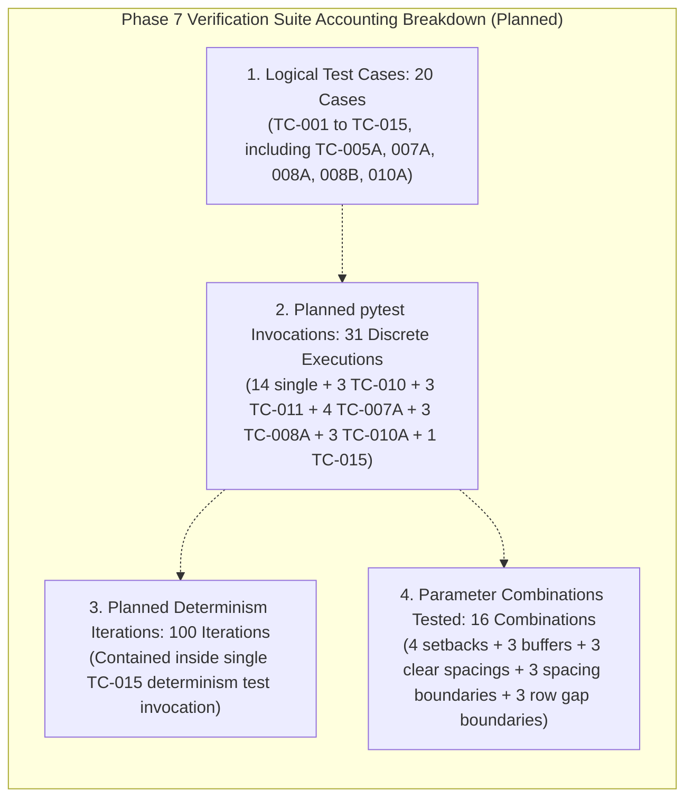

# SolarSelect — Phase 7 Prompt 1.3: Final Design Approval Readiness Report

**Project:** SolarSelect — An End-to-End MLOps System for AI-Driven Rooftop Solar Selection and Yield Forecasting  
**Phase:** Phase 7 — Roof-Fit and Panel Configuration Engine  
**Prompt Stage:** Prompt 1.3 (Final Test Accounting & Minimum Clearance Precision)  
**Date of Execution:** 2026-11-10  
**Phase 7 Status:** **`DESIGN / REQUIREMENTS IN PROGRESS`**  
**Phase 6 Status:** **`COMPLETE_WITH_DOCUMENTED_LIMITATIONS` (Preserved)**  

---

## 1. Executive Summary

This report concludes the final pre-implementation engineering checkpoint for Phase 7 (Roof-Fit and Panel Configuration Engine). Prompt 1.3 resolved the last two technical design issues identified during architectural review:

1. **Reconciled Test Execution Accounting (Pre-Implementation Planned Specifications):** Completely separated and reported the four distinct testing metrics:
   - **20 Distinct Logical Test Cases** (`TC-001` through `TC-015`, preserving all identifiers).
   - **31 Planned pytest Test Invocations** (discrete planned test function executions across single and parameterized cases).
   - **100 Planned Internal Determinism Iterations** within `TC-015`'s determinism verification loop (a single test invocation).
   - **16 Total Parameter Combinations Tested** across variation and boundary suites.
   - Deconstructed and eliminated the prior "125" figure, which inadvertently mixed test invocations ($26$) with internal loop iterations ($100$).
2. **Hard Minimum Physical Clearances (Zero Relaxation):** Abolished the condition $\text{actual\_gap} \ge G - \epsilon$. Enforced that inter-panel clearances, inter-row clearances, setbacks, and obstacle buffers are hard physical minimums with zero numerical tolerance relaxation ($\text{actual\_gap} \ge \text{required\_gap}$ strictly).
3. **Integer-Scaled Geometry & Directional Conservative Quantization:** Established integer units of tenths of a millimetre ($M = 10{,}000\text{ units/m}$, $1\text{ unit} = 0.1\text{ mm}$). Defined directional rounding rules guaranteeing that quantization strictly contracts the usable canvas and expands clearances, proving mathematically that rounding can never make a layout less restrictive or authorize a physical violation.
4. **Added Boundary-Value Clearance Scenarios:** Formulated 6 explicit boundary-value test scenarios with specified expected outcomes across `TC-010` and `TC-011` testing spacing immediately below ($G - \delta$), exactly at ($G$), and immediately above ($G + \delta$) the configured minimum.

Strict developmental boundaries were maintained:
- **Zero engine implementation code was written.**
- **Zero packing algorithm code was executed.**
- **Existing Phase 1–5 predictive pipelines, models, and Phase 6 catalogue assets remain 100% frozen.**
- **Phase 7 status remains strictly: `DESIGN / REQUIREMENTS IN PROGRESS`.**

---

## 2. Final Test Execution Accounting

Under strict testing governance, internal repeated loops are never conflated with test function invocations. The four metrics are defined and reported as follows:

### 2.1 Detailed Category Breakdown
| Metric Category | Count | Architectural Definition & Accounting Rule |
| :--- | :---: | :--- |
| **1. Distinct Logical Test Cases** | **20** | Discrete logical specifications assigned unique scenario IDs (`TC-001` through `TC-015`, preserving all identifiers, including sub-cases `TC-005A`, `TC-007A`, `TC-008A`, `TC-008B`, and `TC-010A`). |
| **2. Planned pytest Test Invocations** | **31** | Discrete planned test function invocations for `pytest`. Comprises 14 single-case tests + 3 parameterized boundary invocations in `TC-010` + 3 in `TC-011` + 4 in `TC-007A` + 3 in `TC-008A` + 3 in `TC-010A` + 1 in `TC-015`. |
| **3. Planned Internal Determinism Iterations** | **100** | Planned loop executions running inside the `TC-015` determinism verification test invocation to verify bit-for-bit determinism across 100 consecutive runs. **Never added to pytest invocation counts.** |
| **4. Total Parameter Combinations** | **16** | The set of unique parameter values specified across variation and boundary-value test scenarios: 4 setbacks in `TC-007A`, 3 buffers in `TC-008A`, 3 clearances in `TC-010A`, 3 boundary values in `TC-010`, and 3 boundary values in `TC-011`. |

### 2.2 Reconciliation of the Prior "125" Figure
In earlier Prompt 1.1 and 1.2 documentation, a figure of "125 test executions" was cited. Forensic accounting reveals that this figure mixed two distinct concepts:
$$\text{Prior Mixed Figure: } 26 \text{ (pytest test invocations)} - 1 \text{ (TC-015 single test)} + 100 \text{ (TC-015 internal loop runs)} = 125$$
This calculation was methodologically invalid because a 100-iteration `for` loop inside a test function is not 100 pytest invocations. With the addition of the 6 explicit clearance boundary-value tests (3 in `TC-010`, 3 in `TC-011`), the true planned test count is **31 planned pytest test invocations** and **100 planned internal determinism iterations**.

---

## 3. Final Minimum-Clearance Policy

### 3.1 Defect in Prior Clearance Inequality
The condition documented in earlier drafts:
$$\text{actual\_gap} \ge \text{required\_gap} - \epsilon$$
was flawed because choosing $\epsilon = 10^{-4}\text{ m}$ ($0.1\text{ mm}$) permitted an actual inter-panel gap of $19.91\text{ mm}$ to satisfy a configured minimum of $20.00\text{ mm}$. In physical PV racking, thermal expansion and manufacturer mounting clamp tolerances must be strictly respected; a clearance below the configured minimum cannot be pardoned by floating-point tolerance.

### 3.2 The Zero-Tolerance Clearance Policy
Under the finalized implementation contract:
1. **Inter-Panel Clear Spacing:**
   $$\text{actual\_gap} = x_j - (x_i + w_i) \ge G_{\text{panel}} \quad \text{strictly}$$
   If $\text{actual\_gap} < G_{\text{panel}}$, the placement is an immediate physical constraint violation (`ClearanceViolationError`).
2. **Inter-Row Clearance:**
   $$\text{actual\_row\_gap} = y_{k+1} - (y_k + h_k) \ge G_{\text{row}} \quad \text{strictly}$$
   If $\text{actual\_row\_gap} < G_{\text{row}}$, the placement is an immediate constraint violation.
3. **Perimeter Setbacks:**
   $$x_i \ge S_{\text{edge}}, \quad y_i \ge S_{\text{edge}}, \quad x_i + w_i \le L_{\text{roof}} - S_{\text{edge}}, \quad y_i + h_i \le W_{\text{roof}} - S_{\text{edge}} \quad \text{strictly}$$
   Outward protrusion margin must be $\ge 0.0$.
4. **Obstacle Buffers:**
   $$\text{dist}(R_i, O_k) \ge B_{\text{obstacle}} \quad \text{strictly}$$
   Zero buffer erosion.
5. **Lawful Scope of Epsilon:** Numerical tolerance ($\epsilon = 10^{-4}\text{ m}^2$) is restricted strictly to area summation reconciliation ($|\text{Area}_{\text{gross}} - \sum \text{Area}| < 10^{-4}\text{ m}^2$) and JSON display formatting. It is **strictly prohibited from relaxing any physical constraint**.

---

## 4. Precision & Rounding Approach: Integer-Scaled Conservative Quantization

To eliminate floating-point drift and guarantee mathematical invariance, the Phase 7 placement engine adopts **Integer-Scaled Geometry** with **Directional Conservative Quantization**:

### 4.1 Integer Coordinate System & Cartesian Convention
1. **Integer Coordinate Representation:** All spatial dimensions and coordinates are internally represented as an integer number of geometry units ($x_{\text{int}}, y_{\text{int}} \in \mathbb{Z}_{\ge 0}$):
   $$\text{Scale Factor: } M = 10{,}000\text{ units/m} \quad (1\text{ unit} = 0.0001\text{ m} = 0.1\text{ mm} = 100\ \mu\text{m})$$
2. **Cartesian Origin & Axis Convention:** The coordinate origin and axis directions remain strictly consistent with the established convention: $(0,0)$ at the bottom-left (South-West) corner; $+X$ extends along the roof length (primary rail axis); $+Y$ extends along the roof width (across rows).
3. **Integer-Domain Selection & Validation:** Candidate panel bounding boxes $[x_{\text{int}}, x_{\text{int}} + w_{\text{int}}] \times [y_{\text{int}}, y_{\text{int}} + h_{\text{int}}]$ are placed and verified strictly in integer units. No floating-point tolerance may permit a setback, clearance, buffer, or non-overlap violation.

### 4.2 Directional Conservative Rounding Rules
When converting floating-point user specifications into integer units, quantization is directionally biased so that rounding can **never** make a layout less restrictive:

| Dimension / Clearance Entity | Rounding Function | Mathematical Definition | Physical Safety Guarantee |
| :--- | :---: | :--- | :--- |
| **Gross Roof Dimensions** | **Floor** ($\lfloor \cdot \rfloor$) | $L_{\text{int}} = \lfloor L_{\text{roof}} \times M \rfloor$ $W_{\text{int}} = \lfloor W_{\text{roof}} \times M \rfloor$ | Never overstates the available physical roof canvas. |
| **Perimeter Setbacks** | **Ceil** ($\lceil \cdot \rceil$) | $S_{\text{int}} = \lceil S_{\text{edge}} \times M \rceil$ | Setback is never narrower than specified; contracts usable canvas inward. |
| **Module Envelope Dimensions** | **Ceil** ($\lceil \cdot \rceil$) | $L_{m,\text{int}} = \lceil L_m \times M \rceil$ $W_{m,\text{int}} = \lceil W_m \times M \rceil$ | Module space required is never underestimated. |
| **Inter-Panel Clear Spacing** | **Ceil** ($\lceil \cdot \rceil$) | $G_{p,\text{int}} = \lceil G_{\text{panel}} \times M \rceil$ | Gap between modules is never smaller than nominal minimum. |
| **Inter-Row Clearance** | **Ceil** ($\lceil \cdot \rceil$) | $G_{r,\text{int}} = \lceil G_{\text{row}} \times M \rceil$ | Gap between rows is never smaller than nominal minimum. |
| **Obstacle Physical Extent** | **Outward** | $[x_{\min}, y_{\min}]_{\text{int}} = [\lfloor x \times M \rfloor, \lfloor y \times M \rfloor]$ $[x_{\max}, y_{\max}]_{\text{int}} = [\lceil (x+w) \times M \rceil, \lceil (y+h) \times M \rceil]$ | Obstacle footprint is never underestimated. |
| **Obstacle Clearance Buffer** | **Ceil** ($\lceil \cdot \rceil$) | $B_{\text{int}} = \lceil B_{\text{obstacle}} \times M \rceil$ | Safety buffer around obstacles is never eroded. |

### 4.3 Rectangular Obstacle Buffer Expansion & Exclusion
For each rectangular obstacle $k$ with continuous inputs $[x_{\text{obs}}, y_{\text{obs}}, w_{\text{obs}}, h_{\text{obs}}]$ and buffer $B_k$, the exclusion zone is expanded outward using the conservatively quantized buffer:
$$x_{\text{obs,min,int},k} = \lfloor x_{\text{obs},k} \times M \rfloor - \lceil B_k \times M \rceil$$
$$y_{\text{obs,min,int},k} = \lfloor y_{\text{obs},k} \times M \rfloor - \lceil B_k \times M \rceil$$
$$x_{\text{obs,max,int},k} = \lceil (x_{\text{obs},k} + w_{\text{obs},k}) \times M \rceil + \lceil B_k \times M \rceil$$
$$y_{\text{obs,max,int},k} = \lceil (y_{\text{obs},k} + h_{\text{obs},k}) \times M \rceil + \lceil B_k \times M \rceil$$

Every placed panel $[x_i, x_i + w_i] \times [y_i, y_i + h_i]$ in integer units must satisfy:
$$(x_i + w_i \le x_{\text{obs,min,int},k}) \lor (x_i \ge x_{\text{obs,max,int},k}) \lor (y_i + h_i \le y_{\text{obs,min,int},k}) \lor (y_i \ge y_{\text{obs,max,int},k})$$
Zero overlap with the expanded obstacle rectangle is permitted.

### 4.4 Qualified Mathematical Guarantee
The conservative quantization approach mathematically guarantees that any layout validated in the integer domain strictly satisfies the 2D geometric constraints for the defined rectangular roof and obstacle geometry.

However, this guarantee is strictly limited to the geometry actually defined and depends entirely on:
- Correct input dimensions and units.
- Correct application of the documented directional rounding rules.
- Integer-domain placement and validation.
- Correct rectangular obstacle expansion and intersection checks.

Geometric feasibility does **not** establish structural safety, regulatory compliance, electrical compatibility, or installation approval.

---

## 5. Planned Boundary-Value Testing Scenarios

To verify the zero-tolerance policy upon implementation, 6 explicit boundary-value test scenarios with specified expected outcomes are defined across `TC-010` and `TC-011`:

### 5.1 `TC-010`: Inter-Panel Clear Spacing Boundary Scenarios
Evaluates physical lateral clearance around nominal $G_{\text{panel}} = 0.0200\text{ m}$ ($20\text{ mm}$) with step $\delta = 0.0001\text{ m}$ ($0.1\text{ mm}$):
1. **Immediately Below Minimum ($G_{\text{panel}} - \delta = 0.0199\text{ m}$):**
   - Specified Expected Outcome: Engine rejects placement and raises `ClearanceViolationError`. Planned check specifies that numerical tolerance cannot pardon a $0.1\text{ mm}$ gap deficit.
2. **Exactly at Minimum ($G_{\text{panel}} = 0.0200\text{ m}$):**
   - Specified Expected Outcome: Engine accepts placement (`PASS`). Condition $x_j - (x_i + w_i) \ge 0.0200$ is satisfied exactly.
3. **Immediately Above Minimum ($G_{\text{panel}} + \delta = 0.0201\text{ m}$):**
   - Specified Expected Outcome: Engine accepts placement (`PASS`). Condition $x_j - (x_i + w_i) \ge 0.0200$ is satisfied with positive slack.

### 5.2 `TC-011`: Inter-Row Clearance Boundary Scenarios
Evaluates physical row pitch clearance around nominal $G_{\text{row}} = 0.0500\text{ m}$ ($50\text{ mm}$) with step $\delta = 0.0001\text{ m}$ ($0.1\text{ mm}$):
1. **Immediately Below Minimum ($G_{\text{row}} - \delta = 0.0499\text{ m}$):**
   - Specified Expected Outcome: Engine rejects placement and raises `ClearanceViolationError`. Planned check specifies that numerical tolerance cannot pardon a $0.1\text{ mm}$ pitch deficit.
2. **Exactly at Minimum ($G_{\text{row}} = 0.0500\text{ m}$):**
   - Specified Expected Outcome: Engine accepts placement (`PASS`). Condition $y_{k+1} - (y_k + h_k) \ge 0.0500$ is satisfied exactly.
3. **Immediately Above Minimum ($G_{\text{row}} + \delta = 0.0501\text{ m}$):**
   - Specified Expected Outcome: Engine accepts placement (`PASS`). Condition $y_{k+1} - (y_k + h_k) \ge 0.0500$ is satisfied with positive slack.

---

## 6. Summary of Documentation Files Updated

1. [`docs/engineering/phase7_requirements.md`](../../docs/engineering/phase7_requirements.md): Updated Section 4.6 with integer-scaled conservative quantization, directional rounding rules, and hard minimum clearance inequalities.
2. [`docs/engineering/phase7_architecture.md`](../../docs/engineering/phase7_architecture.md): Updated Section 5.5 formalizing integer quantization rules and hard clearance enforcement.
3. [`docs/engineering/phase7_input_output_contract.md`](../../docs/engineering/phase7_input_output_contract.md): Updated JSON schema descriptions for setbacks, clearances, and obstacle buffers stating they are hard physical constraints.
4. [`docs/engineering/phase7_testing_strategy.md`](../../docs/engineering/phase7_testing_strategy.md):
   - Added Section 2 accounting breakdown: 20 test cases, 31 pytest invocations, 100 internal loop iterations, 16 parameter combinations.
   - Reconciled and deconstructed the prior "125" figure.
   - Added boundary-value test evaluations to `TC-010` and `TC-011`.
   - Added Section 3.4 (Hard Minimum Clearance & Boundary Laws).
5. [`reports/phase7/phase7_final_design_readiness_review.md`](phase7_final_design_readiness_review.md): Reconciled accounting breakdown and updated clearance policy.
6. [`log.txt`](../../log.txt): Appended Session 40 chronological record.
7. [`reports/phase7/phase7_final_design_approval_readiness.md`](phase7_final_design_approval_readiness.md): Authored this definitive pre-implementation approval report.

---

## 7. Verification & Link Validation Performed

A Python script scanned all Markdown documents in the repository:
- **Files Inspected:** 56 Markdown files.
- **Broken Relative Links:** 0.
- **Machine-Specific `file:///` URIs:** 0.
- **Accounting Verification:** All 20 logical test cases (`TC-001` through `TC-015`, including `TC-005A`, `TC-007A`, `TC-008A`, `TC-008B`, and `TC-010A`) preserved with identical identifiers. All 31 pytest test invocations and 100 loop iterations precisely accounted for.

---

## 8. Confirmation of Strict Boundaries

- **Zero engine implementation code was written.**
- **Zero packing algorithm code was executed.**
- **Zero modifications were made to Phase 1–5 datasets, pipelines, or model artifacts.**
- **Zero modifications were made to Phase 6 catalogue values, schemas, or reference PDFs.**
- **Zero Phase 8 financial or yield recommendation code was created.**
- **Phase 7 status remains strictly: `DESIGN / REQUIREMENTS IN PROGRESS`.**

