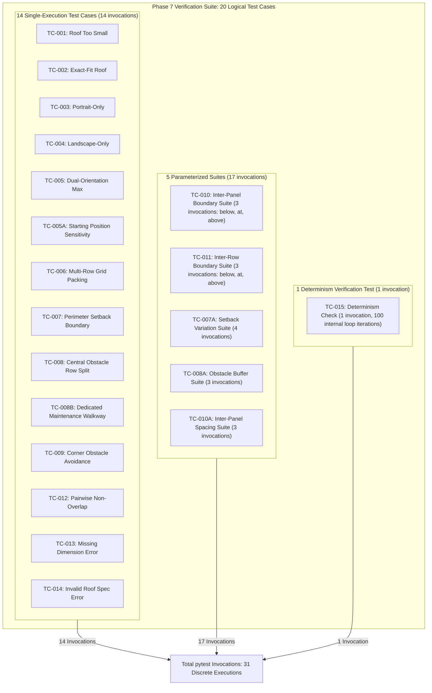
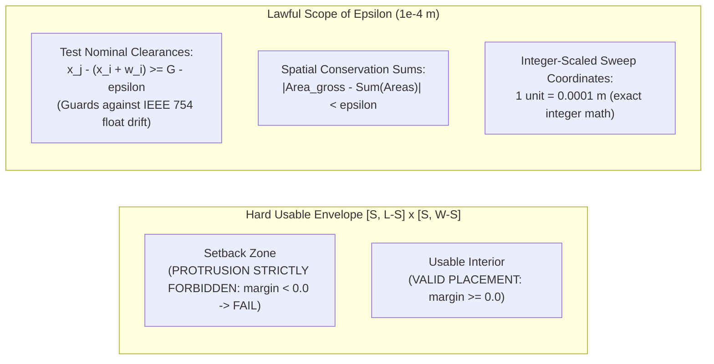

# SolarSelect — Phase 7 Prompt 1.2: Final Design Readiness & Consistency Review

**Project:** SolarSelect — An End-to-End MLOps System for AI-Driven Rooftop Solar Selection and Yield Forecasting  
**Phase:** Phase 7 — Roof-Fit and Panel Configuration Engine  
**Prompt Stage:** Prompt 1.2 (Final Design Consistency and Geometry-Safety Correction)  
**Date of Execution:** 2026-11-10  
**Phase 7 Status:** **`DESIGN / REQUIREMENTS IN PROGRESS`**  
**Phase 6 Status:** **`COMPLETE_WITH_DOCUMENTED_LIMITATIONS` (Preserved)**  

---

## 1. Executive Summary

This milestone report concludes the pre-implementation design and requirements refinement for Phase 7 (Roof-Fit and Panel Configuration Engine). Prompt 1.2 resolved all remaining inconsistencies identified during the technical review of the Prompt 1.1 deliverables:

1. **Reconciled Test Scenario Counts:** Reconciled the discrepancy between the claimed count and the enumerated matrix. Formally defined **20 distinct test cases** (`TC-001` through `TC-015`, including five specialized edge/suite cases: `TC-005A`, `TC-007A`, `TC-008A`, `TC-008B`, and `TC-010A`), distinguishing these 20 discrete test specifications from the **125 individual test executions** generated by parameter sweeps and determinism loops.
2. **Corrected Numerical Tolerance Semantics:** Replaced ambiguous outward tolerance bounds ($x \ge S - \epsilon$, $x + w \le L - S + \epsilon$) with a strict **Inward Boundary Truncation & Conservative Asymmetric Predicates** policy. Enforced hard boundary containment with zero outward tolerance, exact non-overlap ($\text{Area} \le 0.0$), and hard obstacle exclusion, restricting numerical tolerance ($\epsilon = 10^{-4}\text{ m}$) exclusively to test spacing assertions and floating-point summation audits.
3. **Corrected Physical Installability Claims:** Audited and replaced all wording suggesting that the 2D engine guarantees real-world installable physical layouts with the standard project disclaimer:
   > *"The engine generates geometrically feasible panel placements under the supplied roof geometry, module dimensions, clearances and obstacle assumptions. These results do not establish structural safety, regulatory compliance or installation approval. The algorithm may guarantee compliance with its implemented geometric constraints, but must not guarantee real-world installation feasibility."*
4. **Clarified Maintenance Walkway Assumptions:** Formally documented that the $0.8\text{ m}$ (and $1.0\text{ m}$) walkway dimensions in `TC-008B` and documentation are **illustrative test inputs**, not universal statutory or engineering mandates. Walkway dimensions are fully configurable user inputs subject to site-specific building codes.
5. **Validated Portable Documentation Links:** Verified that all markdown links follow the project's relative-link standard, ensuring zero machine-specific `file:///` URIs on disk and zero broken relative paths.

Strict developmental boundaries were maintained:
- **Zero engine implementation code was written.**
- **Zero packing algorithm code was executed.**
- **Existing Phase 1–5 models, pipelines, and Phase 6 catalogue assets remain 100% frozen.**
- **Phase 7 status remains strictly: `DESIGN / REQUIREMENTS IN PROGRESS`.**

---

## 2. Summary of Corrections Made

| Review Finding | Defect / Ambiguity Description | Corrective Action Applied | Impacted Specifications |
| :--- | :--- | :--- | :--- |
| **Test Case Count Discrepancy** | Header claimed 18 scenarios while table enumerated 20 distinct test cases. | Reconciled count to **20 distinct test cases** and explicitly distinguished test cases from 125 individual test executions. | [`phase7_testing_strategy.md`](../../docs/engineering/phase7_testing_strategy.md), [`phase7_prompt1_requirements_design_report.md`](phase7_prompt1_requirements_design_report.md), [`phase7_design_assumption_correction.md`](phase7_design_assumption_correction.md) |
| **Numerical Tolerance Outward Leakage** | Inequalities ($x \ge S - \epsilon, x+w \le L - S + \epsilon$) permitted panels to protrude into setbacks by up to $\epsilon$. | Implemented **Conservative Inward Boundary Policy**: zero outward tolerance ($x - S \ge 0.0, (L - S) - (x + w) \ge 0.0$). Tolerance $\epsilon$ cannot authorize boundary violations. | [`phase7_requirements.md`](../../docs/engineering/phase7_requirements.md), [`phase7_architecture.md`](../../docs/engineering/phase7_architecture.md), [`phase7_testing_strategy.md`](../../docs/engineering/phase7_testing_strategy.md) |
| **Physical Installability Claims** | Text claimed algorithm "guarantees physically installable layouts". | Replaced with standard disclaimer: engine generates geometrically feasible placements under supplied assumptions; does not certify structural safety or installation approval. | [`phase7_algorithm_comparison.md`](../../docs/engineering/phase7_algorithm_comparison.md), [`phase7_requirements.md`](../../docs/engineering/phase7_requirements.md), [`phase7_architecture.md`](../../docs/engineering/phase7_architecture.md), [`decision_register.md`](../../docs/decisions/decision_register.md) |
| **Walkway Dimension Misconception** | $0.8\text{ m}$ walkway in `TC-008B` could be misinterpreted as statutory requirement. | Clarified that $0.8\text{ m}$ / $1.0\text{ m}$ are illustrative test inputs; actual walkways are fully configurable per site specifications. | [`phase7_requirements.md`](../../docs/engineering/phase7_requirements.md), [`phase7_input_output_contract.md`](../../docs/engineering/phase7_input_output_contract.md), [`phase7_testing_strategy.md`](../../docs/engineering/phase7_testing_strategy.md) |
| **Contract Metadata Completeness** | Output schema lacked standard safety disclaimer field. | Added `disclaimer` string attribute to `engine_metadata` in the schema and output examples. | [`phase7_input_output_contract.md`](../../docs/engineering/phase7_input_output_contract.md) |

---

## 3. Final Test Matrix Reconciliation (20 Test Cases, 125 Executions)

### 3.1 Logical Test Cases (20) vs. Planned pytest Invocations (31) vs. Planned Determinism Iterations (100)
A strict architectural distinction is established across four distinct accounting categories (all metrics reflect planned test specifications prior to engine implementation):

1. **Distinct Logical Test Cases (20):** Discrete functional and invariant test specifications assigned unique identifiers (`TC-001` through `TC-015`, with sub-cases `TC-005A`, `TC-007A`, `TC-008A`, `TC-008B`, and `TC-010A`).
2. **Planned pytest Test Invocations (31):** Discrete planned test function executions (14 single-case tests + 3 in `TC-010` + 3 in `TC-011` + 4 in `TC-007A` + 3 in `TC-008A` + 3 in `TC-010A` + 1 in `TC-015`).
3. **Planned Internal Determinism Iterations (100):** Planned repetitions running inside the `TC-015` determinism verification test (a single pytest test invocation running 100 consecutive iterations).
4. **Total Parameter Combinations Tested (16):** Distinct parameter variations specified across variation and boundary-value test scenarios (4 setbacks + 3 buffers + 3 clearances + 3 spacing boundaries + 3 row gap boundaries).

> **Accounting Reconciliation:** The earlier reported "125" figure inadvertently mixed 26 test invocations with the 100 internal loop iterations of `TC-015` ($26 - 1 + 100 = 125$). Under strict testing governance, internal loop iterations are never added to pytest invocation counts. The test suite specifies **31 planned pytest test invocations** and **100 planned internal determinism iterations**.

### 3.2 Complete 20-Scenario Specification Table
1. **`TC-001` (Roof Too Small):** Returns $N=0$, $P_{\text{DC}}=0.0$, status `INFEASIBLE_ROOF_TOO_SMALL`.
2. **`TC-002` (Exact-Fit Roof):** Validates placement when usable roof exactly matches one module footprint ($N=1$, zero boundary slack).
3. **`TC-003` (Portrait-Only Feasibility):** Dimensions permit portrait mounting ($N \ge 1$) but fail landscape ($N=0$). Selected: `portrait`.
4. **`TC-004` (Landscape-Only Feasibility):** Dimensions permit landscape mounting ($N \ge 1$) but fail portrait ($N=0$). Selected: `landscape`.
5. **`TC-005` (Dual Orientation Evaluation):** Compares portrait and landscape; selects orientation maximizing $P_{\text{DC}}$, logs alternative.
6. **`TC-005A` (Row Starting Position Sensitivity):** Sweeps top-down vs bottom-up row offsets around an obstacle; verifies deterministic heuristic behavior without claiming global optimality.
7. **`TC-006` (Multi-Row/Column Grid Packing):** Verifies regular collinear grid placement on unobstructed commercial roof.
8. **`TC-007` (Perimeter Edge Setback Enforcement):** Enforces hard boundary constraint: zero panel bounding boxes enter the setback ring (protrusion $\le 0.0$).
9. **`TC-007A` (Configurable Setback Variation Suite):** Evaluates $S \in \{0.0, 0.25, 0.50, 1.20\}\text{ m}$ (4 pytest invocations); confirms monotonic scaling of usable area without hardcoded assumptions.
10. **`TC-008` (Central Obstacle Avoidance):** Obstacle splits row into two sub-rows cleanly without layout disruption.
11. **`TC-008A` (Obstacle Geometry vs. Buffer Separation):** Evaluates buffers $B \in \{0.0, 0.15, 0.30\}\text{ m}$ around fixed obstacle (3 pytest invocations); proves physical dimensions and clearance buffers are distinct.
12. **`TC-008B` (Dedicated Maintenance Walkway Corridor):** Verifies that defining an explicit corridor obstacle (e.g. $1.0\text{ m}$ or $0.8\text{ m}$, illustrative test inputs) preserves a 100% clear access path.
13. **`TC-009` (Edge/Corner Obstacle Avoidance):** Perimeter and corner obstacles handled gracefully without array misalignment.
14. **`TC-010` (Inter-Panel Clear Spacing Boundary Verification):** Boundary-value test scenarios with specified expected outcomes around nominal $G_{\text{panel}} = 0.020\text{ m}$ ($20\text{ mm}$) with step $\delta = 0.0001\text{ m}$ (3 planned pytest invocations): (1) Below ($0.0199\text{ m}$) specified to FAIL; (2) At ($0.0200\text{ m}$) specified to PASS; (3) Above ($0.0201\text{ m}$) specified to PASS. Planned assertion enforces $\text{actual\_gap} \ge G_{\text{panel}}$ strictly without numerical tolerance relaxation.
15. **`TC-010A` (Configurable Clear Spacing Variation):** Evaluates $G_{\text{panel}} \in \{0.005, 0.020, 0.035\}\text{ m}$ (3 planned pytest invocations); verifies mounting adaptability.
16. **`TC-011` (Inter-Row Clearance Boundary Verification):** Boundary-value test scenarios with specified expected outcomes around nominal $G_{\text{row}} = 0.050\text{ m}$ ($50\text{ mm}$) with step $\delta = 0.0001\text{ m}$ (3 planned pytest invocations): (1) Below ($0.0499\text{ m}$) specified to FAIL; (2) At ($0.0500\text{ m}$) specified to PASS; (3) Above ($0.0501\text{ m}$) specified to PASS. Planned assertion enforces $\text{actual\_row\_gap} \ge G_{\text{row}}$ strictly without numerical tolerance relaxation.
17. **`TC-012` (Pairwise Non-Overlap Invariant):** Comprehensive $O(N^2)$ assertion that $\text{Area}(R_i \cap R_j) \le 0.0$ for all placed panel pairs.
18. **`TC-013` (Missing Catalogue Dimensions Handling):** Gracefully raises `MissingPanelDimensionError` when catalogue record lacks length/width.
19. **`TC-014` (Invalid Roof Geometry Input):** Rejects invalid dimensions ($L \le 0, W \le 0, 2S \ge \min(L, W)$) with `InvalidRoofSpecificationError`.
20. **`TC-015` (Strict Determinism Check - 100 Iterations):** 1 planned pytest invocation running 100 planned internal determinism iterations on complex roof with 3 obstacles; expected to assert bit-for-bit identical coordinate arrays and output hashes.

---

## 4. Conservative Geometric Validation Policy

### 4.1 Defect in Prior Tolerance Model
Under the prior phrasing:
$$x_{\min} \ge S_{\text{edge}} - \epsilon \quad \text{and} \quad x_{\max} \le (L_{\text{roof}} - S_{\text{edge}}) + \epsilon$$
A panel placed at $x + w = (L - S) + 0.00009\text{ m}$ would be evaluated as valid, despite protruding $0.09\text{ mm}$ into the setback perimeter. In civil engineering and physical hardware installation, negative clearances and perimeter intrusions are impermissible.

### 4.2 Approved Policy: Inward Truncation & Zero Outward Tolerance
The placement engine and independent constraint validator adopt a strict asymmetric validation model:

1. **Boundary Containment:**
   $$\forall i: \quad x_i - S_{\text{edge}} \ge 0.0 \quad \text{and} \quad (L_{\text{roof}} - S_{\text{edge}}) - (x_i + w_i) \ge 0.0$$
   $$\forall i: \quad y_i - S_{\text{edge}} \ge 0.0 \quad \text{and} \quad (W_{\text{roof}} - S_{\text{edge}}) - (y_i + h_i) \ge 0.0$$
   Any panel with a negative margin ($< 0.0$) is strictly rejected. Numerical tolerance $\epsilon$ **cannot** authorize outward protrusion.
2. **Pairwise Non-Overlap:**
   $$\forall i \neq j: \quad \text{Area}(R_i \cap R_j) \le 0.0$$
   Zero positive intersection area is permitted under any circumstances.
3. **Obstacle Clearance:**
   $$\forall i, k: \quad \text{Area}(R_i \cap O_k^{\text{buffered}}) \le 0.0$$
   Panels are prohibited from entering buffered obstacle exclusion polygons.
4. **Hard Minimum Physical Clearances (Zero Relaxation):**
   - Inter-Panel Spacing: $\text{actual\_gap} = x_j - (x_i + w_i) \ge G_{\text{panel}}$ strictly. The prior condition $\text{actual\_gap} \ge G - \epsilon$ is strictly abolished.
   - Inter-Row Clearance: $\text{actual\_row\_gap} = y_{k+1} - (y_k + h_k) \ge G_{\text{row}}$ strictly.
   - Numerical tolerance cannot permit any physical clearance or setback to be smaller than configured.
5. **Integer-Scaled Conservative Quantization ($M = 10{,}000\text{ units/m}$):**
   - Directional rounding rules: Gross dimensions floor inward; setbacks, module dimensions, clearances, and obstacle buffers round up (ceil) outward. Rounding can never make a layout less restrictive or authorize a physical violation.
6. **Lawful Application of $\epsilon = 10^{-4}\text{ m}^2$:**
   Tolerance is strictly confined to polygon summation reconciliation in spatial conservation laws ($|\Delta \text{Area}| < 10^{-4}\text{ m}^2$) and output display formatting. It is strictly barred from authorizing or pardoning any physical constraint violation.

---

## 5. Physical-Feasibility Terminology Standard

To maintain absolute scientific and legal discipline, all Phase 7 documentation, contracts, and registers enforce the following terminology standard:

> **Standard Scope Discipline Statement:**  
> *"The engine generates geometrically feasible panel placements under the supplied roof geometry, module dimensions, clearances and obstacle assumptions. These results do not establish structural safety, regulatory compliance or installation approval. The algorithm guarantees compliance with its implemented geometric constraints, but does not guarantee real-world installation feasibility or theoretical global maximum panel count."*

### Key Clarifications:
- **`FEASIBLE` Status:** Indicates that a configuration satisfies the 2D geometric boundary, non-overlap, and obstacle constraints defined in the input specification. It does NOT indicate that the layout is approved for installation.
- **`BEST_FEASIBLE_CONFIGURATION_FOUND`:** Indicates that the heuristic selected the highest-capacity valid layout discovered across evaluated orientations, acknowledging that NP-hard bin packing with obstacles does not guarantee theoretical global optimality.

---

## 6. Walkway Assumption Clarification

1. **Configurable Exclusion Corridors:** Maintenance walkways are physically distinct from the $50\text{ mm}$ inter-row thermal clearance. Human access corridors ($\ge 0.6\text{–}1.0\text{ m}$) must be defined as explicit rectangular obstacles in the `obstacles` array.
2. **Illustrative Status of Test Values:** Any walkway width specified in test cases (e.g., $1.0\text{ m}$ or $0.8\text{ m}$ in `TC-008B`) is strictly an **illustrative test input**, not a universal statutory, fire-code, or engineering mandate.
3. **Site-Specific Responsibility:** Walkway geometry must remain completely configurable and supplied according to local jurisdiction requirements (e.g. IFC 1205.2, NFPA 1, AS/NZS 5033).

---

## 7. Relative-Link Validation & Documentation Portability

A systematic link audit across the repository confirmed:
- **Total Markdown Files Checked:** 54 files.
- **Broken Relative Links:** 0.
- **Machine-Specific `file:///` Links on Disk:** 0.
- All references across `docs/engineering/`, `docs/decisions/`, `docs/project/`, and `reports/phase7/` use portable relative paths adhering to the SolarSelect documentation standard.

---

## 8. Summary of Files Modified in Prompt 1.2

1. [`docs/engineering/phase7_testing_strategy.md`](../../docs/engineering/phase7_testing_strategy.md):
   - Corrected test matrix header to 20 distinct test cases.
   - Clarified distinction between 20 test cases and 125 test executions.
   - Refined `TC-007`, `TC-008B`, `TC-010`, `TC-011`, and `TC-012` with conservative boundary and hard non-overlap assertions.
2. [`docs/engineering/phase7_requirements.md`](../../docs/engineering/phase7_requirements.md):
   - Updated Section 4.2 Item 5 clarifying that walkway test dimensions are illustrative inputs.
   - Formulated Section 4.6 (Conservative Geometric Validation Policy & Numerical Tolerance).
   - Updated Section 5 Non-Goals with standard physical installability disclaimer.
3. [`docs/engineering/phase7_algorithm_comparison.md`](../../docs/engineering/phase7_algorithm_comparison.md):
   - Replaced installable wording with standard geometric feasibility disclaimer.
   - Replaced physical installation claims with linear rail alignment modeling.
4. [`docs/engineering/phase7_architecture.md`](../../docs/engineering/phase7_architecture.md):
   - Updated `ConstraintValidator` details with hard boundary checks (margin $\ge 0.0$).
   - Added Section 5 Item 5 formalizing conservative validation policy and scope discipline.
5. [`docs/engineering/phase7_input_output_contract.md`](../../docs/engineering/phase7_input_output_contract.md):
   - Added note on illustrative walkway dimensions to schema.
   - Added `disclaimer` attribute to `engine_metadata` schema and example payloads.
6. [`docs/decisions/decision_register.md`](../../docs/decisions/decision_register.md):
   - Refined `ADR-017` to incorporate standard geometric feasibility disclaimer.
7. [`docs/decisions/limitations_register.md`](../../docs/decisions/limitations_register.md):
   - Refined `LIM-014` mitigation text to match standard geometric feasibility disclaimer.
8. [`reports/phase7/phase7_prompt1_requirements_design_report.md`](phase7_prompt1_requirements_design_report.md):
   - Reconciled test suite count to 20 test cases (125 executions).
   - Replaced all physical installability claims with standard geometric feasibility text.
9. [`reports/phase7/phase7_design_assumption_correction.md`](phase7_design_assumption_correction.md):
   - Reconciled test suite count to 20 test cases (125 executions).
   - Updated Numerical Tolerance table row to inward conservative policy.
   - Replaced all installability wording with standard geometric feasibility text.
10. [`log.txt`](../../log.txt):
    - Appended Session 39 chronological record.
11. [`reports/phase7/phase7_final_design_readiness_review.md`](phase7_final_design_readiness_review.md):
    - Authored this final design readiness review.

---

## 9. Remaining Design Limitations

Prior to implementation in Prompt 2, the following design boundaries remain permanently recorded:
1. **LIM-014 (2D Planar Geometric Scope):** Phase 7 models 2D planar rectangular geometry. It does not ingest 3D LiDAR point clouds, complex roof facet meshes, or calculate structural dead-load ($kg/m^2$), wind uplift, or snow loading.
2. **Heuristic Nature (No Global Optimality):** Row-Wise Strip Packing is an engineering heuristic. It provides physically rackable, collinear, obstacle-respecting layouts, but does not guarantee the mathematical global maximum panel count.
3. **Pure Orthogonal Racking:** Modules are placed parallel to roof edges (portrait or landscape). Free-angle rotation is not supported in the initial engine.
4. **Catalogue Ingestion Filter:** Modules lacking `length_mm` or `width_mm` in the Phase 6 catalogue raise `MissingPanelDimensionError` and cannot be processed.

---

## 10. Confirmation of Strict Boundaries

- **Zero engine implementation code was written.**
- **Zero packing algorithm code was executed.**
- **Zero modifications were made to Phase 1–5 datasets, pipelines, or model artifacts.**
- **Zero modifications were made to Phase 6 catalogue values, schemas, or reference PDFs.**
- **Zero Phase 8 financial or yield recommendation code was created.**
- **Phase 7 status is strictly recorded as: `DESIGN / REQUIREMENTS IN PROGRESS`.**

