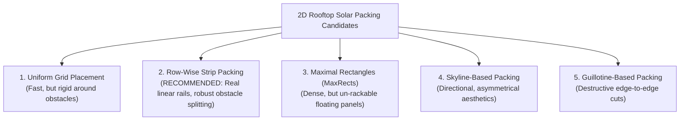

# SolarSelect — Phase 7, Prompt 1: Requirements & Engineering Design Report

**Project:** SolarSelect — An End-to-End MLOps System for AI-Driven Rooftop Solar Selection and Yield Forecasting  
**Phase:** Phase 7 — Roof-Fit and Panel Configuration Engine  
**Prompt Stage:** Prompt 1 of 2 (Requirements Specification & Architectural Design)  
**Date of Execution:** 2026-11-10  
**Phase 7 Status:** **`DESIGN / REQUIREMENTS IN PROGRESS`**  
**Phase 6 Status:** **`COMPLETE_WITH_DOCUMENTED_LIMITATIONS` (Preserved)**  

---

## 1. Executive Summary

Phase 6 established and closed the real commercial solar panel catalogue under the status **`COMPLETE_WITH_DOCUMENTED_LIMITATIONS`**, providing a verified 43-column hardware schema, automated validation tooling, and retained compiled reference summaries for 12 commercial photovoltaic modules across 6 semiconductor technologies.

We have now formally initiated **Phase 7: Roof-Fit and Panel Configuration Engine**. Phase 7 serves as the physical spatial configuration layer of SolarSelect Layer B. Its objective is to determine which catalogue modules and spatial arrangements can physically fit onto a defined rooftop surface, subject to geometric boundaries, installation setbacks, obstacle exclusions, and mounting clamp requirements.

In strict adherence to the project roadmap and prompt boundaries:
- **No engine implementation code was written.**
- **No packing algorithm execution code was created.**
- **Existing Phase 1–5 predictive pipelines, models, and Phase 6 catalogue values were preserved 100% unaltered.**
- A comprehensive repository-aware engineering investigation was completed, resulting in five formal engineering design specifications, two new Architectural Decision Records (`ADR-016`, `ADR-017`), three new risk register controls (`RSK-010` to `RSK-012`), and a new structural safety limitation (`LIM-014`).

---

## 2. Files Inspected & Existing Reusable Infrastructure

### Codebase Files Inspected
1. [`configs/panels_catalogue.csv`](../../configs/panels_catalogue.csv): Inspected physical dimensions (`length_mm`, `width_mm`, `thickness_mm`, `area_m2`, `weight_kg`) and electrical power (`rated_power_wp`, `stc_irradiance_w_m2`, `stc_cell_temperature_c`) across all 12 commercial records.
2. [`configs/panels_catalogue_schema.json`](../../configs/panels_catalogue_schema.json): Inspected group definitions, data types, physical constraints ($L > 0, W > 0$), and verification status strings.
3. [`src/validate_panel_catalogue.py`](../../src/validate_panel_catalogue.py): Inspected two-tier validation checks, tolerance bounds, and documentary scope notes.
4. [`docs/panel_catalogue/catalogue_inventory.md`](../../docs/panel_catalogue/catalogue_inventory.md): Inspected 12-module inventory, technology classifications, and discrepancy resolutions.
5. [`docs/decisions/decision_register.md`](../../docs/decisions/decision_register.md): Inspected ADR-001 through ADR-015 for design precedents.
6. [`docs/decisions/limitations_register.md`](../../docs/decisions/limitations_register.md): Inspected LIM-008 through LIM-013, specifically the compiled PDF format and source URL link rot boundaries.
7. [`docs/decisions/risk_register.md`](../../docs/decisions/risk_register.md): Inspected RSK-005 (Physical Roof Geometry Mismatch).
8. [`docs/project/system_architecture.md`](../../docs/project/system_architecture.md): Inspected Layer A / Layer B architectural separation.
9. [`docs/project/phase_completion_status.md`](../../docs/project/phase_completion_status.md) and [`README.md`](../../README.md).

### Existing Reusable Infrastructure
- **Hardware Parameters:** Dimensions in millimetres and power in Watts-peak are directly queryable by `panel_id` from [`configs/panels_catalogue.csv`](../../configs/panels_catalogue.csv).
- **Physical Bounds:** Module lengths range from $1650.0\text{ mm}$ (Trina 310W) to $2278.0\text{ mm}$ (Canadian Solar 575W, LONGi 580W); widths range from $992.0\text{ mm}$ to $1232.0\text{ mm}$; areas range from $1.6368\text{ m}^2$ to $2.5833\text{ m}^2$.
- **Validation Engine:** [`src/validate_panel_catalogue.py`](../../src/validate_panel_catalogue.py) ensures all input catalogue rows conform to schema boundaries before ingestion into Phase 7.

---

## 3. Requirements Established

The requirements specification was authored and committed to [`docs/engineering/phase7_requirements.md`](../../docs/engineering/phase7_requirements.md). Key requirements include:

1. **Functional Objectives (FR-001 to FR-010):**
   - Calculate maximum feasible panel count ($N_{\text{max}}$).
   - Evaluate orientation feasibility: Portrait ($W_m \parallel X, L_m \parallel Y$) and Landscape ($L_m \parallel X, W_m \parallel Y$).
   - Determine layout maximizing installed DC capacity ($P_{\text{DC}} = N \times P_{\text{STC}}$ in $\text{kW}_p$).
   - Compute full spatial breakdown: gross area, setback area, obstacle exclusion area, net usable area, occupied panel area, and remaining unutilized area.
   - Generate individual 2D bounding boxes $[(x_i, y_i, w_i, h_i)]$ referenced to the roof origin $(0,0)$.
2. **Four-Tier Parameter Classification:**
   - **Mandatory:** `roof_id`, `roof_length_m`, `roof_width_m`, `panel_id`.
   - **Configurable Simulation Defaults:** Perimeter setback ($S_{\text{edge}} = 0.50\text{ m}$, illustrative simulation default requiring site-specific validation), inter-panel clear spacing ($G_{\text{panel}} = 0.020\text{ m}$ / $20\text{ mm}$ clear gap, distinct from clamp hardware specs), inter-row clearance ($G_{\text{row}} = 0.050\text{ m}$ / $50\text{ mm}$ thermal/racking clearance, distinct from $\ge 0.6\text{–}1.0\text{ m}$ maintenance walkways modeled as dedicated exclusion corridors), obstacle clearance buffer ($B_{\text{obstacle}} = 0.20\text{ m}$, distinct from physical obstacle dimensions).
   - **Optional:** `roof_azimuth_deg`, `roof_pitch_deg`, `obstacles` list, `allowed_orientations`.
   - **Future Extensions:** Arbitrary polygon vertices, 3D LiDAR point clouds.
3. **Strict Geometric Invariants:**
   - Coordinate system: Cartesian $(X, Y)$ in metres, $(0,0)$ at bottom-left (South-West) corner.
   - Bare module envelope vs. effective installation footprint ($L_e = L_m + G_x, W_e = W_m + G_y$).
   - Boundary containment: $\forall i, \text{Panel}_i \subset \text{UsableRoofArea}$.
   - Non-overlap: $\forall i \neq j, \text{Area}(\text{Panel}_i \cap \text{Panel}_j) = 0$.
   - Obstacle exclusion: $\forall i, k, \text{Area}(\text{Panel}_i \cap \text{Obstacle}_k^{\text{buffered}}) = 0$.
   - Numerical tolerance: $\epsilon = 10^{-4}\text{ m}$ ($0.1\text{ mm}$).

---

## 4. Packing Algorithm Investigation & Selection

The algorithmic investigation was authored and committed to [`docs/engineering/phase7_algorithm_comparison.md`](../../docs/engineering/phase7_algorithm_comparison.md). Five paradigms were formally evaluated:

### Algorithmic Evaluation Summary
- **Uniform Grid Placement:** Evaluates in $<0.1\text{ ms}$, but discards entire rows/columns when encountering small plumbing vents.
- **Maximal Rectangles (MaxRects):** High theoretical packing ratio, but places isolated "floating" panels requiring fragmented mounting hardware, which drastically increases balance-of-system (BOS) installation costs.
- **Skyline & Guillotine:** Ill-suited for solar arrays due to directional gravity bias and edge-to-edge partition cuts around small obstacles.
- **Row-Wise Strip Packing with Obstacle Interruption (SELECTED):**
  - Directly models continuous aluminum racking rails (e.g. Unirac, Clenergy).
  - Sweeps along the primary rail axis, interrupts strips upon encountering obstacles, applies clearance buffers, and resumes row placement if remaining length permits.
  - Highly efficient $O(R \cdot (C + K \log K))$ complexity (execution latency to be empirically benchmarked post-implementation), deterministic, and generates geometrically feasible collinear layouts under the supplied parameters.
  - **Heuristic Character & Terminology Discipline:** Row-Wise Strip Packing is a directional greedy heuristic; its packing density can be sensitive to row starting positions when complex obstacle geometries fragment strips. The engine generates geometrically feasible panel placements under the supplied roof geometry, module dimensions, clearances and obstacle assumptions. These results do not establish structural safety, regulatory compliance or installation approval. While the algorithm guarantees compliance with its implemented geometric constraints, it does not guarantee real-world installation feasibility or theoretical global maximum panel count. Output is formally designated as **`BEST_FEASIBLE_CONFIGURATION_FOUND`** rather than claiming unproven mathematical global optimality.

---

## 5. Input / Output Contract Design

The machine-readable contracts were authored and committed to [`docs/engineering/phase7_input_output_contract.md`](../../docs/engineering/phase7_input_output_contract.md):

- **Input Contract (`RoofSpecification`):** JSON schema validating gross dimensions, setbacks, inter-module clamp spacings, and internal obstacle lists.
- **Output Contract (`PanelConfigurationResult`):**
  - Selected orientation and feasibility status (`FEASIBLE`, `INFEASIBLE_ROOF_TOO_SMALL`, `INFEASIBLE_SETBACKS_EXCEED_ROOF`, etc.).
  - Panel count ($N$) and installed DC capacity ($P_{\text{DC}} = N \times P_{\text{STC}} / 1000\text{ kW}_p$).
  - Spatial metrics: gross area, setback area, obstacle exclusion area, usable area, occupied panel area, unutilized area, roof utilization factor, and packing efficiency.
  - Exact 2D bounding boxes: $[(x_i, y_i, w_i, h_i, \text{row\_id}, \text{col\_id})]$.
  - Orientation comparison: records feasible panel counts and capacity for both Portrait and Landscape.
  - Constraint violations list and engine metadata.
- **Phase 8 Consumption:** Phase 8 directly scales daily energy generation by multiplying Phase 5 predicted yield ($Y_f$) by the Phase 7 installed capacity ($P_{\text{DC}}$):
  $$\text{Daily Energy (kWh/day)} = Y_f \times P_{\text{DC}}$$

---

## 6. Testing Strategy & Verification Framework

The testing framework was authored and committed to [`docs/engineering/phase7_testing_strategy.md`](../../docs/engineering/phase7_testing_strategy.md). The testing framework defines **20 distinct test cases** (`TC-001` through `TC-015`, including five specialized edge/suite cases `TC-005A`, `TC-007A`, `TC-008A`, `TC-008B`, and `TC-010A`) spanning 125 individual test executions across parameter variations and determinism loops:

1. `TC-001`: Roof too small for any module ($N=0$, `INFEASIBLE_ROOF_TOO_SMALL`).
2. `TC-002`: Exact-fit roof ($N=1$, zero boundary slack).
3. `TC-003`: Portrait-only feasibility (dimensions accommodate portrait but fail landscape).
4. `TC-004`: Landscape-only feasibility (dimensions accommodate landscape but fail portrait).
5. `TC-005`: Both orientations feasible (selects layout maximizing $P_{\text{DC}}$, records alternative).
6. `TC-005A`: Row starting position sensitivity check (verifies heuristic determinism across sweep directions without claiming global optimality).
7. `TC-006`: Multi-row and multi-column packing on clear rectangular roof ($N \times M$ grid).
8. `TC-007`: Perimeter edge setback enforcement (zero panels enter setback ring).
9. `TC-007A`: Configurable perimeter setback variation suite ($S \in \{0.0, 0.3, 0.5, 1.0\}\text{ m}$).
10. `TC-008`: Central obstacle avoidance (plumbing vent cleanly splits row).
11. `TC-008A`: Separation of physical obstacle dimensions and clearance buffer ($w, h$ vs $B$).
12. `TC-008B`: Dedicated maintenance walkway corridor exclusion (walkway dimension is an illustrative test input, not a universal statutory requirement; dimensions remain fully configurable).
13. `TC-009`: Edge/corner obstacle avoidance (boundary obstacle handled without layout collapse).
14. `TC-010`: Inter-panel clear spacing verification ($G_{\text{panel}} \ge 0.020\text{ m}$).
15. `TC-010A`: Configurable clear spacing variation suite ($G_{\text{panel}} \in \{0.010, 0.020, 0.035\}\text{ m}$).
16. `TC-011`: Inter-row clearance verification ($G_{\text{row}} \ge 0.050\text{ m}$).
17. `TC-012`: Pairwise non-overlap invariant ($\forall i \neq j, \text{Area}(R_i \cap R_j) = 0$).
18. `TC-013`: Missing catalogue dimensions handling (raises `MissingPanelDimensionError`).
19. `TC-014`: Invalid roof geometry input (raises `InvalidRoofSpecificationError`).
20. `TC-015`: 100-run strict determinism check (bit-for-bit identical coordinate arrays).

---

## 7. Risks, Limitations & Architectural Decisions

### Architectural Decision Records Adopted
- **`ADR-016` (Geometric Coordinate Standards & Physical Separation of Concerns):** Adopted metres ($m, m^2$) and 2D Cartesian frame $(X, Y)$ with bottom-left origin. Strictly decoupled physical geometric fit from electrical inverter matching (Phase 8), specific yield prediction (Phase 5), and financial LCOE modeling (Phase 8).
- **`ADR-017` (Selection of Row-Wise Strip Packing with Obstacle Interruption):** Adopted row-wise placement to model continuous linear racking rail collinearity and avoid scattered, un-rackable geometric placements; generates geometrically feasible placements without claiming real-world installation approval.

### Risk Register Updates
- **`RSK-010` (Structural & Wind Load Omission):** Acknowledges that 2D geometric fit does not assess roof dead load ($kg/m^2$) or wind uplift. Controlled by embedding explicit engineering disclaimer in engine output.
- **`RSK-011` (Inter-Row Tilt Shading & Pitch Sensitivity):** Flush mounting assumes zero intra-row shading. Tilted flat roofs require dynamic pitch calculations in Phase 8 based on winter solstice sun angles.
- **`RSK-012` (Statutory Clearance & Fire Walkway Non-Compliance):** Provided configurable perimeter setbacks ($S_{\text{edge}} = 0.50\text{ m}$ simulation default) and distinct obstacle/walkway definitions, while requiring site-specific verification by licensed professionals.

### Limitations Register Updates
- **`LIM-014` (2D Planar Geometric Scope & Structural/Wind Safety Disclaimer):** Formally documents that Phase 7 configurations represent spatial feasibility estimates only; initial engine does not certify fire-code compliance, wind-load limits, or civil structural safety. Physical installations require independent certified civil structural engineering and licensed electrical contractor approval.

---

## 8. Files Created or Modified

### Design Deliverables Created (docs/engineering/)
1. [`docs/engineering/phase7_requirements.md`](../../docs/engineering/phase7_requirements.md)
2. [`docs/engineering/phase7_architecture.md`](../../docs/engineering/phase7_architecture.md)
3. [`docs/engineering/phase7_algorithm_comparison.md`](../../docs/engineering/phase7_algorithm_comparison.md)
4. [`docs/engineering/phase7_input_output_contract.md`](../../docs/engineering/phase7_input_output_contract.md)
5. [`docs/engineering/phase7_testing_strategy.md`](../../docs/engineering/phase7_testing_strategy.md)

### Living Registers & Tracking Updated
6. [`docs/decisions/decision_register.md`](../../docs/decisions/decision_register.md) (Appended ADR-016 and ADR-017)
7. [`docs/decisions/risk_register.md`](../../docs/decisions/risk_register.md) (Appended RSK-010 to RSK-012)
8. [`docs/decisions/limitations_register.md`](../../docs/decisions/limitations_register.md) (Appended LIM-014)
9. [`docs/project/phase_completion_status.md`](../../docs/project/phase_completion_status.md) (Updated Phase 7 to `DESIGN / REQUIREMENTS IN PROGRESS`)
10. [`README.md`](../../README.md) (Updated status badge and roadmap table to `DESIGN / REQUIREMENTS IN PROGRESS`)
11. [`log.txt`](../../log.txt) (Appended Session 37)
12. [`reports/phase7/phase7_prompt1_requirements_design_report.md`](phase7_prompt1_requirements_design_report.md) (This milestone report)

---

## 9. Decisions Requiring Approval for Phase 7 Prompt 2

Before executing the implementation in Prompt 2, the following design decisions are recorded for stakeholder awareness:
1. **Inter-Panel Clear Spacing Default ($20\text{ mm}$):** Standard module-to-module clear spacing is set to $0.020\text{ m}$ (as an illustrative simulation default, configurable per mounting system clamp specifications).
2. **Perimeter Setback Default ($0.50\text{ m}$):** Standard perimeter clearance is set to $0.50\text{ m}$ ($500\text{ mm}$) as an illustrative simulation default, requiring site-specific verification by licensed professionals.
3. **Maintenance Walkways via Dedicated Corridors:** Real maintenance walkways ($\ge 0.6\text{–}1.0\text{ m}$) are explicitly decoupled from inter-row racking clearance and modeled as dedicated exclusion corridors.
4. **Pure Orthogonal Racking:** Modules will be aligned strictly parallel to roof edges (no diagonal or free-angle rotation in Prompt 2).
5. **Catalogue Ingestion Policy:** Only catalogue records with non-null `length_mm` and `width_mm` will be processed. Missing dimensions will raise `MissingPanelDimensionError`.

---

## 10. Confirmation of Strict Boundaries

- **Zero engine implementation code was written.**
- **Zero packing algorithm code was executed.**
- **Zero modifications were made to Phase 1–5 datasets, pipelines, or model artifacts.**
- **Zero modifications were made to Phase 6 catalogue values, schemas, or reference PDFs.**
- **Zero Phase 8 financial or yield recommendation code was created.**
- **Phase 7 status is strictly recorded as: `DESIGN / REQUIREMENTS IN PROGRESS`.**

