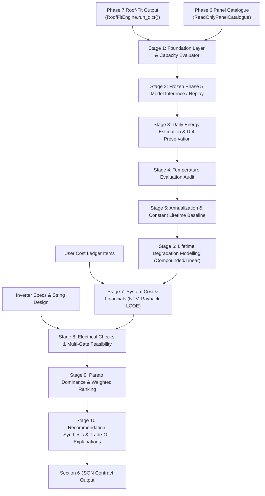

# SolarSelect — Phase 8: Energy, Economics and Recommendation Engine — Final Validation & Formal Closure Report

**Project:** SolarSelect  
**Lifecycle Stage:** Phase 8 — Energy, Economics and Recommendation Engine  
**Final Status:** `COMPLETE_WITH_DOCUMENTED_LIMITATIONS`  
**Closure Session:** Session 72  
**Date:** 2026-11-11  
**Author:** SolarSelect Engineering Team  

---

## 1. Executive Summary

This report establishes the final integration verification, mathematical consistency review, automated test audit, and formal engineering closure of **Phase 8 — Energy, Economics and Recommendation Engine** of Project SolarSelect.

- **Phase Objective:** Couple predicted daily solar specific yield ($kWh/kWp$) from Layer A (Phase 5) with verified commercial panel records from Phase 6 and physically feasible 2D rooftop array layouts from Layer B (Phase 7) to estimate daily and annual energy generation, model 25-year lifetime physical degradation, compute lifecycle financial metrics ($LCOE$, $NPV$, simple/discounted payback), perform electrical and multi-gate feasibility filtering, and produce deterministic multi-objective Pareto and weighted recommendations with transparent trade-off explanations.
- **Ten-Stage Modular Delivery:** Delivered across 10 cleanly decoupled stages in [`src/energy_economics/`](../../src/energy_economics/) unified behind the top-level orchestration entry point [`EnergyEconomicsEngine`](../../src/energy_economics/engine.py):
  1. *Foundation & Ingestion:* [`foundation.py`](../../src/energy_economics/foundation.py), [`capacity_evaluator.py`](../../src/energy_economics/capacity_evaluator.py), [`phase7_adapter.py`](../../src/energy_economics/phase7_adapter.py), [`catalogue.py`](../../src/energy_economics/catalogue.py).
  2. *Inference & Historical Replay:* [`inference.py`](../../src/energy_economics/inference.py), [`historical_replay.py`](../../src/energy_economics/historical_replay.py).
  3. *Energy Estimation:* [`energy_engine.py`](../../src/energy_economics/energy_engine.py).
  4. *Temperature Evaluation:* [`reports/phase8/phase8_stage4_temperature_evaluation_report.md`](./phase8_stage4_temperature_evaluation_report.md).
  5. *Annualization & Lifetime Baseline:* [`annualization.py`](../../src/energy_economics/annualization.py).
  6. *Degradation Modelling:* [`degradation.py`](../../src/energy_economics/degradation.py).
  7. *System Cost & Financials:* [`system_cost.py`](../../src/energy_economics/system_cost.py), [`financial.py`](../../src/energy_economics/financial.py).
  8. *Electrical Compatibility & Feasibility:* [`electrical.py`](../../src/energy_economics/electrical.py), [`feasibility.py`](../../src/energy_economics/feasibility.py).
  9. *Pareto & Weighted Ranking:* [`pareto.py`](../../src/energy_economics/pareto.py), [`weighted_ranking.py`](../../src/energy_economics/weighted_ranking.py).
  10. *Recommendation & Explanations:* [`recommendation.py`](../../src/energy_economics/recommendation.py).
- **Verification Evidence:** 105 Phase 8 automated test items and 126 Phase 7 regression test items executed across the repository with a **100% pass rate** (231 passed, 0 failed, 0 skipped in 3.56s). Read-only catalogue integrity re-verified with 0 critical errors and 0 engineering warnings.
- **Preservation Check:** Zero modifications to completed Phase 1–5 datasets, preprocessing pipelines, or frozen ML model artifacts; zero modifications to Phase 6 catalogue CSV records, schema, validation scripts, or compiled PDF datasheets; zero modifications to Phase 7 geometry and placement engine code.
- **Closure Decision:** The software implementation of Phase 8 is formally closed with status:
  $$\mathbf{COMPLETE\_WITH\_DOCUMENTED\_LIMITATIONS}$$

---

## 2. Stage-by-Stage Closure Table

| Stage | Stage Title | Main Implementation Module | Test Suite & Test Count | Verification Status | Operational Blockers & Preserved Limitations |
|---|---|---|---|---|---|
| **Stage 1** | Foundation & Capacity Support | [`foundation.py`](../../src/energy_economics/foundation.py), [`capacity_evaluator.py`](../../src/energy_economics/capacity_evaluator.py) | `test_phase8_foundation.py` (19 tests) | **VERIFIED** | Marginal capacity support only; does not establish joint 29-feature validity. Out-of-range systems ($< 21.39$ or $> 539.80\text{ kWp}$) quarantined. |
| **Stage 2** | Frozen Phase 5 Inference & Replay | [`inference.py`](../../src/energy_economics/inference.py), [`historical_replay.py`](../../src/energy_economics/historical_replay.py) | `test_phase8_stage2_inference_and_replay.py` (21 tests) | **VERIFIED** | In-sample vs out-of-sample temporal partitioning strictly enforced. Prospective roofs blocked under B-2 (`PREDICTION_PENDING_LAG_POLICY`). |
| **Stage 3** | Energy Estimation & D-4 Handling | [`energy_engine.py`](../../src/energy_economics/energy_engine.py) | `test_phase8_stage3_energy_estimation.py` (14 tests) | **VERIFIED** | Decision D-4: Raw negative predictions preserved unclipped; negative values excluded from accepted energy totals. B-1 metering basis unconfirmed (`UNVERIFIED_ASSUMED_AC`). |
| **Stage 4** | Temperature Evaluation Audit | [`phase8_stage4_temperature_evaluation_report.md`](./phase8_stage4_temperature_evaluation_report.md) | Methodology audit & review | **VERIFIED** | Method A uses existing model output. Method B disabled unless contemporaneous cell temperature and baseline fleet coefficients are available. |
| **Stage 5** | Annualization & Lifetime Baseline | [`annualization.py`](../../src/energy_economics/annualization.py) | `test_phase8_stage5_and_stage6.py` (23 tests) | **VERIFIED** | Observation period (358 days, 11.7 months) is not scaled to 365 days; D-5 monthly annualization remains unapproved; constant baseline forbids degradation or discounting. |
| **Stage 6** | Degradation Modelling | [`degradation.py`](../../src/energy_economics/degradation.py) | `test_phase8_stage5_and_stage6.py` (included above) | **VERIFIED** | Compounded degradation labeled original specification; linear labeled alternative modeling assumption. Configurable negative degradation policy bound ($d \ge -0.05$). |
| **Stage 7** | System Cost & Financials | [`system_cost.py`](../../src/energy_economics/system_cost.py), [`financial.py`](../../src/energy_economics/financial.py) | `test_phase8_stage7_and_stage8.py` (13 tests) | **VERIFIED** | Itemized CAPEX/OPEX ledger, $S_{\text{up}} \le C_{\text{gross}}$, NPV, fractional payback, net/gross LCOE. Catalogue panel prices unpopulated; requires user cost inputs. |
| **Stage 8** | Electrical Compatibility & Feasibility | [`electrical.py`](../../src/energy_economics/electrical.py), [`feasibility.py`](../../src/energy_economics/feasibility.py) | `test_phase8_stage7_and_stage8.py` (included above) | **VERIFIED** | 8 physical engineering checks. Inverter catalogue unpopulated; real candidates evaluate strictly to `NOT_EVALUATED_INSUFFICIENT_SPECIFICATIONS`. Hard filters enforced. |
| **Stage 9** | Pareto & Weighted Ranking | [`pareto.py`](../../src/energy_economics/pareto.py), [`weighted_ranking.py`](../../src/energy_economics/weighted_ranking.py) | `test_phase8_stage9_and_stage10.py` (15 tests) | **VERIFIED** | Scale-free 2-objective Pareto peeling ($E_1$ vs LCOE/NPV/CAPEX), capacity quarantine annex, min-max weighted scoring with bound provenance and no default weights. |
| **Stage 10** | Recommendation & Explanations | [`recommendation.py`](../../src/energy_economics/recommendation.py), [`engine.py`](../../src/energy_economics/engine.py) | `test_phase8_stage9_and_stage10.py` (included above) | **VERIFIED** | Synthesizes Pareto and weighted ranks; explains consensus vs divergent trade-offs; attaches B-1, B-2, pricing, and electrical caveats; enforces `RECOMMENDATION_NOT_EVALUATED`. |

---

## 3. Integration Architecture and Public APIs

### A. Data Flow Sequence
The engine coordinates the ten logical stages through a deterministic, strictly ordered pipeline:



### B. Public Orchestration API ([`src/energy_economics/engine.py`](../../src/energy_economics/engine.py))
The top-level orchestrator provides two primary public execution methods:

1. **`EnergyEconomicsEngine.evaluate_configuration(...)`**:
   Evaluates a single Phase 7 candidate layout through Stages 1 through 8:
   - Validates input geometry via [`Phase7Adapter`](../../src/energy_economics/phase7_adapter.py) (preserving identifiers, panel count, installed kWp).
   - Ingests energy reference or flags `PREDICTION_PENDING_LAG_POLICY` under Decision B-2.
   - Calculates constant lifetime baseline and evaluates lifetime degradation.
   - Computes gross/net CAPEX, cash flows, simple/discounted payback, and LCOE.
   - Evaluates 8 physical electrical checks and executes 7-gate sequential feasibility filtering.
   - Returns a canonical candidate dictionary conforming to Section 6 schema.

2. **`EnergyEconomicsEngine.run(...)`**:
   Executes multi-candidate ranking and recommendation synthesis (Stages 9 and 10):
   - Computes scale-free Pareto dominance frontiers (Frontier 1, Frontier 2, ...).
   - Computes min-max normalized weighted scores if user weights are supplied.
   - Synthesizes recommendations across `pareto`, `weighted`, `energy_only`, or `none` bases.
   - Formulates transparent explanation narratives distinguishing consensus from divergent trade-offs.
   - Emits contract-compliant Section 6 JSON dictionaries with full provenance metadata.

---

## 4. Mathematical and Scientific Consistency Review

### A. Energy Estimation and D-4 Negative Yield Preservation
- Specific yield ($kWh/kWp/day$) predicted by the frozen Phase 5 peer-cohort model is multiplied by installed DC capacity ($kWp$) exactly once:
  $$E_{\text{daily}} = y_{\text{predicted}} \times P_{DC} \quad [\text{kWh}]$$
- In accordance with Decision D-4, non-physical negative predictions ($y < 0$) are **not clipped** in mathematical storage. They are flagged with `NEGATIVE_PREDICTION_WARNING` and strictly excluded from accepted positive energy sums ($E_{\text{accepted}} = 0.0$).
- The partial UNISOLAR observation window (358 calendar dates, 11.7 months) is strictly preserved without invalid 365-day scaling. Decision D-5 monthly coverage-adjusted annualization remains unapproved.

### B. Degradation Formulation and Governance
- Compounded degradation is implemented as the normative specification formula:
  $$E_t = E_1 \times (1 - d)^{t - 1}$$
- Linear degradation ($E_t = E_1 \times [1 - d(t - 1)]$) is retained and explicitly labeled `ALTERNATIVE_MODELLING_ASSUMPTION` with a physical positivity check ($1 - d(L - 1) > 0$).
- Negative degradation ($d < 0$) is permitted only under user-specified empirical assumptions with mandatory documentation and automatically emits `EXTRAPOLATED_BEYOND_WARRANTY`. The lower bound is governed by a configurable policy bound ($d \ge -0.05$).
- Catalogue warranty degradation rates are explicitly documented as minimum guaranteed thresholds rather than measured empirical fleet degradation.

### C. Financial Evaluation (CAPEX, OPEX, NPV, Payback, LCOE)
- CAPEX accounting strictly separates gross expenditure, upfront subsidies, and net outlay:
  $$C_{\text{gross}} = \sum_k q_k u_k, \quad C_{\text{net}} = C_{\text{gross}} - S_{\text{up}}, \quad S_{\text{up}} \le C_{\text{gross}}$$
  Initial CAPEX enters the cash flow ledger exactly once at $t = 0$ ($CF_0 = -C_{\text{net}}$).
- Net Present Value ($NPV$) discounted at real/nominal rate $r \ge 0$:
  $$NPV = \sum_{t=0}^L \frac{CF_t}{(1 + r)^t}$$
- Simple and discounted payback periods use exact cumulative recovery integer year detection with linear fractional-year interpolation:
  $$\text{Payback} = (T - 1) + \frac{-\sum_{t=0}^{T-1} CF_t}{CF_T}$$
- Levelized Cost of Energy ($LCOE$) requires an explicit basis selection (`net` or `gross`):
  $$\text{LCOE} = \frac{C_0 + \sum_{t=1}^L (O_t + Rp_t)(1 + r)^{-t} - V_L(1 + r)^{-L}}{\sum_{t=1}^L E_t (1 + r)^{-t}} \quad [\text{AUD/kWh}]$$
  Revenues, feed-in tariffs, and self-consumption bill savings are strictly excluded from LCOE.

### D. Electrical Compatibility
Evaluates 8 physical engineering checks based on component temperature coefficients:
1. `panel_count_consistency`: $n_s \times n_{\text{strings}} = N_{\text{panels}}$.
2. `max_string_voltage_cold`: $V_{oc,\text{cold}} = n_s V_{oc} [1 + \beta_{Voc}(T_{\text{min}} - 25)] \le \min(V_{dc,\text{max}}, V_{sys,\text{max}})$.
3. `mppt_upper_voltage_cold`: $n_s V_{mp}(T_{\text{min}}) \le V_{\text{mppt,max}}$.
4. `mppt_lower_voltage_hot`: $n_s V_{mp}(T_{\text{hot}}) \ge V_{\text{mppt,min}}$.
5. `mppt_input_current`: $n_{\text{par}} I_{mp} \le I_{\text{max,mppt}}$.
6. `mppt_short_circuit_current`: $n_{\text{par}} I_{sc}(T_{\text{max}}) \le I_{sc,\text{max,mppt}}$.
7. `series_fuse_rating`: $(n_{\text{par}} - 1) I_{sc} \le I_{\text{fuse,max}}$.
8. `dc_input_power_capacity`: $N P_{\text{STC}} \le P_{dc,\text{max}}$, with advisory DC/AC ratio reporting.

Generic, unstated safety multipliers (e.g. arbitrary 1.25 factors) are eliminated in favor of direct physical temperature modeling. Missing specifications evaluate strictly to `NOT_EVALUATED_INSUFFICIENT_SPECIFICATIONS`.

---

## 5. Feasibility Filtering and Recommendation Consistency

### A. Multi-Gate Feasibility Hierarchy
Candidates pass through 7 ordered evaluation gates:
1. Geometric Feasibility (`FEASIBLE` | `INFEASIBLE`)
2. Catalogue Validity (`VALID` | `INVALID`)
3. Marginal Capacity Support (`CAPACITY_ELIGIBLE`, `CAPACITY_FLAGGED_SPARSE`, `CAPACITY_INELIGIBLE_OUT_OF_RANGE`)
4. Prediction Availability (`PREDICTION_AVAILABLE`, `PREDICTION_PENDING_LAG_POLICY`, `PREDICTION_UNAVAILABLE`)
5. Electrical Compatibility (`COMPATIBLE`, `INCOMPATIBLE`, `NOT_EVALUATED_INSUFFICIENT_SPECIFICATIONS`)
6. Economic Feasibility (`PASS`, `FAIL`, `NOT_EVALUATED_MISSING_COSTS`)
7. Overall Recommendation Eligibility:
   - Failure of ANY hard gate $\implies$ `RECOMMENDATION_INELIGIBLE` (with `first_failed_stage` logged).
   - Any mandatory gate unevaluated $\implies$ `RECOMMENDATION_NOT_EVALUATED`.
   - All mandatory gates pass + sparse capacity $\implies$ `RECOMMENDATION_FLAGGED`.
   - All mandatory gates pass + eligible capacity $\implies$ `RECOMMENDATION_ELIGIBLE`.

### B. Ranking Eligibility and Missing Data Safeguards
- **Pareto Ranking:** Primary Pareto ranking is strictly restricted to candidates with `RECOMMENDATION_ELIGIBLE` or `RECOMMENDATION_FLAGGED`. Unsupported capacities ($< 21.39$ or $> 539.80\text{ kWp}$) are isolated into an exploratory quarantine annex. Missing objectives receive `NOT_COMPARABLE_MISSING_OBJECTIVE` without synthetic zero imputation.
- **Weighted Ranking:** Min-max normalized scoring ($z_k \in [0, 1]$). Equal candidate bounds assign neutral score $1.0$ (zero discrimination). Candidates lacking any required criterion are excluded (`EXCLUDED_MISSING_CRITERION`) without per-candidate weight re-normalization.
- **Recommendation Synthesis:** If all candidates are ineligible or unevaluated, the engine returns `NONE_ELIGIBLE` or `RECOMMENDATION_NOT_EVALUATED` with explicit blocker explanations.

---

## 6. Test Evidence and Regression Results

Automated regression testing was executed using `pytest` across all Phase 8 test suites and the complete repository:

### Command Invocations and Results
1. **Phase 8 Comprehensive Suite:**
   ```bash
   pytest -v tests/test_phase8_*.py
   ```
   - `test_phase8_foundation.py`: 19 passed
   - `test_phase8_stage2_inference_and_replay.py`: 21 passed
   - `test_phase8_stage3_energy_estimation.py`: 14 passed
   - `test_phase8_stage5_and_stage6.py`: 23 passed
   - `test_phase8_stage7_and_stage8.py`: 13 passed
   - `test_phase8_stage9_and_stage10.py`: 15 passed
   - **Result:** **105 passed, 0 failed, 0 skipped** in 3.65s.

2. **Phase 7 Placement & Geometry Regression Suite:**
   ```bash
   pytest -v tests/test_roof_fit_*.py tests/test_placement_engine.py
   ```
   - `test_roof_fit_foundation.py`: 70 passed
   - `test_placement_engine.py`: 32 passed
   - `test_roof_fit_integration.py`: 24 passed
   - **Result:** **126 passed, 0 failed, 0 skipped** in 0.84s.

3. **Complete Repository Test Suite:**
   ```bash
   pytest -q tests/
   ```
   - **Result:** **231 passed, 0 failed, 0 skipped** in 3.56s (100% pass rate).

4. **Phase 6 Catalogue Integrity Audit:**
   ```bash
   python3 src/validate_panel_catalogue.py
   ```
   - **Result:** 0 Critical Errors, 0 Engineering Warnings (`PASS_AUTOMATED_WITH_CANDIDATE_CAMPUS_MAPPINGS`).

---

## 7. Real-Data Evaluation vs Synthetic Integration

| Evaluation Scenario | Input Nature | Execution Pipeline | Observed Engine Verdict | Governance & Integrity Assessment |
|---|---|---|---|---|
| **Historical UNISOLAR Replay** | Empirical telemetry from 22 peer-cohort sites (May 2021–Apr 2022). | Stage 2 Replay $\to$ Stage 3 Estimation $\to$ Stage 5 Annualization. | Verified specific yields ($kWh/kWp/day$), in-sample vs out-of-sample partitions. | Validated replay baseline. `energy_basis` remains `UNVERIFIED_ASSUMED_AC` under B-1. |
| **Real Prospective Roof** | Phase 7 geometric layout (e.g. 5.28 kWp residential or 35 kWp commercial) using Phase 6 catalogue panels. | Full `EnergyEconomicsEngine` pipeline. | `RECOMMENDATION_NOT_EVALUATED` (Prediction blocked under B-2, electrical blocked on missing inverters, financial blocked on missing panel pricing). | **Scientifically Honest:** Engine strictly refuses to fabricate missing lag features, synthetic commercial prices, or unverified inverter specs. |
| **Controlled Synthetic Scenario** | Fully specified synthetic test fixture with explicit annual energy, cost ledger, inverter specs, and string designs. | Complete 10-stage pipeline via `EnergyEconomicsEngine.evaluate_configuration()` and `.run()`. | `RECOMMENDATION_ELIGIBLE` with complete Pareto frontier peeling, weighted scoring, and consensus trade-off explanation. | **Mathematically Verified:** Proves that when all required engineering inputs exist, all ten stages execute flawlessly and generate compliant Section 6 output schemas. |

---

## 8. Known Limitations and Operational Blockers Register

1. **Decision B-1 (AC vs DC Net Metering Semantics):** Historical training target generation cannot be confirmed as pure AC inverter output versus DC string output. Energy estimates carry `energy_basis = "UNVERIFIED_ASSUMED_AC"` and `WARNING_B1_UNVERIFIED_AC_DC_METERING`.
2. **Decision B-2 (Prospective Roof Lag Yield Policy):** 12 of the 29 Phase 5 model features depend on empirical historical generation. Prospective unbuilt roofs lack generation history and evaluate strictly to `PREDICTION_PENDING_LAG_POLICY`.
3. **Decision D-2 (Meteorological Feature Source):** The repository does not include an external weather API or satellite irradiance service for arbitrary user locations.
4. **Decision D-4 (Model Negative Predictions):** Negative specific yield predictions are unclipped in mathematical storage but excluded from accepted positive energy totals.
5. **Decision D-5 (Annualization & Coverage Thresholds):** Partial observation periods (358 calendar dates) are not scaled to 365 days; monthly coverage annualization remains unapproved.
6. **Phase 6 Catalogue Pricing:** Commercial panel procurement pricing (AUD/W) is unpopulated in the catalogue. Financial calculations require explicit user-supplied cost ledger entries.
7. **Phase 6 Inverter Database:** The catalogue contains module records but lacks matched central/string inverter specifications, preventing automated electrical compatibility sign-off for prospective candidates without user-supplied inverter datasheets.
8. **Geographical Transferability:** The Phase 5 ML model was trained on a single Melbourne campus (lat -37.718, lon 145.051) over 11.7 months. Predictions for other climates carry `UNVALIDATED_GEOGRAPHY`.
9. **Marginal Training Capacity Distribution:** 86.4% of training installations cluster between 21.39 and 100 kWp. Residential-scale arrays ($< 21.39\text{ kWp}$) and utility-scale systems ($> 539.80\text{ kWp}$) fall into `OUT_OF_TRAINING_RANGE` and are quarantined from primary recommendation frontiers.

---

## 9. Protected Asset Preservation Check

Throughout the design, implementation, and verification of Phase 8:
- **Phase 1–5 Assets:** Zero modifications to raw datasets (`data/raw/`), processed datasets (`data/processed/`), training notebooks (`notebooks/`), and frozen model joblib artifacts (`models/phase5/final/`).
- **Phase 6 Catalogue:** Zero modifications to catalogue records (`configs/panels_catalogue.csv`), canonical JSON schema (`configs/panels_catalogue_schema.json`), compiled specification summaries (`data/reference/panel_datasheets/`), or validation tooling (`src/validate_panel_catalogue.py`).
- **Phase 7 Geometry:** Zero modifications to geometric algorithms, placement engines, or tests in `src/roof_fit/` and `tests/test_roof_fit_*.py`.
- **Roadmap Boundary:** Zero Phase 9 (REST API / Streamlit serving) or Phase 10 (Evidently drift monitoring / CI/CD retraining) code has been introduced.

---

## 10. Formal Phase 8 Closure Decision

### A. Software Implementation Closure
The software implementation of Phase 8 is declared **COMPLETE**:
- All ten logical stages are implemented with modular, documented source code.
- Public APIs and data contracts are verified across all 10 stages.
- The top-level orchestrator (`EnergyEconomicsEngine`) integrates the entire pipeline end-to-end.
- Mathematical formulations pass all unit, integration, and property tests (105 Phase 8 tests, 231 repository tests, 0 failures).
- Output JSON serialization strictly conforms to the Section 6 Output Schema Contract.

### B. Real-World Recommendation Readiness
Real-world recommendation readiness remains **RESTRICTED WITH DOCUMENTED LIMITATIONS**:
- Real prospective roof installations cannot receive a certified, deployable recommendation until upstream decisions B-1 (metering point) and B-2 (prospective lag policy) are resolved, and commercial procurement pricing and inverter specifications are supplied.
- Returning `RECOMMENDATION_NOT_EVALUATED` for prospective roofs is the scientifically honest, compliant, and defensible engineering verdict.

### Formal Acceptance Verdict
Phase 8 is formally closed on the SolarSelect project lifecycle roadmap with status:
$$\mathbf{PHASE\ 8\ —\ COMPLETE\_WITH\_DOCUMENTED\_LIMITATIONS}$$

