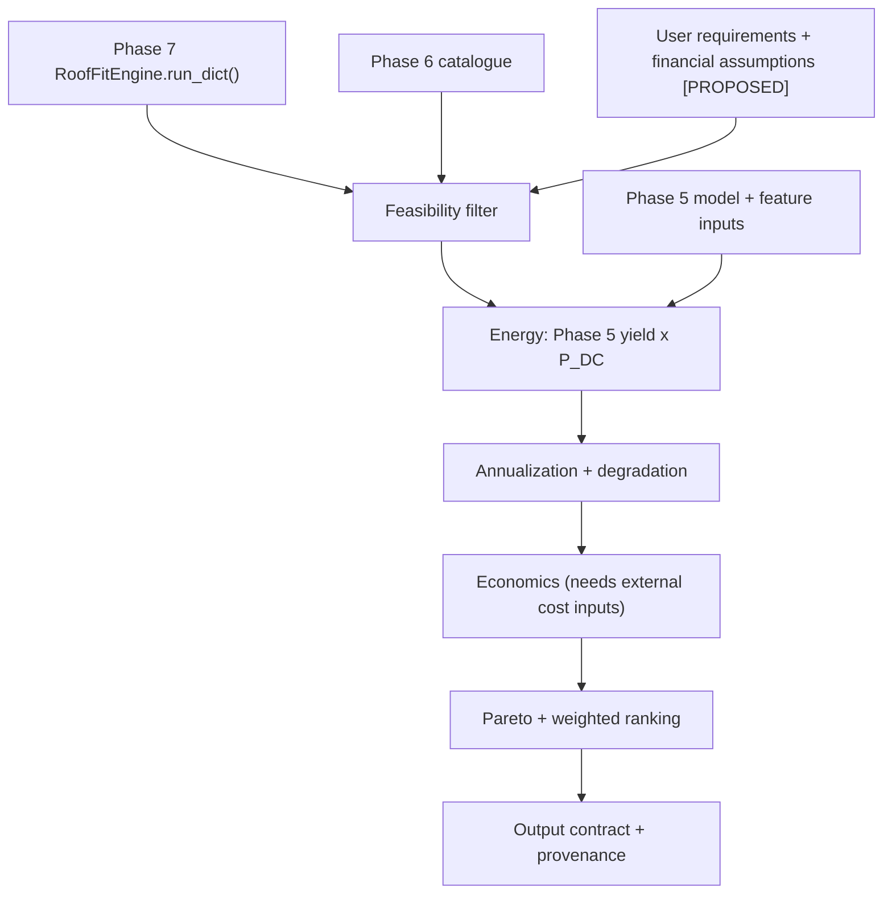

# Phase 8 — Energy, Economics and Recommendation Engine: Mathematical Specification and I/O Contract

**Project:** SolarSelect  
**Lifecycle Stage:** Phase 8 — Mathematical Specification, I/O Contract & Implementation Architecture  
**Status:** `IMPLEMENTED_WITH_DOCUMENTED_LIMITATIONS`  
**Execution Context:** Implemented across Sessions 55–71; verified and formally validated in Session 72.  
**Evidence convention:** `[VERIFIED]` = inspected in the repository during this task. `[DOCUMENTED]` = asserted by a project document but not independently verifiable from raw sources. `[UNRESOLVED]` = could not be established. `[PROPOSED]` = original Phase 8 design element, now implemented and verified in `src/energy_economics/`.

**Implementation and Validation Reports:**
- Stage 1 Foundation: [`reports/phase8/phase8_stage1_foundation_report.md`](./phase8_stage1_foundation_report.md)
- Stage 2 Inference & Replay: [`reports/phase8/phase8_stage2_historical_replay_report.md`](./phase8_stage2_historical_replay_report.md)
- Stage 3 Energy Estimation: [`reports/phase8/phase8_stage3_energy_estimation_report.md`](./phase8_stage3_energy_estimation_report.md)
- Stage 4 Temperature Evaluation: [`reports/phase8/phase8_stage4_temperature_evaluation_report.md`](./phase8_stage4_temperature_evaluation_report.md)
- Stage 5 Annualization Methodology: [`reports/phase8/phase8_stage5_annualization_lifetime_methodology_report.md`](./phase8_stage5_annualization_lifetime_methodology_report.md)
- Stage 5 Implementation Plan: [`reports/phase8/phase8_stage5_implementation_plan.md`](./phase8_stage5_implementation_plan.md)
- Stage 5–6 Implementation: [`reports/phase8/phase8_stage5_stage6_implementation_report.md`](./phase8_stage5_stage6_implementation_report.md)
- Stage 7–8 Implementation: [`reports/phase8/phase8_stage7_stage8_implementation_report.md`](./phase8_stage7_stage8_implementation_report.md)
- Stage 9–10 Implementation: [`reports/phase8/phase8_stage9_stage10_implementation_report.md`](./phase8_stage9_stage10_implementation_report.md)
- Final Validation & Formal Closure: [`reports/phase8/phase8_final_validation_and_closure.md`](./phase8_final_validation_and_closure.md)

**Inspected repository evidence**
- Phase 5: [`final_model_metadata.json`](../../models/phase5/final_model_metadata.json), [`models/phase5/final/`](../../models/phase5/final/), [`reports/phase5/`](../phase5/), [`final_model_evaluation_and_generalization.ipynb`](../../notebooks/phase5/final_model_evaluation_and_generalization.ipynb), [`target_definition.md`](../../docs/machine_learning/target_definition.md), [`data_dictionary.md`](../../docs/data/data_dictionary.md), [`data_governance_and_provenance.md`](../../docs/data/data_governance_and_provenance.md), [`limitations_register.md`](../../docs/decisions/limitations_register.md), [`prepare_phase3_data.py`](../../src/prepare_phase3_data.py)
- Phase 6: [`panels_catalogue.csv`](../../configs/panels_catalogue.csv), [`panels_catalogue_schema.json`](../../configs/panels_catalogue_schema.json), [`docs/panel_catalogue/`](../../docs/panel_catalogue/), [`validate_panel_catalogue.py`](../../src/validate_panel_catalogue.py)
- Phase 7: [`engine.py`](../../src/roof_fit/engine.py), [`placement_engine.py`](../../src/roof_fit/placement_engine.py), [`serializer.py`](../../src/roof_fit/serializer.py), [`roof_validator.py`](../../src/roof_fit/roof_validator.py), [`catalogue_adapter.py`](../../src/roof_fit/catalogue_adapter.py), [`phase7_input_output_contract.md`](../../docs/engineering/phase7_input_output_contract.md), [`phase7_final_validation_and_closure.md`](../phase7/phase7_final_validation_and_closure.md)
- Project log: [`log.txt`](../../log.txt)

---

## 1. Purpose and Scope

Phase 8 will combine (a) predicted daily specific yield from Phase 5, (b) real panel records from Phase 6, and (c) geometrically feasible layouts from Phase 7 to estimate energy, lifecycle economics and a ranked recommendation. This document specifies mathematics, schemas, statuses and provenance. It does **not** implement anything, and it does not alter Phases 1–7. Phase 9 follows Phase 8; Phase 10 remains postponed until after Phase 9.

Non-claims: no financial return is promised; geometric feasibility is not electrical compatibility, structural approval or installation approval; no prices, tariffs, inverter specifications or installation costs are supplied by this document.

---

## 2. Architecture and Integration Boundaries



Boundaries:
1. Phase 8 consumes Phase 7 output as-is; it never re-runs placement logic or edits geometry.
2. Phase 8 reads the catalogue read-only. Missing values stay missing.
3. Phase 8 does not retrain or modify Phase 5 models.
4. Electrical compatibility, economics and geometry are three separate verdicts (§4.7).

---

## 3. Actual Inspected Contracts

### 3.1 Phase 5

| Item | Finding | Evidence |
|---|---|---|
| Final models | Peer cohort primary: `ExtraTreesRegressor` (`models/phase5/final/peer_cohort/final_extra_trees.joblib`); authorised fallback: 50/50 blend with `ElasticNet` (`final_elastic_net.joblib`). Full cohort primary: `ElasticNet`; fallback 70/30 ElasticNet/ExtraTrees blend. | [VERIFIED] metadata JSON; all four joblib files loaded, types confirmed |
| Model version identifier | No semantic version field exists. Only `evaluation_timestamp` `2026-11-10T08:45:00Z` in metadata and file hashes (not recorded). | [VERIFIED]; version ID is [UNRESOLVED] → Phase 8 must record artifact path + SHA-256 computed at run time |
| Inference interface | **No inference/prediction module or pipeline exists** (searched `src/`, `models/`, `notebooks/` for infer/predict). Models are bare scikit-learn estimators saved with joblib; prediction is done ad hoc in the notebook via `.predict(X[features])`. No saved preprocessing pipeline. | [VERIFIED] absence; interface is [UNRESOLVED] |
| Feature count / names | 29 features; `feature_names_in_` of loaded models matches `feature_space.predictive_feature_names` in metadata (listed in §6 Schema A). | [VERIFIED] |
| Documentation conflict | `data_dictionary.md` §4 lists different feature names (`day_sin`, `temp_rolling_mean_7d`, `has_valid_lag2`, …) from the actual model (`sin_doy`, `solar_noon_zenith_deg`, `lat`, `Lon`, `day_of_week`, …). The **model's `feature_names_in_` is authoritative**; the data dictionary is stale for features. | [VERIFIED] conflict |
| Target | `target_daily_yield` = Σ 96 fifteen-minute `SolarGeneration` kWh ÷ `kWp`, unit **kWh/kWp/day** (`prepare_phase3_data.py` L99–100; `target_definition.md`). Valid site-day: 96 intervals present and ≥26/28 core intervals non-null (09:00–15:45). NaN intervals are summed as zero (ASM-001, partially supported). | [VERIFIED] |
| Granularity / horizon | Daily, one value per site per calendar day. Weather features are lagged ≥24 h (`lag1_*`), i.e. day-ahead style. | [VERIFIED] |
| Geography | UNISOLAR Campus 1, Victoria, Australia (lat −37.718, lon 145.051 — **one location**). Training 2021-05-01→2021-12-31; validation 2022-01-01→2022-02-28; test 2022-03-01→2022-04-23. | [VERIFIED] |
| Test metrics (peer, N=1128) | ExtraTrees MAE 0.905, RMSE 1.070, R² 0.258, bias −0.1036 kWh/kWp/day (≈30.9 % of mean); blend MAE 0.8898, R² 0.2698. Persistence baseline MAE 1.0875. | [VERIFIED] metadata |
| Cohorts | Peer = 22 sites; Full = 24 sites incl. Site 19 and 24 (unverified anomalies). LIM-001: Site 19 "prohibited for panel recommendations". Phase 8 must use the peer-cohort model. | [VERIFIED] limitations register |
| Training capacity distribution | 22 unique peer-cohort training sites (Sites 15, 16, 17, 18, 20, 21, 22, 23, 25, 26, 27, 30, 31, 32, 33, 34, 35, 36, 37, 38, 39, 40). Capacities span 21.39 to 539.80 kWp. Statistics across unique sites: Min 21.39, Q1 39.99, Median 53.96, Mean 96.86 kWp (sample std $s = 124.59\text{ kWp}$ with $\text{ddof}=1$; population std $\sigma \approx 121.72\text{ kWp}$ with $\text{ddof}=0$), Q3 82.91, Max 539.80 kWp. 19 of 22 sites (86.4%) cluster in the commercial core [21.39, 100.00] kWp; only 3 sites exist in (100.00, 539.80] kWp (with a 216 kWp gap between 168 and 384 kWp); 0 sites exist below 21.39 kWp. Note: this represents marginal one-feature capacity support only; it does not establish predictive accuracy or joint 29-feature support. | [VERIFIED from `data/processed/unisolar/peer_cohort/train.csv`] |

> **GEOGRAPHICAL TRANSFER LIMITATION.** The Phase 5 models were trained and evaluated on a single Melbourne campus (one coordinate pair, May 2021–Apr 2022). `lat`/`Lon` are model inputs but the training data contains effectively one location, so the model has **no demonstrated ability to generalise to other latitudes or climates**, and only ~11.7 months of seasonal coverage (the test window is autumn only; Phase 5 itself documented a seasonal bias). Outputs for any other site must be labelled `UNVALIDATED_GEOGRAPHY`.

> **BLOCKING ISSUE B-1 — AC vs DC basis `[UNRESOLVED]`.** `target_definition.md` states the summed energy is "total daily AC energy delivered by the inverter system". This is a project assertion `[DOCUMENTED]`. The raw `SolarGeneration` column is described only as "15-minute interval energy output, kWh" (`data_dictionary.md`); no raw-source document inspected establishes the metering point (AC inverter output vs DC/optimizer-level vs feeder). Site details show SolarEdge inverters *with DC optimizers*, and Site 19 shows output exceeding nameplate and inverter rating (LIM-001), which shows the metering basis is not reliable. **Until the measurement basis is verified, Phase 8 must not apply (or omit) inverter, wiring or conversion losses on a verified-basis claim**; outputs carry `energy_basis = "UNVERIFIED_ASSUMED_AC"` and a warning.

> **BLOCKING ISSUE B-2 — Required lag inputs for a prospective roof.** 12 of 29 features (`lag1/2/7_daily_yield`, `rolling_*_yield`, `has_valid_lag1`) are *measured past specific yields of the same system*. A roof with no installed PV has none. The inferred interface therefore cannot produce a prediction for a new roof without substituting these values. No substitution policy exists in Phase 5; Phase 8 must not invent one silently. Resolution options (design decision D-1, §12): train a Layer-A model variant without yield-lag features (changes Phase 5; out of scope here), or use climatological/proxy values labelled as scenario inputs. Also, imputation medians for missing lags were fitted at training time (governance L4) but are **not serialized with the models** `[VERIFIED absent]`.

### 3.2 Phase 6 catalogue

12 records × 43 columns `[VERIFIED]`; required schema columns: `panel_id`, `manufacturer`, `model`. Adapter: `CatalogueAdapter` → `PanelDimensionSpec` (fields `panel_id, manufacturer, model, length_mm, width_mm, thickness_mm, rated_power_wp, length_m, width_m, length_int, width_int, area_m2`) `[VERIFIED]`. The adapter exposes **no** temperature coefficient, degradation, electrical or price fields; Phase 8 must read those from the CSV through a new read-only path `[PROPOSED]`, not by editing Phase 7.

| Field | Unit | Population | Class |
|---|---|---|---|
| `panel_id`, `manufacturer`, `model` | text | 12/12 | 1 Available & usable |
| `cell_technology` | enum | 12/12 | 1 |
| `rated_power_wp` (310–580) | Wp | 12/12 | 1 |
| `length_mm`, `width_mm`, `thickness_mm`, `area_m2`, `weight_kg` | mm / m² / kg | 12/12 | 1 |
| `pmax_temp_coefficient_pct_per_c` (−0.41…−0.24) | %/°C | 12/12 | 2 Available, requires validation (provenance) |
| `annual_degradation_pct` (0.20–0.70) | %/yr | 12/12 | 2 (see note below) |
| `performance_warranty_years`, `end_of_warranty_power_pct` | yr / % | 12/12 | 2 |
| `voc_v, isc_a, vmp_v, imp_a, max_system_voltage_v, max_series_fuse_rating_a` | V / A | 12/12 | 2 |
| `voc_temp_coefficient_pct_per_c`, `isc_temp_coefficient_pct_per_c` | %/°C | 12/12 | 2 |
| `noct_c` | °C | 8/12 | 2 (4 missing → 3) |
| `nmot_c` | °C | 4/12 | 2 (8 missing → 3) |
| `price_per_module`, `price_per_wp`, `currency`, `price_basis`, `price_region`, `price_confidence`, `price_observed_date` | various | **0/12 each** | **3 Missing** |
| Inverter specs, MPPT window, BOS, labour, tariffs | — | no catalogue field | 3 Missing (not in catalogue) |
| Structural roof load fields | — | `weight_kg` only | 4 Not applicable to Phase 8 energy/economics |

Provenance limitation `[VERIFIED]`: `verification_status` reads `VERIFIED_OFFICIAL_DATASHEET` for all 12 rows and `specification_source` points to local files under `data/reference/panel_datasheets/`. Per Phase 6 closure, these local files are **compiled, text-extractable specification summaries, not independently authenticated original manufacturer datasheets**, and source URLs were not independently verified. The status string must **not** be reported by Phase 8 as manufacturer authentication. Validator status `PASS_AUTOMATED_WITH_CANDIDATE_CAMPUS_MAPPINGS` means automated structural checks passed only. Degradation figures are datasheet linear-warranty-style values, not measured field degradation.

### 3.3 Phase 7

Public interface `[VERIFIED]`: `RoofFitEngine(catalogue_path=None, catalogue_adapter=None, placement_engine=None)` with `fit()` → `PanelConfigurationResult`, `run(..., output_format="dict"|"json"|"result")`, `run_dict(roof_spec, panel_id=None, allowed_orientations=None)`, `run_json()`, `list_supported_panels()`, `get_panel_specs(panel_id)`.

Input accepted by `RoofSpecificationValidator.validate` `[VERIFIED by execution]`: keys `roof_id`, `length` (or `roof_length_m`), `width` (or `roof_width_m`), `perimeter_setback` (or `perimeter_setback_m`) — all three required; optional `azimuth_deg` (default 180), `tilt_deg` (0), `obstacles`, `clamping_gap`, `walkway_gap`, `allowed_orientations`. Note: the Phase 7 contract document uses `roof_length_m` etc.; both are accepted by code. `azimuth_deg`/`tilt_deg` are validated and stored but **not used** by Phase 5 or by geometry; Phase 8 must not claim tilt/azimuth yield corrections without a model that uses them.

Serialized output (`PanelConfigurationResult.to_dict()`), confirmed by running the engine on a test roof:

| Field | Type | Unit | Use in Phase 8 |
|---|---|---|---|
| `configuration_id` | str | — | Direct (stable key, e.g. `CFG-ROOF-TEST-PNL-TRINA-330W-PORTRAIT`) |
| `roof_id`, `panel_id`, `panel_model` | str | — | Direct |
| `feasibility_status` | str | — | Direct (observed `FEASIBLE`; other values per Phase 7 report) |
| `selected_orientation` | str | — | Direct |
| `panel_count` | int | panels | Direct |
| `installed_dc_capacity_kwp` | float | kWp | Direct, **cross-checked** |
| `module_stc_power_wp` | float | Wp | Direct |
| `spatial_metrics` | dict[str,float] | m², ratios | Direct (informational) |
| `placements` | list[dict] | m | Direct: `panel_index,row_id,col_id,x_m,y_m,width_m,height_m,orientation` |
| `alternatives_evaluated` | dict | — | Direct: per orientation `feasible, panel_count, dc_capacity_kwp` |
| `constraint_violations` | list | — | Direct |
| `engine_metadata` | dict | — | Direct: `algorithm, algorithm_version, algorithm_selection_rationale, optimality_guarantee, disclaimer, execution_timestamp` |

Panel dimensions are not a top-level output field; they are per-placement `width_m`/`height_m` or obtained via `get_panel_specs`. `execution_timestamp` makes raw output non-bit-reproducible; Phase 8 provenance hashes must exclude it.

Capacity cross-check (derived):
$$P_{DC} = \frac{N \cdot P_{STC,W}}{1000}\ [\text{kWp}],\qquad \left|P_{DC,\text{reported}} - P_{DC}\right| \le 10^{-6}\cdot\max(1,P_{DC})$$
Rules: `N` integer ≥ 1 for energy evaluation; `P_STC,W` > 0 finite; mismatch → `INVALID_INPUT`. Phase 7 rounds capacity (observed 5.28 for 16×330 W), so tolerance, not equality, is used.

---

## 4. Mathematical Formulations

Notation: $d$ date; $N$ panels; $P_{DC}$ kWp; $\hat Y_f(d)$ predicted specific yield [kWh/kWp/day]; $r$ real discount rate; $L$ lifetime [yr].

### 4.1 Daily energy
$$E_{\text{daily}}(d) = \hat Y_f(d)\cdot P_{DC}\quad[\text{kWh/day}]$$
**Capacity-dependent prediction and training-capacity distribution.** The Phase 5 prediction is a function of the full feature vector *including installed capacity*: $\hat Y_f = f(X,\ \text{kWp})$, where `kWp` is one of the 29 model inputs `[VERIFIED]`. The daily energy is then $E_{\text{daily}}=\hat Y_f\cdot \text{kWp}$.

**Empirical Training-Capacity Distribution [VERIFIED from `data/processed/unisolar/peer_cohort/train.csv`]:**
The Phase 5 Peer Cohort model was trained on 4,383 daily observations across **exactly 22 unique installations** on UNISOLAR Campus 1 (Melbourne, Victoria). Repeated daily observations across calendar dates represent temporal measurements of these same 22 static systems, not independent capacity samples.

The 22 unique training-site capacities (sorted in ascending order, kWp) are:
`[21.39, 29.45, 30.00, 35.64, 38.94, 39.27, 42.16, 45.26, 47.74, 49.83, 51.15, 56.76, 58.90, 72.27, 76.23, 77.22, 84.81, 87.78, 94.24, 167.97, 384.12, 539.80]`

Summary statistics across the 22 unique training sites:
- Count: $N = 22$ unique physical installations
- Minimum: $21.39\text{ kWp}$ (Site 34)
- 25th percentile (Q1): $39.99\text{ kWp}$ ($39.9925\text{ kWp}$, linear interpolation)
- Median (50th percentile): $53.96\text{ kWp}$ ($53.955\text{ kWp}$)
- Mean: $96.86\text{ kWp}$ (sample standard deviation $s = 124.59\text{ kWp}$ with $\text{ddof}=1$; population standard deviation $\sigma \approx 121.72\text{ kWp}$ with $\text{ddof}=0$)
- 75th percentile (Q3): $82.91\text{ kWp}$ ($82.9125\text{ kWp}$)
- Maximum: $539.80\text{ kWp}$ (Site 27)
- Interquartile Range (IQR): $42.92\text{ kWp}$

**Documented Capacity Bands and Support Density:**
To prevent arbitrary interpolation across unpopulated ranges, the observed training domain is partitioned into transparent, non-overlapping capacity bands:

| Capacity Band | Band Range (kWp) | Unique Training Sites | Cohort Share | Empirical Support Classification | Representative Sites |
|---|---|---:|---:|---|---|
| **Sub-Minimum** | $[0.00, 21.39)$ | **0 sites** | **0.0%** | `OUT_OF_TRAINING_RANGE` | *None in training data.* (Typical residential 3–15 kWp & Phase 7 test layout 5.28 kWp fall here.) |
| **Lower Commercial Core** | $[21.39, 50.00]$ | **10 sites** | **45.5%** | `SUPPORTED_WITHIN_OBSERVED_DISTRIBUTION` | Sites 34 (21.39), 35 (29.45), 16 (30.00), 32 (35.64), 26 (38.94), 21 (39.27), 30 (42.16), 17 (45.26), 39 (47.74), 36 (49.83) |
| **Upper Commercial Core** | $(50.00, 100.00]$ | **9 sites** | **40.9%** | `SUPPORTED_WITHIN_OBSERVED_DISTRIBUTION` | Sites 37 (51.15), 38 (56.76), 23 (58.90), 22 (72.27), 31 (76.23), 20 (77.22), 40 (84.81), 33 (87.78), 15 (94.24) |
| **Dense Commercial Core (Combined)** | $[21.39, 100.00]$ | **19 sites** | **86.4%** | `SUPPORTED_WITHIN_OBSERVED_DISTRIBUTION` | *Dense empirical cluster encompassing Q1, median, and Q3.* |
| **Intermediate High-Capacity** | $(100.00, 200.00]$ | **1 site** | **4.5%** | `SPARSE_TRAINING_SUPPORT` | Site 18 (167.97 kWp) |
| **Mid-Scale Unobserved Gap** | $(200.00, 350.00]$ | **0 sites** | **0.0%** | `SPARSE_TRAINING_SUPPORT` | *Completely empty empirical gap of 216.15 kWp between Sites 18 and 25.* |
| **Large-Scale Rooftop Outliers** | $(350.00, 539.80]$ | **2 sites** | **9.1%** | `SPARSE_TRAINING_SUPPORT` | Site 25 (384.12 kWp), Site 27 (539.80 kWp) |
| **Super-Maximum** | $> 539.80$ | **0 sites** | **0.0%** | `OUT_OF_TRAINING_RANGE` | *None in training data.* (Exceeds largest university campus installation.) |

**Distinctions Enforced by the Specification:**
1. *Overall observed training range:* strictly the scalar interval $[21.39, 539.80]\text{ kWp}$. It represents the absolute extremes seen during training, **not** a uniform region of validity.
2. *Empirical core distribution:* the interval $[21.39, 100.00]\text{ kWp}$, where 19 of the 22 training sites reside (86.4% of the cohort). This reflects dense marginal capacity representation across commercial rooftop installations. However, this is strictly a marginal, one-feature capacity-support assessment based solely on the `kWp` training distribution; it does not establish joint feature-space support across the remaining 28 features, nor does it prove predictive accuracy at that capacity.
3. *Sparse-support region:* the interval $(100.00, 539.80]\text{ kWp}$. While inside the overall observed range, this vast 440 kWp span has limited, highly discontinuous marginal representation (only 3 isolated training sites, separated by a 216.15 kWp void). Capacities in this region cannot be assumed to have reliable empirical model support.
4. *Capacities outside the observed range:* any candidate with $P_{DC} < 21.39\text{ kWp}$ or $P_{DC} > 539.80\text{ kWp}$.

**Explicit Capacity-Support Statuses:**
Phase 8 defines four mutually exclusive, auditable categorical statuses based strictly on marginal one-feature training support:
- `SUPPORTED_WITHIN_OBSERVED_DISTRIBUTION`: Candidate installed DC capacity lies within the densely represented observed commercial cluster ($21.39 \le P_{DC} \le 100.00\text{ kWp}$, encompassing 19 of 22 training installations). This indicates dense marginal capacity representation only; it does **not** establish validated predictive accuracy at that capacity, joint feature-space support across all 29 model features, or geographic/temporal generalization.
- `SPARSE_TRAINING_SUPPORT`: Candidate capacity lies within the overall observed training range ($100.00 < P_{DC} \le 539.80\text{ kWp}$) but has limited, highly discontinuous marginal representation (only 3 isolated installations across a 440 kWp span, with an unobserved 216.15 kWp void). The capacity cannot be assumed to have reliable model support; tagged with mandatory warning `SPARSE_TRAINING_SUPPORT_WARNING`.
- `OUT_OF_TRAINING_RANGE`: Candidate capacity lies strictly outside the observed training minimum ($P_{DC} < 21.39\text{ kWp}$) or maximum ($P_{DC} > 539.80\text{ kWp}$). Model evaluation represents an unsupported extrapolation; tagged with mandatory warning `CAPACITY_OUT_OF_DISTRIBUTION_WARNING`.
- `CAPACITY_DISTRIBUTION_UNAVAILABLE`: The authoritative training distribution cannot be established, loaded, or verified, or an external model lacking distribution metadata is supplied.

**Prediction and Recommendation Safeguards (Normative Rules):**
1. **Per-Candidate Feature Binding:** Candidate installed DC capacity ($P_{DC}$, Phase 7 `installed_dc_capacity_kwp`, validated per §3.3) **must be passed into the `kWp` feature before prediction**, separately for every candidate. A single $\hat Y_f$ must never be reused across candidates with different capacities.
2. **Sub-Minimum & Super-Maximum Boundaries:** Any candidate with $P_{DC} < 21.39\text{ kWp}$ or $P_{DC} > 539.80\text{ kWp}$ must receive `capacity_support_status = "OUT_OF_TRAINING_RANGE"`.
3. **Sparse-Support Warning:** Any candidate with $100.00 < P_{DC} \le 539.80\text{ kWp}$ must receive `capacity_support_status = "SPARSE_TRAINING_SUPPORT"`.
4. **No Silent Extrapolation:** The engine must not extrapolate silently or claim reliable yield predictions for unsupported capacities. In particular, tree-based models (such as ExtraTrees) produce piecewise-constant plateaus outside training feature thresholds and cannot learn linear capacity growth beyond observed splits, while linear models (ElasticNet) extrapolate unchecked.
5. **Separation of Capacity Eligibility from Overall Recommendation Eligibility:**
   To prevent conflating marginal capacity representation with overall recommendation validity, the engine evaluates two distinct, decoupled fields:
   - **A. Capacity Eligibility (`capacity_eligibility`):** Evaluates strictly whether candidate capacity $P_{DC}$ is represented in the marginal training distribution:
     * `SUPPORTED_WITHIN_OBSERVED_DISTRIBUTION` $\implies$ `capacity_eligibility = "CAPACITY_ELIGIBLE"` (dense marginal capacity representation; grants capacity eligibility only).
     * `SPARSE_TRAINING_SUPPORT` $\implies$ `capacity_eligibility = "CAPACITY_FLAGGED_SPARSE"` (sparse marginal representation; carries mandatory warning `SPARSE_TRAINING_SUPPORT_WARNING`).
     * `OUT_OF_TRAINING_RANGE` $\implies$ `capacity_eligibility = "CAPACITY_INELIGIBLE_OUT_OF_RANGE"` (unsupported extrapolation; carries mandatory warning `CAPACITY_OUT_OF_DISTRIBUTION_WARNING`).
     * `CAPACITY_DISTRIBUTION_UNAVAILABLE` $\implies$ `capacity_eligibility = "CAPACITY_INELIGIBLE_UNAVAILABLE"`.
   - **B. Overall Recommendation Eligibility (`overall_recommendation_eligibility`):** Evaluates all mandatory feasibility, operational, and data gates across the full system lifecycle:
     1. Geometric feasibility: `FEASIBLE` (from Phase 7).
     2. Catalogue validity: valid record, positive physical dimensions, and rated power (from Phase 6).
     3. Marginal capacity eligibility: `capacity_eligibility == "CAPACITY_ELIGIBLE"` (or conditionally `"CAPACITY_FLAGGED_SPARSE"` with warning).
     4. Prediction availability: model loaded and successfully generated predictions from finite, plausible inputs.
     5. Feature policy resolution: required lag-yield features resolved under an approved prospective-roof policy (B-2 resolved).
     6. Geographic and temporal applicability: scenario or historical inputs within validated operational domain (e.g., Melbourne climate domain or validated transfer).
     7. Electrical compatibility: `COMPATIBLE` (when electrical specifications are supplied and required).
     8. Economic feasibility: passes budget constraint (when budget is specified).
   - **Multi-Gate Verdict Rules for Overall Recommendation Eligibility:**
     * `RECOMMENDATION_ELIGIBLE`: Every mandatory evaluation gate has been fully evaluated and passes. Dense marginal capacity support is strictly a necessary prerequisite, never sufficient on its own.
     * `RECOMMENDATION_FLAGGED`: All mandatory gates pass, but with non-blocking warnings or sensitivity flags (e.g. `capacity_eligibility == "CAPACITY_FLAGGED_SPARSE"` or experimental temperature Method B comparison).
     * `RECOMMENDATION_INELIGIBLE`: Any evaluated mandatory gate fails (e.g. geometric infeasibility, catalogue invalid, `capacity_eligibility == "CAPACITY_INELIGIBLE_OUT_OF_RANGE"`, electrical incompatibility, or budget exceeded). Disqualified from primary recommendation candidate pool.
     * `RECOMMENDATION_NOT_EVALUATED`: One or more mandatory evaluation gates cannot be completed or have unresolved dependencies (e.g. lag-feature policy B-2 is unresolved for prospective roofs, electrical specifications are not supplied, or economic data is missing for required cost-based recommendations). Under no circumstances does a candidate receive `RECOMMENDATION_ELIGIBLE` when mandatory gates are unevaluated or unresolved.
   - **Ranking Partitioning:**
     * Unsupported candidates (`CAPACITY_INELIGIBLE_OUT_OF_RANGE` $\implies$ `RECOMMENDATION_INELIGIBLE`) must **not** be pooled into the primary Pareto frontier or primary weighted ranking as ordinary comparable alternatives alongside supported candidates. If exploratory evaluation of such candidates is requested (e.g. residential rooftop studies), their results must be quarantined in a separate exploratory annex with an unmissable disclaimer.
     * Sparse candidates (`CAPACITY_FLAGGED_SPARSE`) receive `overall_recommendation_eligibility = "RECOMMENDATION_FLAGGED"` (provided all other mandatory gates pass). They may participate in candidate rankings only with a visible warning and sensitivity flag.
     * Dense core candidates (`CAPACITY_ELIGIBLE`) receive `overall_recommendation_eligibility = "RECOMMENDATION_ELIGIBLE"` **only if and when all other mandatory gates have been evaluated and pass**. If any mandatory gate remains unevaluated (e.g. B-2 lag features or electrical checks), the candidate remains `RECOMMENDATION_NOT_EVALUATED`.
6. **Capacity Support is Strictly Marginal, Necessary but Not Sufficient:**
   - The capacity-support evaluation is a **marginal, one-feature assessment** based solely on the univariate distribution of the training `kWp` feature.
   - It does **not** establish validated predictive accuracy at that capacity.
   - It does **not** establish joint feature-space support across the 29-dimensional input space (e.g. realistic combinations of solar angles, temperatures, humidity, and lag yields for that capacity).
   - It does **not** establish geographic, temporal, tilt/azimuth, or installation-level generalization (the model remains trained on a single Melbourne campus, with lag-yield dependency B-2).
   - Passing this capacity-support check (`SUPPORTED_WITHIN_OBSERVED_DISTRIBUTION` $\implies$ `capacity_eligibility = "CAPACITY_ELIGIBLE"`) is necessary for marginal capacity eligibility, but is **not sufficient** to establish overall model applicability, predictive validity, or overall recommendation eligibility.

Other assumptions: (i) the Phase 5 model, evaluated with candidate `kWp`, yields a mathematical prediction $\hat Y_f(X, \text{kWp})$ whose marginal capacity input lies within the observed cluster — **this does not establish prediction accuracy, which remains bounded by reported Phase 5 test error metrics and single-location limits**; (ii) candidate array resembles training systems (fixed roof PV, similar tilt/azimuth, same inverter class) — tilt/azimuth of training sites are **not recorded** `[UNRESOLVED]`; (iii) no inter-row shading beyond the Phase 7 spacing; (iv) energy basis per B-1.

Loss handling: because the target is a measured system output, baseline conversion, wiring, soiling and thermal losses of the *training fleet* are already inside $\hat Y_f$. Phase 8 applies **no additional generic loss factor**. A loss adjustment is permitted only as an explicit user-supplied *differential* relative to a documented baseline, and only after B-1 is resolved. Every such adjustment is recorded in `assumptions`.

### 4.2 Temperature comparison
- **Method A (reference):** $E_A = \hat Y_f\cdot P_{DC}$.
- **Method B (experimental, off by default):** conventional relation
$$P_T = P_{STC}\,[1+\gamma\,(T_{cell}-25)],\quad \gamma=\frac{\text{pmax\_temp\_coefficient\_pct\_per\_c}}{100}\ [1/^\circ\text{C}]$$
$T_{cell}$ in °C, STC reference 25 °C / 1000 W/m² (catalogue columns `stc_cell_temperature_c`, `stc_irradiance_w_m2`). $\gamma$ is negative in the catalogue.

Why it cannot be applied directly: $P_T$ is an *instantaneous DC power* relation requiring cell temperature at each instant, whereas $\hat Y_f$ is a daily AC-basis energy ratio. Applying a factor to $\hat Y_f$ double counts thermal loss, since Phase 5 includes `lag1_temp_mean/max/min/range`, `lag1_rh_mean`, solar-geometry features and (via the training sites' Trina modules, γ −0.41 / −0.39 %/°C by catalogue and site metadata) the fleet's thermal behaviour. Also: Phase 5 temperatures are **ambient, lagged one day**; no cell-temperature, irradiance (POA/GHI), wind, mounting-type or cell-temperature model exists in the repository `[VERIFIED absent]`. No universal cell model is adopted, and none is invented.

Permitted experimental form (differential only, requires user-supplied $T_{cell}$ series with source, and a documented baseline $\gamma_{base}$ for the training fleet — that baseline is itself [UNRESOLVED] as the fleet mixes 330 W/310 W Trina modules and others):
$$E_B = E_A\cdot\left[1+\frac{\gamma_{cand}-\gamma_{base}}{100}\,(\overline{T}_{cell}-25)\right]$$
(γ here in %/°C; note signs.) Output status `EXPERIMENTAL_NOT_VALIDATED`; if any input is absent → `method_b = null`, reason `MISSING_CELL_TEMPERATURE_INPUT`. Method A is always the value used for ranking and economics.

### 4.3 Annualization
Three mutually exclusive modes; the mode is always echoed in the output.

1. **Historical replay (`historical_replay`)** — chronological dates with fully valid 29-feature rows.
   - Per-day validity: all 29 features finite, within training-range plausibility checks, `has_valid_lag1` flag recorded.
   - **Observed-period energy** is always computed and reported: $E_{obs}=\sum_{d\in valid}E_{daily}(d)$ [kWh], with $N_{cal}$ (calendar days in the period), $N_{valid}$, **missing-day count** $N_{miss}=N_{cal}-N_{valid}$ and coverage $c=N_{valid}/N_{cal}$.
   - A *validated complete historical year* requires ≥ 12 consecutive calendar months **and** every calendar month meeting a configurable monthly coverage minimum $c_{m,min}$ (and every season, i.e. no month/season entirely absent), in addition to overall $c\ge c_{min}$. Parameter values (**0.90 overall, monthly minimum, and any seasonal rule are proposals requiring approval**, D-5).
   - A coverage threshold alone does **not** prove representativeness: missing days may cluster in a season or in weather regimes (e.g. cloudy days dropped by the validity filter). Passing the thresholds only *permits* a coverage-adjusted estimate; it does not certify it.
   - **Coverage-adjusted annualization (extrapolating)** is permitted only if the 12-consecutive-month span exists, all monthly/seasonal checks pass, and it assumes the missing days are sufficiently representative of the observed days within the same month:
     $E_{annual}=\sum_{m=1}^{12}\dfrac{N_{cal,m}}{N_{valid,m}}\sum_{d\in valid_m}E_{daily}(d)$ with $N_{cal,m}$ the actual days in month $m$ (leap-year aware). A month with $N_{valid,m}=0$ makes this undefined (→ not permitted). If $N_{miss}=0$ the factor is 1 and no extrapolation occurs.
   - Required reporting fields: `observed_period_energy_kwh`, `valid_day_coverage` (overall and per month), `missing_day_count`, `annualization_method` (`none_observed_only` | `full_observed_year` | `monthly_coverage_adjusted`), `extrapolated` (bool; true if any scaling factor ≠ 1), `max_monthly_scaling_factor`, `annualization_limitations` (text list: representativeness assumption, in-sample share, geography), and `historical_year_status`.
   - If the span is < 12 consecutive calendar months, or any monthly/seasonal check fails, or $c<c_{min}$: return the **observed-period energy only**, `annualization_method="none_observed_only"`, `extrapolated=false`, `historical_year_status = "NOT_A_VALIDATED_COMPLETE_YEAR"`, annual-based economics null (`PARTIAL_RESULT`). Such data may **not** be labelled a complete historical year, and it is not silently converted into a representative-year scenario; a scenario must be requested separately via mode 2 or 3.
   - Leap years: use actual calendar length; never fixed 365 when the span contains 29 February.
   - **In-sample vs out-of-sample flag per day:** a date is `out_of_sample` only if it lies in 2022-03-01…2022-04-23 and the model is the frozen Phase 5 final model (trained on ≤2022-02-28), for UNISOLAR peer sites; every other date for those sites is `in_sample`. For any other site, `sample_status = "NOT_APPLICABLE_NEW_SITE"` with geography warning. A 12-month replay therefore cannot be fully out-of-sample.
2. **Representative-year scenario (`representative_year`)** — an explicitly identified, user-supplied profile of 365 (366) complete feature days with `scenario_id`, source and construction method. Labelled "scenario, not forecast". Missing days → `UNSUPPORTED_SCENARIO`.
3. **Future-year scenario (`future_year`)** — same as 2 but for a stated future year; allowed only with explicit driver inputs; labelled "scenario". Described as a forecast only if the supplier declares genuine forecast data with provenance. Because Phase 5 features include lagged yield, multi-day recursion would use predicted values as inputs — this error-compounding behaviour is **not validated**, so recursion is disallowed by default.

Never `daily × 365`: any request with < 30 valid days → `INSUFFICIENT_DATA_COVERAGE`.

### 4.4 Lifetime energy and degradation
The degradation model type is an **explicit required input** `degradation_model ∈ {compounded, linear}`; there is no implicit default.

- **Compounded:** $E_t = E_1\,(1-d)^{t-1}$, $t=1,\dots,L$. Cumulative: $E_{life}=E_1\frac{1-(1-d)^L}{d}$ for $d>0$, $E_1 L$ for $d=0$.
- **Linear:** $E_t = E_1\,[1-d\,(t-1)]$, $t=1,\dots,L$, requiring $1-d(L-1)>0$ (energy must stay positive; otherwise `INVALID_INPUT`). Cumulative: $E_{life}=E_1\left[L-d\,\frac{L(L-1)}{2}\right]$.

Variables: $E_1$ kWh/yr (first operating year, from §4.3, mode-labelled); $E_t$ kWh/yr; $d$ fraction of $E_1$ (linear) or fraction of previous-year output (compounded) per year, dimensionless/yr; $t$ integer operating-year index ($t=1$ is the first year); $L$ years; `start_year` calendar year of $t=1$ (required for dated outputs).

**Source semantics.** The input carries `degradation_value`, `degradation_unit` (`fraction_per_year`), `degradation_model`, `degradation_source` (`catalogue` | `user` | `assumption`) and `degradation_source_note`. The catalogue field `annual_degradation_pct` `[VERIFIED: 0.20–0.70 %/yr, 12/12]` is a datasheet-derived value whose **model type is not recorded in the catalogue**. It is **not automatically interpreted as a compounded annual rate**: many datasheets state a linear performance warranty (e.g. guaranteed power fraction at year 25/30, with a possibly larger first-year drop), which corresponds to a *linear* interpretation; using it as compounded changes lifetime energy and is a different claim. Phase 8 must therefore (a) require the user to choose `degradation_model` when the catalogue value is used, (b) tag the value `catalogue_unverified_model_type`, and (c) emit warning `DEGRADATION_MODEL_TYPE_NOT_ESTABLISHED_BY_CATALOGUE`. The catalogue's `end_of_warranty_power_pct` and `performance_warranty_years` can be used for a consistency check (linear: $1-d(L_w-1)$ vs `end_of_warranty_power_pct`/100; compounded: $(1-d)^{L_w-1}$) and any mismatch is reported as a warning, not corrected.

**Warranty limitations.** A warranty is a manufacturer's guaranteed *minimum* output, not an expected or measured degradation. It excludes first-year/light-induced effects unless stated and is not evidence of actual field degradation. If $L$ exceeds `performance_warranty_years`, the result is labelled `EXTRAPOLATED_BEYOND_WARRANTY`. The first-year loss is not modelled separately (LID out of scope).

**Validation.** $0\le d\le 0.05$ (proposed bound, D-5; for linear also $d(L-1)<1$), $1\le L\le 40$ integer, `start_year` integer, `degradation_model` in the allowed set; violations → `INVALID_INPUT`.

### 4.5 System cost structure
All monetary values carry `currency` (ISO 4217), `price_date`, `price_basis`, `source`, quantity and unit. None of them has a default.

CAPEX (t=0): panels, inverter(s), mounting structure, balance of system (cabling, protection, monitoring hardware), installation labour, permits/interconnection/fees, taxes (VAT/GST) where not included in the bases, **less** capital subsidies/rebates.
OPEX (t≥1): maintenance, cleaning, insurance, monitoring/communications, other documented recurring costs, plus replacements (e.g. inverter at user-specified year(s)) and optional decommissioning/residual value in year $L$.

### 4.6 Financial calculations
Three distinct quantities are defined and never mixed:
$$C_{gross}=\sum_k q_k\,u_k\ \text{(panels, inverter, mounting, BOS, labour, fees, taxes)},\qquad S_{up}=\text{upfront incentives/subsidies at }t=0\ (\ge0),\qquad C_{net}=C_{gross}-S_{up}$$
with $q_k$ the quantity and $u_k$ the unit price (currency per stated unit). Taxes: either included in unit prices (`tax_included=true`) or added as rate × taxable base; never both. Only incentives paid or credited **at commissioning** are in $S_{up}$; incentives received later are recurring/dated inflows ($Inc_t$ below) and are never also placed in $S_{up}$. If $S_{up}>C_{gross}$ the input is `INVALID_INPUT`.

Annual OPEX: $O_t=\left(\sum_j o_j\right)(1+e_{o})^{t-1}$ [currency/yr]. Replacement: $Rp_t=\sum_m \text{cost}_m\ \mathbb 1[t=t_m]$ (nominal user-supplied costs, optionally with their own escalation). Residual value $V_L\ge0$ (optional, default absent = not credited).

Energy split (kWh): generated $E_t$; self-consumed $E^{sc}_t=\sigma E_t$; exported $E^{ex}_t=(1-\sigma)E_t$, $\sigma\in[0,1]$ the self-consumption ratio (user input; not derivable from yield). 
Tariffs: $p^{buy}_t=p^{buy}_1(1+e_p)^{t-1}$ avoided purchase price; $p^{exp}_t=p^{exp}_1(1+e_x)^{t-1}$ export price [currency/kWh], $e_x$ may differ from $e_p$.
$$\text{Savings}_t=E^{sc}_t\,p^{buy}_t,\quad \text{ExportRev}_t=E^{ex}_t\,p^{exp}_t,\quad Inc_t=\text{recurring incentives (e.g. feed-in premium) as supplied}$$
$$CF_0=-C_{net},\quad CF_t=\text{Savings}_t+\text{ExportRev}_t+Inc_t-O_t-Rp_t\ (+V_L\text{ at }t=L),\ t\ge1$$
$$DCF_t=\frac{CF_t}{(1+r)^t},\quad NPV=\sum_{t=0}^{L}DCF_t$$
**CAPEX basis used by each metric (normative):**

| Metric | Initial outlay used at $t=0$ |
|---|---|
| NPV | $C_{net}$ via $CF_0=-C_{net}$ (CAPEX enters exactly once, at $t=0$) |
| Simple payback | $C_{net}$ via $CF_0=-C_{net}$ |
| Discounted payback | $C_{net}$ via $DCF_0=-C_{net}$ |
| LCOE | selected by `lcoe_capex_basis` ∈ {`net`, `gross`}; **required input, no silent default**. `net` uses $C_{net}$ (private-cost view); `gross` uses $C_{gross}$ (technology-cost view, upfront incentives excluded). |

The selected bases (`financial_capex_basis = "net"` for NPV/paybacks, plus `lcoe_capex_basis`) and the values $C_{gross}$, $S_{up}$, $C_{net}$ are recorded in the output and provenance. Gross and net are never combined in one metric, and upfront incentives are not subtracted twice (once in $C_{net}$ and again as a $t\ge1$ inflow).
Savings assume the displaced consumption actually occurs (self-consumption is supplied, not computed). Rates are **real or nominal consistently**: the `rate_basis` field (`real`|`nominal`) must match all escalations; mixed basis → `INVALID_INPUT`.

**LCOE** (full lifecycle, discounted):
$$\text{LCOE}=\frac{\sum_{t=0}^{L}C_t(1+r)^{-t}}{\sum_{t=1}^{L}E_t(1+r)^{-t}}\ \ [\text{currency/kWh}]$$
Cost stream: $C_0$ = $C_{net}$ or $C_{gross}$ per `lcoe_capex_basis` (§ table above), at $t=0$; $C_t=O_t+Rp_t$ for $t\ge1$; residual value is subtracted at $t=L$ if supplied; taxes are included only if part of the cost basis. Recurring incentives and all revenue/tariffs are **excluded** from LCOE. $E_t$ is generated energy (not self-consumed energy). $r\ge0$ required; for $r=0$ the sums are undiscounted. `lcoe_capex_basis` is echoed in the output.

**Payback.** Cumulative cashflow **includes** the initial outlay: $CF_0=-C_{net}$ is already part of the sums, so CAPEX is not subtracted a second time.
- **Simple payback:** smallest integer $T\in\{0,1,\dots,L\}$ with $\displaystyle\sum_{t=0}^{T}CF_t\ge0$.
- **Discounted payback:** smallest integer $T$ with $\displaystyle\sum_{t=0}^{T}DCF_t\ge0$.
- **Fractional year** (for $T\ge1$): with $\Sigma_{T-1}=\sum_{t=0}^{T-1}CF_t<0$, $\text{Payback}=(T-1)+\dfrac{-\Sigma_{T-1}}{CF_T}$ (same with $DCF$). This linear interpolation assumes cashflow accrues evenly within year $T$ and is an approximation; the integer $T$ is also reported.
- **Never achieved:** if no $T\le L$ satisfies the condition → value `null`, status `NOT_ACHIEVED_WITHIN_LIFETIME`. If $C_{net}\le0$ → payback `null`, `NOT_APPLICABLE_NONPOSITIVE_NET_CAPEX` (cumulative cashflow is non-negative at $t=0$). If any mandatory input is missing → `null`, `INCOMPLETE_INPUTS`. Because costs include replacements, cumulative cashflow may cross zero and return negative; the **first** crossing is reported and `cumulative_cashflow_recrosses_negative` (bool) is recorded. No sentinel numbers (such as 999) are ever returned. Results are scenario outputs under stated assumptions, not guarantees.

### 4.7 Feasibility filtering (evaluated in this order; first failure recorded, all later stages marked `NOT_EVALUATED`)
1. **Geometric:** `feasibility_status == "FEASIBLE"`, `panel_count ≥ 1`, `constraint_violations == []`. Else `INCOMPATIBLE_CONFIGURATION` (geometric).
2. **Catalogue record valid:** `panel_id` exists once in the catalogue; `rated_power_wp`, dimensions finite and > 0.
3. **Capacity validity and training-support assessment:**
   - Arithmetic cross-check of §3.3 passes: $|P_{DC,\text{reported}} - P_{DC}| \le 10^{-6}\cdot\max(1,P_{DC})$.
   - Training-distribution support audit (§4.1): compares candidate $P_{DC}$ against the 22 unique peer-cohort training installations:
     * $P_{DC} \in [21.39, 100.00]\text{ kWp}$ $\implies$ `capacity_support_status = "SUPPORTED_WITHIN_OBSERVED_DISTRIBUTION"`, `capacity_eligibility = "CAPACITY_ELIGIBLE"` (dense marginal capacity representation; does not guarantee predictive accuracy, joint feature-space support, or overall recommendation eligibility).
     * $P_{DC} \in (100.00, 539.80]\text{ kWp}$ $\implies$ `capacity_support_status = "SPARSE_TRAINING_SUPPORT"`, `capacity_eligibility = "CAPACITY_FLAGGED_SPARSE"` (conditional marginal support carrying `SPARSE_TRAINING_SUPPORT_WARNING`).
     * $P_{DC} < 21.39\text{ kWp}$ or $P_{DC} > 539.80\text{ kWp}$ $\implies$ `capacity_support_status = "OUT_OF_TRAINING_RANGE"`, `capacity_eligibility = "CAPACITY_INELIGIBLE_OUT_OF_RANGE"`. Causes `overall_recommendation_eligibility = "RECOMMENDATION_INELIGIBLE"`; disqualified from the primary recommendation candidate pool.
     * Training distribution metadata missing $\implies$ `capacity_support_status = "CAPACITY_DISTRIBUTION_UNAVAILABLE"`, `capacity_eligibility = "CAPACITY_INELIGIBLE_UNAVAILABLE"`, `overall_recommendation_eligibility = "RECOMMENDATION_INELIGIBLE"`.
4. **Electrical compatibility** — outcomes per check: `COMPATIBLE`, `INCOMPATIBLE`, `NOT_EVALUATED` (with the list of missing inputs); the aggregate is `COMPATIBLE` only if **every** check is evaluated and passes, `INCOMPATIBLE` if any evaluated check fails, otherwise `NOT_EVALUATED_INSUFFICIENT_SPECIFICATIONS`. This phase specifies the *checks and required inputs* only; **string sizing/design is not performed or implemented by Phase 8 specification or Phase 7**, so the string layout is a user/designer-supplied input, never inferred from `panel_count`.

   Required inputs (all `[PROPOSED]`, none available in the repository):
   - *Inverter:* `n_mppt_inputs`; `max_dc_input_voltage_v`; `mppt_min_voltage_v`, `mppt_max_voltage_v`; `max_input_current_per_mppt_a`; `max_short_circuit_current_per_mppt_a`; `max_dc_input_power_kw` (total, and per MPPT if specified); `rated_ac_power_kw`; `inverter_model`, `quantity`.
   - *String design:* `n_strings` per MPPT input and total; `modules_per_string`; `parallel_strings_per_mppt`; total modules covered by the design (must equal Phase 7 `panel_count`, else `INVALID_INPUT`).
   - *Site:* `min_design_temperature_c` (source required); `max_design_temperature_c` and expected module operating temperature (needed for the MPPT lower-bound check).
   - *Module (catalogue):* `voc_v`, `vmp_v`, `isc_a`, `imp_a`, `max_system_voltage_v`, `max_series_fuse_rating_a` `[available, class 2]`, `voc_temp_coefficient_pct_per_c` `[available]`, `isc_temp_coefficient_pct_per_c` `[available]`; a Vmp temperature coefficient is **not** a catalogue column, so it is `NOT_AVAILABLE` and must be supplied or the check marked `NOT_EVALUATED`.

   Checks and what they need:

   | Check | Formula | Needs | Without them |
   |---|---|---|---|
   | Max string voltage (cold) | $n_s V_{oc}[1+\beta_{Voc}(T_{min}-25)]\le\min(V_{dc,max},V_{sys,max})$ | `modules_per_string`, `max_dc_input_voltage_v`, `min_design_temperature_c`, module Voc, β_Voc, `max_system_voltage_v` | `NOT_EVALUATED` |
   | MPPT window (upper) | $n_s V_{mp}(T_{min})\le V_{mppt,max}$ | above + Vmp temp. coefficient (not in catalogue) | `NOT_EVALUATED` |
   | MPPT window (lower, hot) | $n_s V_{mp}(T_{hot})\ge V_{mppt,min}$ | hot temperature + Vmp temp. coefficient | `NOT_EVALUATED` |
   | Input current per MPPT | $n_{par}\,I_{mp}\le I_{max,mppt}$ | `parallel_strings_per_mppt`, module Imp, inverter limit | `NOT_EVALUATED` |
   | Short-circuit current per MPPT | $n_{par}\,I_{sc}[1+\alpha_{Isc}(T-25)]\le I_{sc,max,mppt}$ (worst-case irradiance factor and temperature to be fixed by the design standard chosen — **unresolved**) | inverter Isc limit, `isc_temp_coefficient_pct_per_c` | `NOT_EVALUATED` |
   | Module series fuse | $n_{par}$ strings per combiner vs `max_series_fuse_rating_a` (reverse-current rule) | string/combiner layout | `NOT_EVALUATED` |
   | DC input power | $N P_{STC}/1000\ \text{vs}\ P_{dc,max}$ (reported as DC/AC ratio; exceeding is a clipping warning, not by itself a fault unless the inverter specifies a hard limit) | `max_dc_input_power_kw` | `NOT_EVALUATED` |
   | MPPT/string allocation | strings assigned ≤ `n_mppt_inputs`×allowed per input; $n_{strings}\cdot n_s=N$ | `n_strings`, `n_mppt_inputs` | `NOT_EVALUATED` |

   With only the **currently available** inputs (catalogue module data and Phase 7 geometry) **no** check above can be evaluated: the electrical verdict is `NOT_EVALUATED_INSUFFICIENT_SPECIFICATIONS`. `NOT_EVALUATED` never counts as pass; such candidates are ranked only with a visible `ELECTRICAL_UNVERIFIED` flag. Passing these checks would indicate only compatibility with the *supplied* specifications, not code compliance or installation approval. Geometric feasibility remains a separate verdict and is not evidence of electrical compatibility.
5. **Budget** (if user budget $B$ supplied): $C_{net}\le B$ → pass (the budget is compared against $C_{net}$ unless `budget_basis="gross"`, which must be echoed); if $C_{net}$ unavailable → `NOT_EVALUATED_MISSING_COSTS` (not pass, not fail).

The engine reports four separate feasibility verdicts (`geometric`, `catalogue`, `electrical`, `economic`), the marginal **capacity eligibility status** (`capacity_eligibility` $\in$ {`CAPACITY_ELIGIBLE`, `CAPACITY_FLAGGED_SPARSE`, `CAPACITY_INELIGIBLE_OUT_OF_RANGE`, `CAPACITY_INELIGIBLE_UNAVAILABLE`}), and the multi-gate composite **overall recommendation eligibility** (`overall_recommendation_eligibility` $\in$ {`RECOMMENDATION_ELIGIBLE`, `RECOMMENDATION_FLAGGED`, `RECOMMENDATION_INELIGIBLE`, `RECOMMENDATION_NOT_EVALUATED`}). These fields are never conflated: passing marginal capacity support grants capacity eligibility only and never automatically grants overall recommendation eligibility. If any mandatory gate remains unevaluated or unresolved (such as prospective lag-feature policy B-2, electrical compatibility, or required economic inputs), `overall_recommendation_eligibility` evaluates to `RECOMMENDATION_NOT_EVALUATED`.

### 4.8 Pareto ranking
Objectives (default): maximise $E_1$ (kWh/yr); minimise LCOE. Alternative cost objective `lifecycle_cost_npv` or CAPEX if selected. Only candidates with both objectives defined are comparable. Dominance: $A\succ B$ iff $E_1^A\ge E_1^B$, $\text{LCOE}^A\le\text{LCOE}^B$, and at least one strict. Pareto set = non-dominated comparable candidates; each candidate gets `pareto_rank` (non-dominated sorting layer). No normalisation is needed for dominance (it is scale-free); ties on both objectives are mutually non-dominated. Candidates with a missing objective are listed under `pareto_status="NOT_COMPARABLE_MISSING_OBJECTIVE"`, never as zero. If the energy-only objective set is requested (costs missing), a single-objective ordering is returned, labelled `ENERGY_ONLY`.

**Recommendation Eligibility & Capacity Safeguards for Pareto Analysis:**
Only candidates with `overall_recommendation_eligibility ∈ {"RECOMMENDATION_ELIGIBLE", "RECOMMENDATION_FLAGGED"}` enter the primary Pareto frontier. Marginal capacity support (`capacity_eligibility == "CAPACITY_ELIGIBLE"`) is a necessary prerequisite, but does **not** independently authorize a candidate to enter the Pareto ranking if other mandatory gates (prediction validity, lag-feature policy B-2, electrical compatibility, cost objectives) are unevaluated or failed.
- Candidates with `overall_recommendation_eligibility == "RECOMMENDATION_INELIGIBLE"` (including out-of-range capacity `CAPACITY_INELIGIBLE_OUT_OF_RANGE`, geometric violations, or electrical incompatibility) must **not** be pooled into the primary Pareto frontier, as doing so would treat unvalidated extrapolations or infeasible designs as legitimate optimal trade-offs.
- Candidates with unevaluated mandatory gates (`overall_recommendation_eligibility == "RECOMMENDATION_NOT_EVALUATED"`) cannot enter the primary Pareto frontier and are marked `pareto_status = "NOT_EVALUATED_UNRESOLVED_GATES"`. Missing or unsupported predictions must never be treated as zero or as valid comparable energy estimates.
- If exploratory evaluation of out-of-range candidates is explicitly requested by the user (e.g. exploratory residential rooftop studies), they must be quarantined in a separate exploratory annex under `pareto_status = "EXTRAPOLATED_CAPACITY_QUARANTINED"` with an unmissable disclaimer.
- Any candidate with `RECOMMENDATION_FLAGGED` (e.g. possessing `capacity_eligibility == "CAPACITY_FLAGGED_SPARSE"`) that achieves non-dominated status carries a visible `SPARSE_SUPPORT_FLAG` in the Pareto summary.

### 4.9 Weighted ranking
Over candidates with all selected criteria defined, min-max normalise: maximise $z=\frac{x-x_{min}}{x_{max}-x_{min}}$; minimise $z=\frac{x_{max}-x}{x_{max}-x_{min}}$; if $x_{max}=x_{min}$, $z=1$ for all (criterion carries no discrimination — reported). Score $S=\sum_k w_k z_k$ with $w_k\ge0$, $\left|\sum w_k-1\right|\le10^{-9}$, else `INVALID_INPUT`. Weights are user-configurable; no default weights are asserted as "correct" (D-5). Candidates missing any weighted criterion are **excluded** from scoring (`EXCLUDED_MISSING_CRITERION`) — weights are not re-normalised per candidate, because that would let missing data change a candidate's effective objective. Normalisation depends on the candidate set, so scores are not comparable across runs; the set and bounds are echoed. Both Pareto and weighted outputs are always returned, and the recommendation explanation states where they agree or differ.

**Recommendation Eligibility & Capacity Safeguards for Weighted Scoring:**
Primary weighted ranking is strictly restricted to candidates with `overall_recommendation_eligibility ∈ {"RECOMMENDATION_ELIGIBLE", "RECOMMENDATION_FLAGGED"}` whose selected criteria are fully defined. Marginal capacity support does not independently authorize a candidate to be ranked.
- Candidates with `overall_recommendation_eligibility == "RECOMMENDATION_INELIGIBLE"` are strictly excluded from primary weighted ranking (`weighted_status = "EXCLUDED_INELIGIBLE"` or `"EXCLUDED_UNSUPPORTED_CAPACITY"`) to prevent unvalidated extrapolations or invalid configurations from receiving ranks.
- Candidates with `overall_recommendation_eligibility == "RECOMMENDATION_NOT_EVALUATED"` (e.g. unresolved lag feature policy B-2 or unevaluated mandatory criteria) are excluded from scoring (`weighted_status = "EXCLUDED_UNRESOLVED_GATES"`). Missing or unsupported predictions must never be treated as zero or as valid comparable energy estimates.
- For ranked candidates, passing marginal capacity support does not guarantee that predicted yields are free of model error. Candidates with `RECOMMENDATION_FLAGGED` (e.g. `CAPACITY_FLAGGED_SPARSE`) are scored and ranked only alongside an unmissable warning annotation.

---

## 5. Input Schemas
(Existing = [VERIFIED]; New = [PROPOSED].)

### A. Phase 5 prediction input / output
Input: one row per (site, date), pandas columns in exact `feature_names_in_` order. Types: `float64` unless stated.

| Field | Type | Unit | Req. | Source | Validation | Missing behaviour |
|---|---|---|---|---|---|---|
| `kWp` | float | kWp | R | Phase 7 `installed_dc_capacity_kwp` of **the candidate being evaluated** (set per candidate before prediction, §4.1) | >0; evaluated against 22-site training distribution (§4.1): $[21.39, 100.00]\text{ kWp} \implies$ `SUPPORTED_WITHIN_OBSERVED_DISTRIBUTION` (dense marginal representation, not proof of prediction validity, grants `capacity_eligibility = "CAPACITY_ELIGIBLE"`); $(100.00, 539.80]\text{ kWp} \implies$ `SPARSE_TRAINING_SUPPORT` (`CAPACITY_FLAGGED_SPARSE`); $<21.39$ or $>539.80\text{ kWp} \implies$ `OUT_OF_TRAINING_RANGE` (`CAPACITY_INELIGIBLE_OUT_OF_RANGE`). Governs `capacity_eligibility` and serves as a prerequisite for `overall_recommendation_eligibility`. | `INVALID_INPUT` |
| `lat`, `Lon` | float | deg | R | user | [−90,90], [−180,180] | `INVALID_INPUT` |
| `day_of_year`, `month`, `day_of_week`, `is_weekend` | int | — | R | derived from date | ranges 1–366, 1–12, 0–6, {0,1} | derived; invalid date → `INVALID_INPUT` |
| `sin_doy`, `cos_doy`, `sin_month`, `cos_month` | float | — | R | derived | [−1,1] | derived |
| `solar_declination_deg`, `solar_noon_elevation_deg`, `solar_noon_zenith_deg`, `daylight_hours`, `extraterrestrial_radiation_h0` | float | deg, h, `extraterrestrial_radiation_h0` kWh/m²/day per code (docs say MJ/m² — **unit conflict, `[UNRESOLVED]`**; code in `prepare_phase3_data.py` uses Gsc=1.367 kW/m² ⇒ kWh/m²/day) | R | must be generated by the same function `calculate_solar_features` | finite | `PREDICTION_UNAVAILABLE` if absent |
| `has_valid_lag1` | int | flag | R | history | {0,1} | — |
| `lag1_daily_yield`, `lag2_daily_yield`, `lag7_daily_yield`, `rolling_mean_7d_yield`, `rolling_std_7d_yield`, `rolling_mean_14d_yield`, `rolling_mean_30d_yield` | float | kWh/kWp/day | R | **measured history of the same system (B-2)** | ≥0, finite | no silent fill; `INCOMPLETE_INPUTS`/`PREDICTION_UNAVAILABLE` |
| `lag1_temp_mean`, `lag1_temp_max`, `lag1_temp_min`, `lag1_temp_range` | float | °C ambient | R | weather source | finite, max≥min, range=max−min | as above |
| `lag1_rh_mean` | float | % | R | weather source | [0,100] | as above |

Output (proposed wrapper): `predicted_specific_yield_kwh_per_kwp_day` float ≥ 0 (negative predictions flagged `NEGATIVE_PREDICTION_CLIPPED`? — **clipping policy is D-4**), `model_id`, `model_artifact_sha256`, `sample_status`.

### B. Phase 6 panel record (existing columns, §3.2). New requirement `[PROPOSED]`: read via a read-only loader that returns `None` (never 0) for nulls.

### C. Phase 7 configuration — fields in §3.3; additional required `[PROPOSED]` check: `engine_metadata.algorithm_version` recorded; `execution_timestamp` ignored for hashing.

### D. User installation requirements `[PROPOSED]`
| Field | Type | Unit | Req. | Validation | Missing |
|---|---|---|---|---|---|
| `request_id` | str | — | R | non-empty | `INVALID_INPUT` |
| `roof_id` | str | — | R | equals Phase 7 `roof_id` | `INVALID_INPUT` |
| `site_latitude`, `site_longitude` | float | deg | R | ranges | `INVALID_INPUT` |
| `budget_max` | float | currency | O | >0 | null = no budget filter |
| `currency` | str | ISO 4217 | R if any monetary input | 3 letters | `INCOMPLETE_INPUTS` (no default) |
| `candidate_panel_ids` | list[str] | — | O | all exist | `INVALID_INPUT` on unknown id |
| `minimum_annual_energy_kwh` | float | kWh | O | >0 | null |
| `ranking_weights` | dict | — | O | §4.9 | profile must be explicit |

### E. Energy scenario inputs `[PROPOSED]`
`scenario_id` (str, R), `annualization_mode` (enum `historical_replay|representative_year|future_year`, R), `start_date`/`end_date` (ISO date, R, end ≥ start), `weather_source` (str, R), `weather_source_provenance` (str, R: station/dataset, license, retrieval date), `is_forecast` (bool, R; true only for genuine forecast data), `feature_rows` (list of Schema-A rows, R), `coverage_threshold` (float 0–1, O, see D-5). Missing mandatory → `INCOMPLETE_INPUTS`; non-contiguous or duplicate dates → `INVALID_INPUT`.

### F. System design and financial assumptions `[PROPOSED]` — none has a default
| Field | Type | Unit | Req. for financials | Validation |
|---|---|---|---|---|
| `currency`, `price_date`, `price_basis`, `price_source`, `rate_basis` | str/date | — | R | ISO code; date ≤ today; basis non-empty |
| `panel_unit_price` per `panel_id` | float | currency per module or per Wp (`price_unit`) | R | >0 |
| `inverter` {`model`, `quantity`, `unit_cost`, `rated_ac_power_kw`, `max_dc_input_power_kw`, `n_mppt_inputs`, `max_dc_input_voltage_v`, `mppt_min_voltage_v`, `mppt_max_voltage_v`, `max_input_current_per_mppt_a`, `max_short_circuit_current_per_mppt_a`} | obj | kW, V, A, currency | R for electrical checks (cost fields R for financials) | positive finite; `n_mppt_inputs` integer ≥1; min<max voltage |
| `string_design` {`n_strings_total`, `modules_per_string`, `parallel_strings_per_mppt`, `mppt_assignment`} | obj | counts | R for electrical checks | integers ≥1; strings × modules = Phase 7 `panel_count` |
| `site_temperatures` {`min_design_temperature_c`, `max_design_temperature_c`, `source`} | obj | °C | R for electrical checks | finite, min<max |
| `vmp_temp_coefficient_pct_per_c` | float | %/°C | R for MPPT-window checks (not in catalogue) | finite, normally negative |
| `mounting_cost`, `bos_cost`, `labour_cost`, `permit_fees` | float + `cost_unit` (per_panel/per_wp/per_kw/fixed) + `quantity` | currency | R | ≥0 |
| `tax` {`rate`, `included_in_prices`} | obj | fraction | R | 0≤rate≤1 |
| `subsidies` list {`name`,`amount`,`timing`,`source`} | obj | currency | O | ≥0 |
| `opex_items` list {`name`,`annual_cost`,`escalation`} ; `replacements` list {`item`,`year`,`cost`} | obj | currency | R (may be explicit empty list with note) | year ∈[1,L] |
| `discount_rate` | float | fraction | R | 0 ≤ r ≤ 1 |
| `retail_tariff`, `export_tariff` | float | currency/kWh | R | retail>0, export≥0 |
| `tariff_escalation`, `export_escalation`, `opex_escalation` | float | fraction/yr | R (0 allowed explicitly) | −0.1…0.2 |
| `self_consumption_ratio` | float | fraction | R | 0…1 |
| `system_lifetime_years`, `start_year` | int | yr | R | §4.4 |
| `degradation_model` | enum | — | R (`compounded`\|`linear`; no default) | §4.4 |
| `degradation_value`, `degradation_unit`=`fraction_per_year`, `degradation_source`, `degradation_source_note` | float/str | fraction/yr | R | §4.4; catalogue value not auto-assumed compounded |
| `lcoe_capex_basis` | enum | — | R (`net`\|`gross`; no default) | §4.6 |
| `budget_basis` | enum | — | O (`net` default echoed, or `gross`) | §4.7 |
| `upfront_incentives` (= `subsidies` timed at t=0) vs `recurring_incentives` | list | currency | O | not double counted (§4.6) |
| `system_loss_adjustments` | list | fraction | O | only with documented differential basis; requires B-1 resolved |
Missing any "R for financials" ⇒ financial status `INCOMPLETE_INPUTS`; energy results are still returned.

---

## 6. Output Schema `[PROPOSED]`
All floats are JSON numbers or `null` (never NaN); every nullable metric has a sibling `*_status`. Illustrative structure (field names normative; values omitted):

```json
{
  "run_id": "string",
  "schema_version": "phase8-io-0.1",
  "engine_status": "SUCCESS|PARTIAL_RESULT|INCOMPLETE_INPUTS|...",
  "candidates": [{
    "configuration_id": "from Phase 7",
    "panel_id": "from catalogue",
    "feasibility": {
      "geometric": "FEASIBLE|INFEASIBLE",
      "catalogue": "VALID|INVALID",
      "capacity_support_status": "SUPPORTED_WITHIN_OBSERVED_DISTRIBUTION|SPARSE_TRAINING_SUPPORT|OUT_OF_TRAINING_RANGE|CAPACITY_DISTRIBUTION_UNAVAILABLE",
      "capacity_eligibility": "CAPACITY_ELIGIBLE|CAPACITY_FLAGGED_SPARSE|CAPACITY_INELIGIBLE_OUT_OF_RANGE|CAPACITY_INELIGIBLE_UNAVAILABLE",
      "prediction_availability": "PREDICTION_AVAILABLE|PREDICTION_UNAVAILABLE|PREDICTION_PENDING_LAG_POLICY",
      "electrical": "COMPATIBLE|INCOMPATIBLE|NOT_EVALUATED_INSUFFICIENT_SPECIFICATIONS",
      "electrical_checks": [{"check": "", "status": "COMPATIBLE|INCOMPATIBLE|NOT_EVALUATED", "missing_inputs": []}],
      "economic": "PASS|FAIL|NOT_EVALUATED_MISSING_COSTS",
      "first_failed_stage": null,
      "overall_recommendation_eligibility": "RECOMMENDATION_ELIGIBLE|RECOMMENDATION_FLAGGED|RECOMMENDATION_INELIGIBLE|RECOMMENDATION_NOT_EVALUATED"
    },
    "energy": {
      "mode": "historical_replay|scenario_synthetic|scenario_user",
      "energy_basis": "UNVERIFIED_ASSUMED_AC",
      "installed_dc_capacity_kwp": 0,
      "model_input_kwp": 0,
      "capacity_support": {
        "status": "SUPPORTED_WITHIN_OBSERVED_DISTRIBUTION|SPARSE_TRAINING_SUPPORT|OUT_OF_TRAINING_RANGE|CAPACITY_DISTRIBUTION_UNAVAILABLE",
        "candidate_kwp": 0,
        "capacity_eligibility": "CAPACITY_ELIGIBLE|CAPACITY_FLAGGED_SPARSE|CAPACITY_INELIGIBLE_OUT_OF_RANGE|CAPACITY_INELIGIBLE_UNAVAILABLE",
        "training_distribution": {
          "n_sites": 22,
          "min_kwp": 21.39,
          "q1_kwp": 39.99,
          "median_kwp": 53.96,
          "q3_kwp": 82.91,
          "max_kwp": 539.80,
          "core_band_kwp": [21.39, 100.00],
          "sparse_band_kwp": [100.00, 539.80]
        },
        "warning": null
      },
      "predicted_specific_yield_kwh_per_kwp_day": null,
      "coverage": {"n_calendar_days": 0, "n_valid_days": 0, "fraction": 0, "in_sample_days": 0, "out_of_sample_days": 0},
      "historical_year_status": "VALIDATED_COMPLETE_YEAR|NOT_A_VALIDATED_COMPLETE_YEAR|NOT_APPLICABLE_SCENARIO",
      "observed_period_energy_kwh": null,
      "missing_day_count": 0,
      "monthly_coverage": [],
      "annualization_method": "none_observed_only|full_observed_year|monthly_coverage_adjusted|scenario",
      "extrapolated": false,
      "max_monthly_scaling_factor": null,
      "annualization_limitations": [],
      "e_year1_kwh": null,
      "lifetime": [{"t": 1, "calendar_year": null, "energy_kwh": 0}],
      "lifetime_total_kwh": null,
      "degradation": {"model": "compounded|linear", "value": 0, "unit": "fraction_per_year", "source": "catalogue|user|assumption", "source_note": ""}
    },
    "temperature_comparison": {"method_a_kwh": null, "method_b_kwh": null, "method_b_status": "EXPERIMENTAL_NOT_VALIDATED|MISSING_CELL_TEMPERATURE_INPUT", "delta_pct": null},
    "costs": {"currency": "...", "price_date": "...", "capex_breakdown": [{"item": "", "quantity": 0, "unit": "", "unit_price": 0, "amount": 0, "source": ""}], "opex_schedule": [], "replacements": [], "financial_status": "SUCCESS|INCOMPLETE_INPUTS", "missing_inputs": []},
    "financials": {"capex_gross": null, "upfront_incentives": null, "capex_net": null, "financial_capex_basis": "net", "lcoe_capex_basis": "net|gross", "npv": null, "lcoe": null,  "simple_payback_years": null, "simple_payback_status": "", "discounted_payback_years": null, "discounted_payback_status": "", "energy_split": {"generated": [], "self_consumed": [], "exported": []}, "cashflows": [{"t": 0, "net": null, "discounted": null}]},
    "ranking": {"pareto_status": "", "pareto_rank": null, "weighted_score": null, "weighted_status": "", "weighted_rank": null}
  }],
  "pareto_set": [], "weighted_ranking": {"weights": {}, "normalisation_bounds": {}, "order": []},
  "recommendation": {
    "configuration_id": null,
    "basis": "pareto|weighted|energy_only|none",
    "overall_recommendation_eligibility": "RECOMMENDATION_ELIGIBLE|RECOMMENDATION_FLAGGED|RECOMMENDATION_NOT_EVALUATED|NONE_ELIGIBLE",
    "explanation": "",
    "caveats": []
  },
  "provenance": {"...see §9..."},
  "warnings": [], "unresolved_inputs": []
}
```
Recommendation is `null` (with explanation) when no candidate is rankable; it is never forced.

---

## 7. Units and Validation Summary
Energy kWh (day/yr); capacity kWp; power Wp; temperatures °C; coefficients %/°C in catalogue and fraction/°C in formulas (convert once, at ingestion); money in the declared `currency`; tariffs currency/kWh; rates dimensionless fractions per year; geometry metres (Phase 7). All numerics must be finite; booleans not accepted as numbers; ids case-sensitive exact match.

## 8. Missing Data, Uncertainty and Status Handling

### 8.1 Primary Workflow Status Codes
| Status | Meaning | Still returned |
|---|---|---|
| `SUCCESS` | All required inputs valid, coverage adequate for the chosen mode, financials complete, candidate capacity supported | everything |
| `PARTIAL_RESULT` | Energy over an incomplete period or some candidates failed/unevaluable | observed-period energy, per-candidate statuses; no annual-based economics |
| `INCOMPLETE_INPUTS` | Mandatory (financial or scenario) inputs missing | energy and feasibility; financial metrics null with `missing_inputs`; Pareto only energy-only |
| `INSUFFICIENT_DATA_COVERAGE` | < 30 valid days or coverage below threshold with no partial-period request | nothing annualised |
| `UNSUPPORTED_SCENARIO` | Scenario incomplete, non-chronological, or not identifiable, or geography/mode unsupported | none |
| `INVALID_INPUT` | Type/range/consistency error (e.g. weights not summing to 1, capacity mismatch) | none (typed error) |
| `INCOMPATIBLE_CONFIGURATION` | Geometric infeasibility or electrical incompatibility | candidate excluded, reason shown |
| `PREDICTION_UNAVAILABLE` | Model cannot load, feature mismatch, or required lag/weather inputs unavailable | none for that candidate |

### 8.2 Training-Capacity Support & Recommendation Eligibility Statuses

#### 8.2.1 Marginal Training-Capacity Support & Capacity Eligibility Statuses
The marginal capacity support audit evaluates whether the candidate installed DC capacity $P_{DC}$ falls within the empirical distribution of the 22 unique peer-cohort training sites. This grants **capacity eligibility only** and does not establish prediction accuracy, joint feature-space support, or overall recommendation eligibility.

| Status Code (`capacity_support_status`) | Domain / Trigger Condition | Marginal Capacity Interpretation | Capacity Eligibility Verdict (`capacity_eligibility`) | Engine Action & Impact on Overall Recommendation Eligibility |
|---|---|---|---|---|
| `SUPPORTED_WITHIN_OBSERVED_DISTRIBUTION` | Candidate $P_{DC} \in [21.39, 100.00]\text{ kWp}$ (encompasses 19/22 training sites, 86.4% of cohort, spanning Q1=39.99, median=53.96, Q3=82.91 kWp). | Dense marginal capacity representation across commercial rooftop installations. | `CAPACITY_ELIGIBLE` | Satisfies the capacity support prerequisite only. Does **not** grant overall recommendation eligibility; `overall_recommendation_eligibility` requires all remaining mandatory gates (prediction, lag policy B-2, electrical, economics) to pass. |
| `SPARSE_TRAINING_SUPPORT` | Candidate $P_{DC} \in (100.00, 539.80]\text{ kWp}$ (inside overall range, but has limited or discontinuous marginal representation across a 440 kWp span with only 3 isolated sites and a 216 kWp void). | Sparse, discontinuous marginal representation; model support cannot be assumed reliable. | `CAPACITY_FLAGGED_SPARSE` | Prediction permitted with mandatory warning `SPARSE_TRAINING_SUPPORT_WARNING`. When all other mandatory gates pass, sets `overall_recommendation_eligibility = "RECOMMENDATION_FLAGGED"`. Carries visible `SPARSE_SUPPORT_FLAG` in rankings. |
| `OUT_OF_TRAINING_RANGE` | Candidate $P_{DC} < 21.39\text{ kWp}$ (sub-minimum; e.g. residential 3–15 kWp & Phase 7 test layout 5.28 kWp) or $P_{DC} > 539.80\text{ kWp}$ (super-maximum). | Capacity lies strictly outside observed training bounds; model prediction represents unsupported extrapolation. | `CAPACITY_INELIGIBLE_OUT_OF_RANGE` | Fails mandatory capacity gate; sets `overall_recommendation_eligibility = "RECOMMENDATION_INELIGIBLE"`. Strictly excluded from primary Pareto and weighted rankings; segregated in exploratory annex with warning `CAPACITY_OUT_OF_DISTRIBUTION_WARNING`. |
| `CAPACITY_DISTRIBUTION_UNAVAILABLE` | Authoritative training distribution cannot be established, loaded, or verified, or an external model lacking distribution metadata is supplied. | Training capacity distribution unverified. | `CAPACITY_INELIGIBLE_UNAVAILABLE` | Fails mandatory capacity gate; sets `overall_recommendation_eligibility = "RECOMMENDATION_INELIGIBLE"`. Logs `CAPACITY_DISTRIBUTION_METADATA_MISSING`. |

#### 8.2.2 Overall Recommendation Eligibility Statuses & Multi-Gate Evaluation Rules
Overall recommendation eligibility is a multi-gate composite verdict. Under no circumstances does passing marginal capacity support automatically grant overall recommendation eligibility.

| Overall Status (`overall_recommendation_eligibility`) | Mandatory Gate Requirements & Evaluation Conditions | Primary Ranking & Recommendation Authorization | Explanatory Semantics / Missing-Gate Behavior |
|---|---|---|---|
| `RECOMMENDATION_ELIGIBLE` | **All** mandatory evaluation gates are evaluated and PASS: (1) Geometric `FEASIBLE`, (2) Catalogue `VALID`, (3) Capacity `CAPACITY_ELIGIBLE`, (4) Prediction `PREDICTION_AVAILABLE`, (5) Lag feature policy resolved (B-2), (6) Geographic/temporal domain validated, (7) Electrical `COMPATIBLE` (when required), (8) Budget pass (when required). | Authorized for primary Pareto frontier, primary weighted ranking, and primary system recommendation. | Fully qualified candidate with dense marginal training capacity representation and all system-level gates verified. |
| `RECOMMENDATION_FLAGGED` | All mandatory gates pass, but one or more non-blocking sensitivity flags or warnings exist: e.g. `capacity_eligibility == "CAPACITY_FLAGGED_SPARSE"`, or experimental temperature Method B was compared, or historical year coverage is near threshold. | Authorized for ranking and recommendation only with unmissable visible warning annotations (`SPARSE_SUPPORT_FLAG`). | Conditionally qualified; user is alerted to sparse training support or unvalidated secondary methods. |
| `RECOMMENDATION_INELIGIBLE` | Any evaluated mandatory gate FAILS: geometric infeasibility, catalogue invalid, `CAPACITY_INELIGIBLE_OUT_OF_RANGE`, `CAPACITY_INELIGIBLE_UNAVAILABLE`, electrical incompatibility, or budget exceeded. | Strictly excluded from primary Pareto frontier and weighted rankings; no primary recommendation permitted. | Disqualified design. Quarantined in exploratory annex if unvalidated extrapolation was explicitly requested. |
| `RECOMMENDATION_NOT_EVALUATED` | One or more mandatory evaluation gates cannot be completed or have unresolved dependencies: (1) Prospective unbuilt roof without historical generation under unresolved policy B-2, (2) Missing weather/solar inputs (`PREDICTION_UNAVAILABLE`), (3) Electrical checks `NOT_EVALUATED_INSUFFICIENT_SPECIFICATIONS`, or (4) Required cost metrics missing (`NOT_EVALUATED_MISSING_COSTS`). | Excluded from primary rankings (`pareto_status = "NOT_EVALUATED_UNRESOLVED_GATES"`, `weighted_status = "EXCLUDED_UNRESOLVED_GATES"`). Primary recommendation is `null`. | **Unevaluated gates never count as pass.** Marginal capacity support alone cannot authorize a recommendation when dependencies remain unresolved. |

When financial inputs are incomplete the engine may return: capacity, daily/annual/lifetime energy, temperature comparison, feasibility (geometric, catalogue, capacity), and energy-only ranking. It may **not** return capex, opex, NPV, LCOE, paybacks, budget verdict or cost-based ranking.

### 8.3 Partitioned Uncertainty Governance
Uncertainty is reported in four separate, explicitly delineated blocks:
1. **Model Prediction Uncertainty:** Point estimate only; reference Phase 5 test MAE/RMSE/bias and the test-window limitation; **no prediction interval is produced** — Phase 5 residuals were not calibrated for conformal intervals.
2. **Training-Capacity Distribution Uncertainty:** The Phase 5 Peer Cohort model is a data-driven estimator whose internal tree splits (ExtraTrees) and regression coefficients (ElasticNet) are bounded by the empirical range of training arrays. In particular, tree-based regressors predict constant step values outside their training split range and cannot extrapolate linear growth, while linear models extrapolate without physical saturation limits. Therefore, capacity uncertainty is partitioned into:
   - *Dense Core* ($21.39 \le P_{DC} \le 100.00\text{ kWp}$, 19 sites): dense marginal capacity coverage. Predictions remain subject to Phase 5 test error (MAE ~31% of mean during seasonal transition), single-location geographic limits, and joint feature-space validity. Capacity support is marginal only and does not establish predictive validity.
   - *Sparse Region* ($100.00 < P_{DC} \le 539.80\text{ kWp}$, 3 sites): high variance and discontinuous support across a 440 kWp range with wide unobserved capacity intervals (including a 216.15 kWp empty gap); reliable model support cannot be assumed.
   - *Extrapolated Region* ($P_{DC} < 21.39$ or $> 539.80\text{ kWp}$, 0 sites): unquantified extrapolation error; excluded from standard recommendation.
3. **Input Telemetry Uncertainty:** Coverage fraction, imputed/flagged lag days, weather provenance, missingness flags.
4. **Scenario & Economic Uncertainty:** Explicit assumptions; optional user-requested sensitivity on $r$, tariffs, degradation — each labelled a sensitivity, not an interval.

## 9. Provenance and Reproducibility
Each run records: Phase 5 `model_name`, artifact path, run-time SHA-256, `feature_names` hash, metadata `evaluation_timestamp`, cohort, training date range; Phase 6 `panel_id`, catalogue MD5/SHA-256 at run time, `verification_status` as-recorded plus the provenance caveat; Phase 7 `configuration_id`, `algorithm_version`, input roof spec hash; scenario `scenario_id`, source, provenance, `is_forecast`; financial `price_date`, `currency`, `price_source`, assumption set hash, `financial_capex_basis`, `lcoe_capex_basis`, $C_{gross}$/$S_{up}$/$C_{net}$; degradation `model`/`value`/`source`/`source_note`; annualization `method`, `extrapolated`, coverage and missing-day count; model-input `kWp`, `capacity_support_status`, `training_distribution_metrics` (n_unique_sites=22, min=21.39, q1=39.99, median=53.96, mean=96.86 with sample_std=124.59 [ddof=1] and pop_std=121.72 [ddof=0], q3=82.91, max=539.80 kWp), marginal capacity support assessment, `capacity_eligibility`, and `overall_recommendation_eligibility`; electrical-check inputs and per-check status; Phase 8 `calculation_method_version`; full `assumptions`, `limitations`, `warnings`. Determinism requirement: identical inputs ⇒ identical numerical output (ExtraTrees has `random_state` fixed at training; inference is deterministic); timestamps excluded from hashes.

## 10. Known Limitations
1. Phase 5 is single-location (Melbourne), ~12 months, autumn-only out-of-sample test, R² 0.258 (peer); weak absolute accuracy (MAE ≈ 31 % of mean).
2. Lag-yield features make the model unsuitable for unbuilt roofs without a decision (B-2).
3. AC/DC basis unresolved (B-1).
4. No inference module, no serialized preprocessing/imputation; no model version ID.
5. Tilt/azimuth, shading, soiling and module technology are not model inputs, so panel-technology differences (temperature coefficient, efficiency) are **not reflected** by Method A; ranking between panel models is therefore driven mainly by $P_{DC}$ and cost. This must be stated in any recommendation.
6. Catalogue: no prices; spec summaries are not independently authenticated; NOCT/NMOT partially missing; Phase 6 limitations preserved.
7. Phase 7: planar rectangular roofs, axis-aligned clearances, heuristic (not optimal) packing, geometry only.
8. Capacity dependence and marginal training distribution: Phase 5 was trained on 22 unique peer-cohort installations in Victoria, Australia, with installed capacities spanning 21.39 to 539.80 kWp. The distribution is heavily skewed toward mid-sized commercial rooftops:
   - Median capacity is 53.96 kWp, with interquartile range (IQR) from 39.99 kWp (Q1) to 82.91 kWp (Q3). Mean capacity is 96.86 kWp, with sample standard deviation $s = 124.59\text{ kWp}$ ($\text{ddof}=1$) and population standard deviation $\sigma \approx 121.72\text{ kWp}$ ($\text{ddof}=0$).
   - 19 of the 22 training sites (86.4%) lie in the dense commercial core band [21.39, 100.00] kWp.
   - Only 3 sites exist above 100.00 kWp (167.97, 384.12, 539.80 kWp), separated by large unobserved intervals (including a 216.15 kWp void between 168 and 384 kWp).
   - Zero training sites exist below 21.39 kWp.
   - **Marginal vs. Joint Support and Prediction Validity:** Capacity support is strictly a marginal, one-feature assessment. Being in the dense commercial core (21.39–100.00 kWp) does not establish validated predictive accuracy at that capacity, does not establish joint 29-feature support, and does not establish geographic, temporal, or installation generalization.
   Consequently, typical residential rooftop PV systems (3 to 15 kWp), as well as small commercial arrays (including the 5.28 kWp Phase 7 test layout), fall strictly **outside** the training distribution (`OUT_OF_TRAINING_RANGE`, `CAPACITY_INELIGIBLE_OUT_OF_RANGE`). The model's capacity-dependent predictions for such systems represent unsupported extrapolations. Furthermore, capacity support is strictly marginal, necessary but not sufficient: passing marginal capacity support grants capacity eligibility only and does not imply overall recommendation eligibility, geographic validity (Melbourne-only), temporal completeness, or prospective-roof feature availability.
9. Degradation model type of the catalogue values is not recorded; warranty values are guaranteed minima, not measured degradation.
10. Electrical compatibility cannot be evaluated with currently available inputs (no inverter/string/temperature data; no Vmp temperature coefficient in catalogue).
11. Documentation conflicts: feature names in `data_dictionary.md`; `extraterrestrial_radiation_h0` units (docs MJ/m², code kWh/m²).

## 11. Unresolved Decisions and Required External Inputs

| ID | Item | Blocking? |
|---|---|---|
| B-1 | Verify AC/DC metering basis of UNISOLAR `SolarGeneration` (source/provider confirmation) | Blocks any loss adjustment; energy proceeds with warning |
| B-2 | Policy for lag-yield features on prospective roofs | **Blocks** prospective-roof prediction |
| D-1 | Whether to create a no-lag Layer-A variant (would be Phase 5 work) | Decision |
| D-2 | Where weather/feature rows come from for a user location (no weather source in repo) | **Blocks** non-UNISOLAR use |
| D-3 | Panel prices, inverter specs, BOS/labour/permit costs, taxes, incentives (external; none in repo) | Blocks financial metrics only |
| D-4 | Handling of negative or out-of-range predictions (clip vs. flag) | Decision |
| D-5 | Parameters: overall/monthly/seasonal coverage thresholds, degradation/lifetime bounds, weight profiles, sensitivity set, and user-override policy for `OUT_OF_TRAINING_RANGE` and `SPARSE_TRAINING_SUPPORT` candidates (strict exclusion from ranking vs segregated exploratory reporting, preserving marginal support boundaries) | Decision |
| D-9 | Design standard/worst-case factors for the short-circuit current check; Vmp temperature coefficient source | Blocks those electrical checks only |
| D-6 | Baseline fleet temperature coefficient for Method B | Blocks Method B only |
| D-7 | Retail/export tariffs, escalation, self-consumption (user/jurisdiction supplied) | Blocks financial metrics only |
| D-8 | Model version identifier policy (hash-based proposed) | Decision |

## 12. (reserved — decisions listed in §11)

## 13. Implementation and Verification Assessment

| Area | Status | Implementation Evidence |
|---|---|---|
| Phase 7 interface | **Implemented & Verified** | Public API, dictionary ingestion, and capacity cross-check verified (`src/energy_economics/phase7_adapter.py`). |
| Phase 6 catalogue | **Implemented & Verified** | Read-only adapter loading all 12 commercial records with provenance caveats (`src/energy_economics/catalogue.py`). |
| System Cost & Financials | **Implemented & Verified** | Full itemized CAPEX/OPEX, gross/net LCOE, NPV, and payback calculators (`system_cost.py`, `financial.py`). |
| Degradation & Lifetime | **Implemented & Verified** | Compounded and linear models, configurable negative degradation policy bound (`degradation.py`). |
| Electrical Compatibility | **Implemented & Verified** | Physical temperature-adjusted checks with strict `NOT_EVALUATED` on missing specs (`electrical.py`). |
| Multi-Gate Feasibility | **Implemented & Verified** | 7-gate sequential evaluation with fail-fast logging and hard filter disqualification (`feasibility.py`). |
| Pareto Ranking | **Implemented & Verified** | Scale-free 2-objective non-dominated sorting and capacity quarantine annex (`pareto.py`). |
| Weighted Ranking | **Implemented & Verified** | Min-max scoring with equal-bound neutrality and candidate exclusion without weight re-normalization (`weighted_ranking.py`). |
| Recommendation Engine | **Implemented & Verified** | Synthesizes rankings, explains consensus vs divergent trade-offs, and generates transparent caveats (`recommendation.py`). |
| Pipeline Orchestrator | **Implemented & Verified** | Unified `EnergyEconomicsEngine` producing Section 6 Output Schema dictionaries (`engine.py`). |

**Verdict: Phase 8 software implementation is COMPLETE WITH DOCUMENTED LIMITATIONS (`IMPLEMENTED_WITH_DOCUMENTED_LIMITATIONS`).**

All ten logical stages of Phase 8 have been implemented, verified, and integrated with full automated test coverage (105 Phase 8 tests, 231 full repository tests, 100% pass rate). However, real-world deployment on prospective unbuilt installations remains constrained by documented project limitations:
1. **Decision B-1:** Historical generation telemetry cannot be confirmed as pure AC vs DC net metering (`energy_basis = "UNVERIFIED_ASSUMED_AC"`).
2. **Decision B-2:** Prospective unbuilt roofs lack empirical lag yield history; predictions remain blocked (`PREDICTION_PENDING_LAG_POLICY`) until an approved proxy policy exists.
3. **Phase 6 Catalogue Pricing:** Commercial panel AUD/W prices remain unpopulated; financial metrics require explicit user-supplied cost ledger items.
4. **Inverter Specifications:** Catalogue currently lacks matched inverter records; electrical evaluation for real prospective candidates evaluates strictly to `NOT_EVALUATED_INSUFFICIENT_SPECIFICATIONS`.

Because of these unresolved mandatory inputs, real prospective candidates evaluate strictly to `RECOMMENDATION_NOT_EVALUATED`. This is a scientifically honest, compliant, and defensible result. Software implementation closure is declared complete while operational caveats are preserved.

